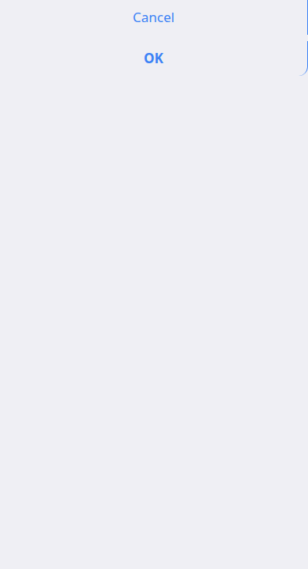
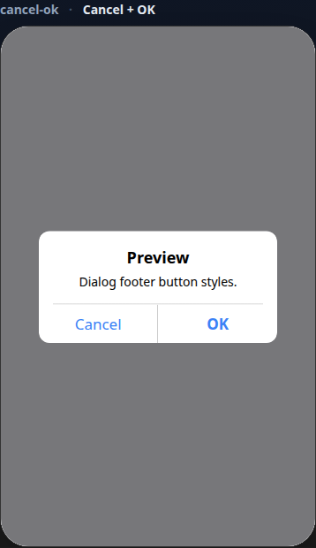
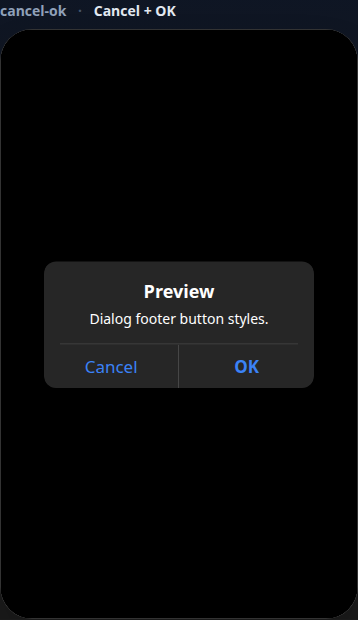
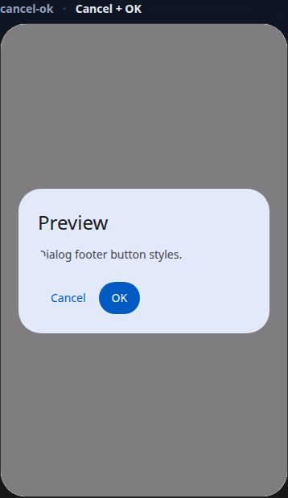
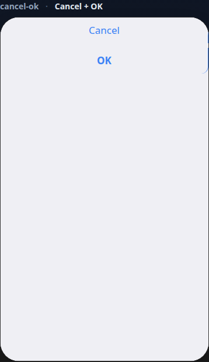
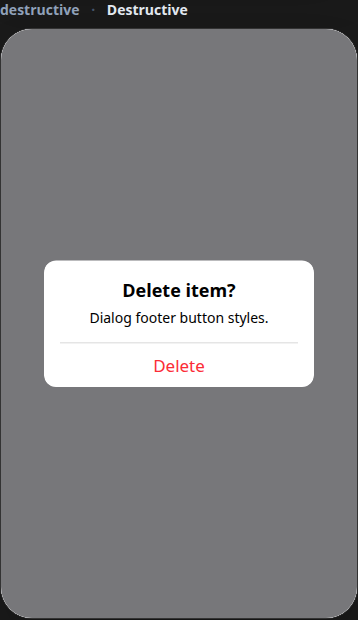
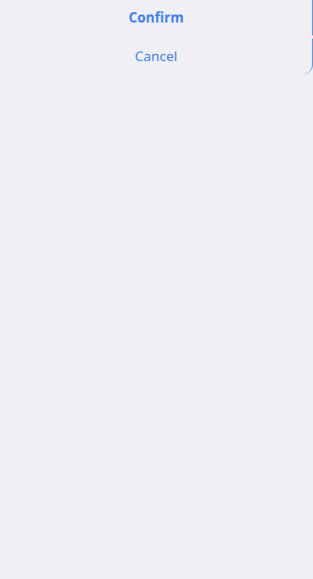
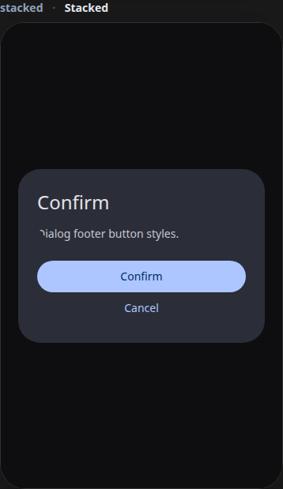

# Tailwind Capacitor demo QA shots

Base URL: http://127.0.0.1:4322

Pass: 519, Fail: 0

Each component lists every state with phone-frame and (on mobile) full 390px viewport page shots.

## capacitor-dialog-button

### cancel-ok (Cancel + OK)

#### desktop ios-light (frame)

#### desktop ios-dark (frame)

#### desktop material-light (frame)

#### desktop material-dark (frame)

#### mobile ios-light (frame)

#### mobile ios-light (page)

#### mobile ios-dark (frame)

#### mobile ios-dark (page)

#### mobile material-light (frame)

#### mobile material-light (page)

#### mobile material-dark (frame)

#### mobile material-dark (page)

### destructive (Destructive)

#### desktop ios-light (frame)

#### desktop ios-dark (frame)

#### desktop material-light (frame)

#### desktop material-dark (frame)

#### mobile ios-light (frame)

#### mobile ios-light (page)

#### mobile ios-dark (frame)

#### mobile ios-dark (page)

#### mobile material-light (frame)

#### mobile material-light (page)

#### mobile material-dark (frame)

#### mobile material-dark (page)

### stacked (Stacked)

#### desktop ios-light (frame)

#### desktop ios-dark (frame)

#### desktop material-light (frame)

#### desktop material-dark (frame)

#### mobile ios-light (frame)

#### mobile ios-light (page)

#### mobile ios-dark (frame)

#### mobile ios-dark (page)

#### mobile material-light (frame)

#### mobile material-light (page)

#### mobile material-dark (frame)

#### mobile material-dark (page)

