# Tailwind Capacitor demo QA shots

Base URL: http://127.0.0.1:4322

Pass: 6844, Fail: 0

Each component lists every state with phone-frame and (on mobile) full 390px viewport page shots.

## foundation

### packages (Packages)

#### desktop ios-light (frame)

#### desktop ios-dark (frame)

#### desktop material-light (frame)

#### desktop material-dark (frame)

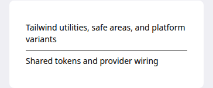

#### mobile ios-light (frame)

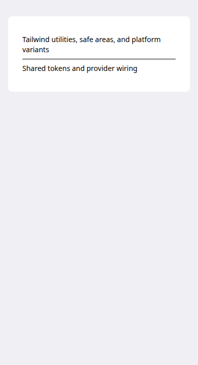

#### mobile ios-light (page)

#### mobile ios-dark (frame)

#### mobile ios-dark (page)

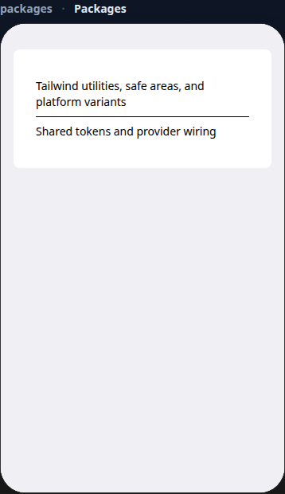

#### mobile material-light (frame)

#### mobile material-light (page)

#### mobile material-dark (frame)

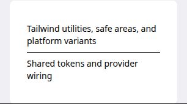

#### mobile material-dark (page)

### icons (Icons)

#### desktop ios-light (frame)

#### desktop ios-dark (frame)

#### desktop material-light (frame)

#### desktop material-dark (frame)

#### mobile ios-light (frame)

#### mobile ios-light (page)

#### mobile ios-dark (frame)

#### mobile ios-dark (page)

#### mobile material-light (frame)

#### mobile material-light (page)

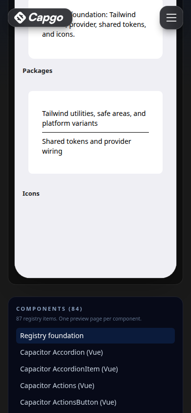

#### mobile material-dark (frame)

#### mobile material-dark (page)

## capacitor-accordion

### single-section (Single section)

#### desktop ios-light (frame)

#### desktop ios-dark (frame)

#### desktop material-light (frame)

#### desktop material-dark (frame)

#### mobile ios-light (frame)

#### mobile ios-light (page)

#### mobile ios-dark (frame)

#### mobile ios-dark (page)

#### mobile material-light (frame)

#### mobile material-light (page)

#### mobile material-dark (frame)

#### mobile material-dark (page)

### multi-section (Multi section)

#### desktop ios-light (frame)

#### desktop ios-dark (frame)

#### desktop material-light (frame)

#### desktop material-dark (frame)

#### mobile ios-light (frame)

#### mobile ios-light (page)

#### mobile ios-dark (frame)

#### mobile ios-dark (page)

#### mobile material-light (frame)

#### mobile material-light (page)

#### mobile material-dark (frame)

#### mobile material-dark (page)

### nested-copy (With descriptions)

#### desktop ios-light (frame)

#### desktop ios-dark (frame)

#### desktop material-light (frame)

#### desktop material-dark (frame)

#### mobile ios-light (frame)

#### mobile ios-light (page)

#### mobile ios-dark (frame)

#### mobile ios-dark (page)

#### mobile material-light (frame)

#### mobile material-light (page)

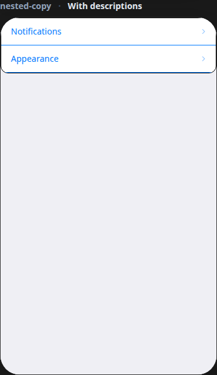

#### mobile material-dark (frame)

#### mobile material-dark (page)

## capacitor-accordion-item

### collapsed (Collapsed)

#### desktop ios-light (frame)

#### desktop ios-dark (frame)

#### desktop material-light (frame)

#### desktop material-dark (frame)

#### mobile ios-light (frame)

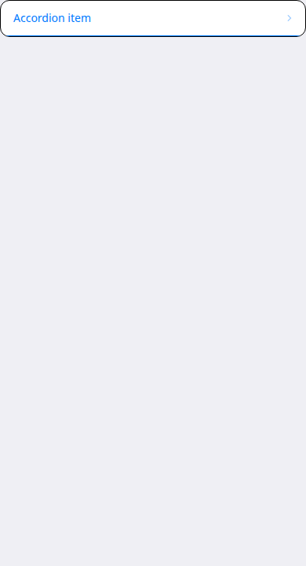

#### mobile ios-light (page)

#### mobile ios-dark (frame)

#### mobile ios-dark (page)

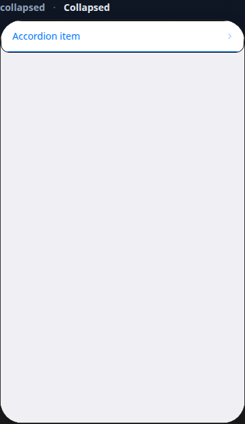

#### mobile material-light (frame)

#### mobile material-light (page)

#### mobile material-dark (frame)

#### mobile material-dark (page)

### expanded-copy (Expanded copy)

#### desktop ios-light (frame)

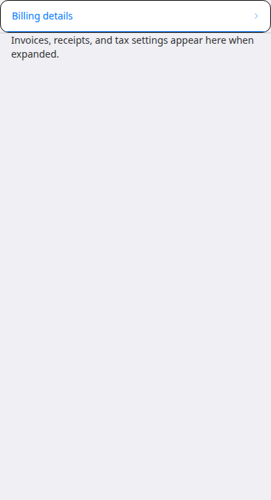

#### desktop ios-dark (frame)

#### desktop material-light (frame)

#### desktop material-dark (frame)

#### mobile ios-light (frame)

#### mobile ios-light (page)

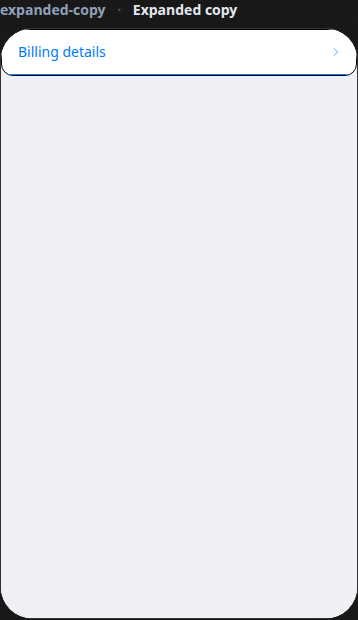

#### mobile ios-dark (frame)

#### mobile ios-dark (page)

#### mobile material-light (frame)

#### mobile material-light (page)

#### mobile material-dark (frame)

#### mobile material-dark (page)

### stacked (Stacked items)

#### desktop ios-light (frame)

#### desktop ios-dark (frame)

#### desktop material-light (frame)

#### desktop material-dark (frame)

#### mobile ios-light (frame)

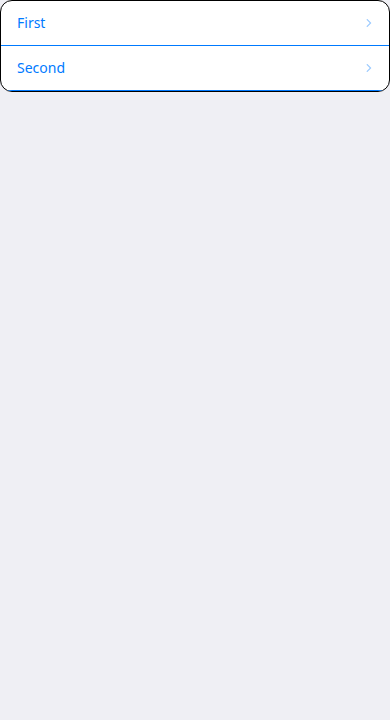

#### mobile ios-light (page)

#### mobile ios-dark (frame)

#### mobile ios-dark (page)

#### mobile material-light (frame)

#### mobile material-light (page)

#### mobile material-dark (frame)

#### mobile material-dark (page)

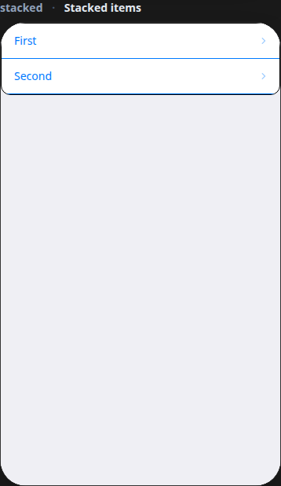

## capacitor-actions

### screen (Screen)

#### desktop ios-light (frame)

#### desktop ios-dark (frame)

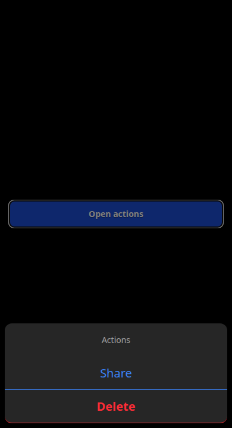

#### desktop material-light (frame)

#### desktop material-dark (frame)

#### mobile ios-light (frame)

#### mobile ios-light (page)

#### mobile ios-dark (frame)

#### mobile ios-dark (page)

#### mobile material-light (frame)

#### mobile material-light (page)

#### mobile material-dark (frame)

#### mobile material-dark (page)

### sheet-open (Sheet open)

#### desktop ios-light (frame)

#### desktop ios-dark (frame)

#### desktop material-light (frame)

#### desktop material-dark (frame)

#### mobile ios-light (frame)

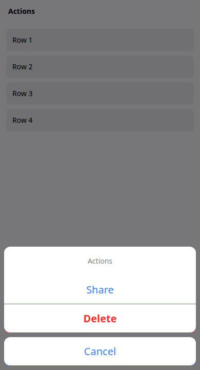

#### mobile ios-light (page)

#### mobile ios-dark (frame)

#### mobile ios-dark (page)

#### mobile material-light (frame)

#### mobile material-light (page)

#### mobile material-dark (frame)

#### mobile material-dark (page)

## capacitor-actions-button

### screen (Screen)

#### desktop ios-light (frame)

#### desktop ios-dark (frame)

#### desktop material-light (frame)

#### desktop material-dark (frame)

#### mobile ios-light (frame)

#### mobile ios-light (page)

#### mobile ios-dark (frame)

#### mobile ios-dark (page)

#### mobile material-light (frame)

#### mobile material-light (page)

#### mobile material-dark (frame)

#### mobile material-dark (page)

### sheet-open (Sheet open)

#### desktop ios-light (frame)

#### desktop ios-dark (frame)

#### desktop material-light (frame)

#### desktop material-dark (frame)

#### mobile ios-light (frame)

#### mobile ios-light (page)

#### mobile ios-dark (frame)

#### mobile ios-dark (page)

#### mobile material-light (frame)

#### mobile material-light (page)

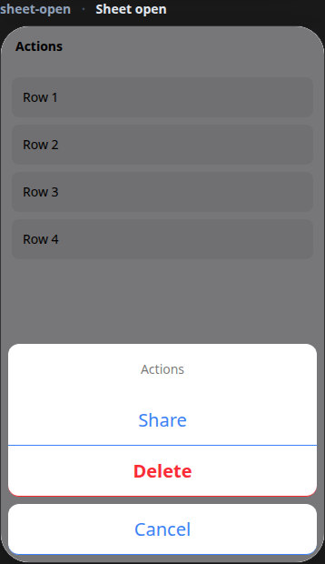

#### mobile material-dark (frame)

#### mobile material-dark (page)

### primary-row (Primary row)

#### desktop ios-light (frame)

#### desktop ios-dark (frame)

#### desktop material-light (frame)

#### desktop material-dark (frame)

#### mobile ios-light (frame)

#### mobile ios-light (page)

#### mobile ios-dark (frame)

#### mobile ios-dark (page)

#### mobile material-light (frame)

#### mobile material-light (page)

#### mobile material-dark (frame)

#### mobile material-dark (page)

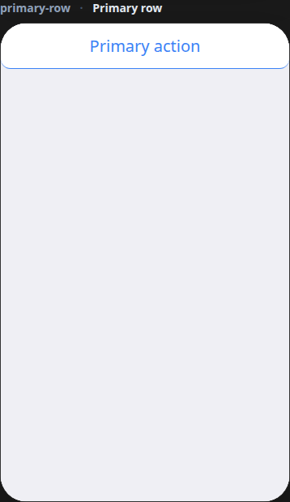

## capacitor-actions-group

### screen (Screen)

#### desktop ios-light (frame)

#### desktop ios-dark (frame)

#### desktop material-light (frame)

#### desktop material-dark (frame)

#### mobile ios-light (frame)

#### mobile ios-light (page)

#### mobile ios-dark (frame)

#### mobile ios-dark (page)

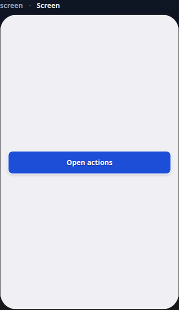

#### mobile material-light (frame)

#### mobile material-light (page)

#### mobile material-dark (frame)

#### mobile material-dark (page)

### sheet-open (Sheet open)

#### desktop ios-light (frame)

#### desktop ios-dark (frame)

#### desktop material-light (frame)

#### desktop material-dark (frame)

#### mobile ios-light (frame)

#### mobile ios-light (page)

#### mobile ios-dark (frame)

#### mobile ios-dark (page)

#### mobile material-light (frame)

#### mobile material-light (page)

#### mobile material-dark (frame)

#### mobile material-dark (page)

### single-group (Single group)

#### desktop ios-light (frame)

#### desktop ios-dark (frame)

#### desktop material-light (frame)

#### desktop material-dark (frame)

#### mobile ios-light (frame)

#### mobile ios-light (page)

#### mobile ios-dark (frame)

#### mobile ios-dark (page)

#### mobile material-light (frame)

#### mobile material-light (page)

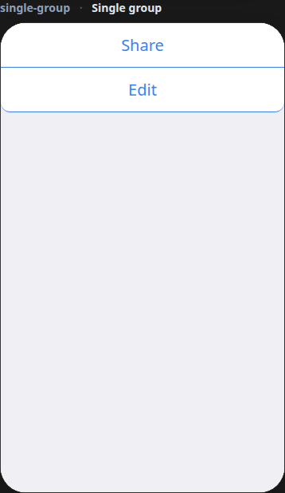

#### mobile material-dark (frame)

#### mobile material-dark (page)

## capacitor-actions-label

### screen (Screen)

#### desktop ios-light (frame)

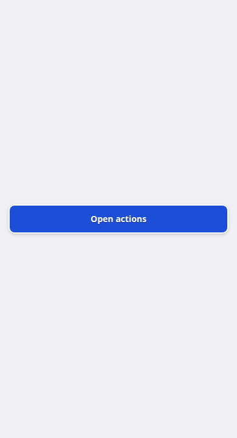

#### desktop ios-dark (frame)

#### desktop material-light (frame)

#### desktop material-dark (frame)

#### mobile ios-light (frame)

#### mobile ios-light (page)

#### mobile ios-dark (frame)

#### mobile ios-dark (page)

#### mobile material-light (frame)

#### mobile material-light (page)

#### mobile material-dark (frame)

#### mobile material-dark (page)

### sheet-open (Sheet open)

#### desktop ios-light (frame)

#### desktop ios-dark (frame)

#### desktop material-light (frame)

#### desktop material-dark (frame)

#### mobile ios-light (frame)

#### mobile ios-light (page)

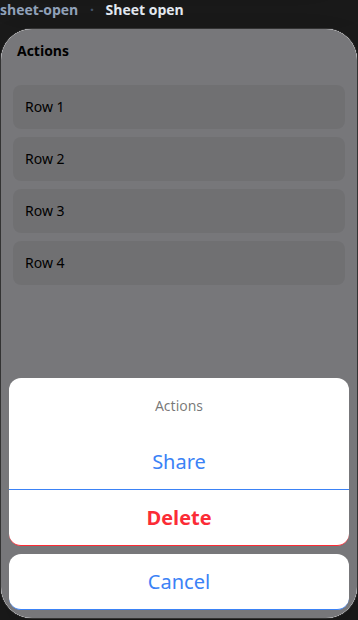

#### mobile ios-dark (frame)

#### mobile ios-dark (page)

#### mobile material-light (frame)

#### mobile material-light (page)

#### mobile material-dark (frame)

#### mobile material-dark (page)

### section-label (Section label)

#### desktop ios-light (frame)

#### desktop ios-dark (frame)

#### desktop material-light (frame)

#### desktop material-dark (frame)

#### mobile ios-light (frame)

#### mobile ios-light (page)

#### mobile ios-dark (frame)

#### mobile ios-dark (page)

#### mobile material-light (frame)

#### mobile material-light (page)

#### mobile material-dark (frame)

#### mobile material-dark (page)

## capacitor-alert

### inline (Inline)

#### desktop ios-light (frame)

#### desktop ios-dark (frame)

#### desktop material-light (frame)

#### desktop material-dark (frame)

#### mobile ios-light (frame)

#### mobile ios-light (page)

#### mobile ios-dark (frame)

#### mobile ios-dark (page)

#### mobile material-light (frame)

#### mobile material-light (page)

#### mobile material-dark (frame)

#### mobile material-dark (page)

### closed (Closed)

#### desktop ios-light (frame)

#### desktop ios-dark (frame)

#### desktop material-light (frame)

#### desktop material-dark (frame)

#### mobile ios-light (frame)

#### mobile ios-light (page)

#### mobile ios-dark (frame)

#### mobile ios-dark (page)

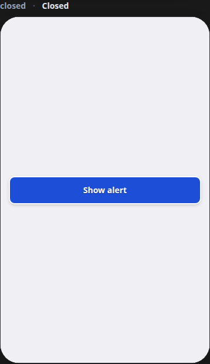

#### mobile material-light (frame)

#### mobile material-light (page)

#### mobile material-dark (frame)

#### mobile material-dark (page)

### open (Open)

#### desktop ios-light (frame)

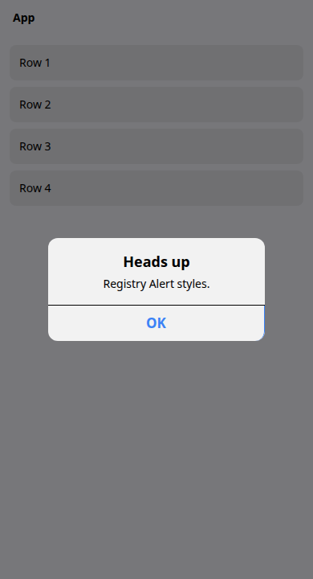

#### desktop ios-dark (frame)

#### desktop material-light (frame)

#### desktop material-dark (frame)

#### mobile ios-light (frame)

#### mobile ios-light (page)

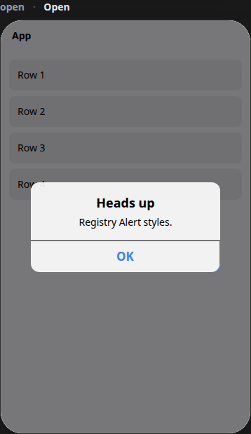

#### mobile ios-dark (frame)

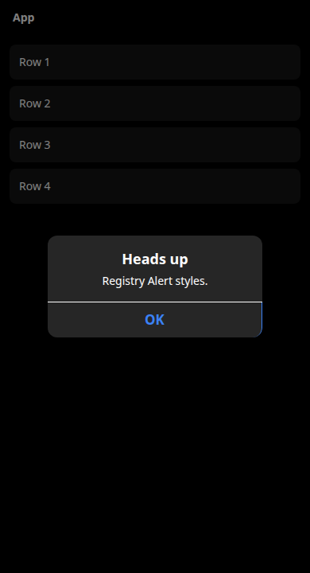

#### mobile ios-dark (page)

#### mobile material-light (frame)

#### mobile material-light (page)

#### mobile material-dark (frame)

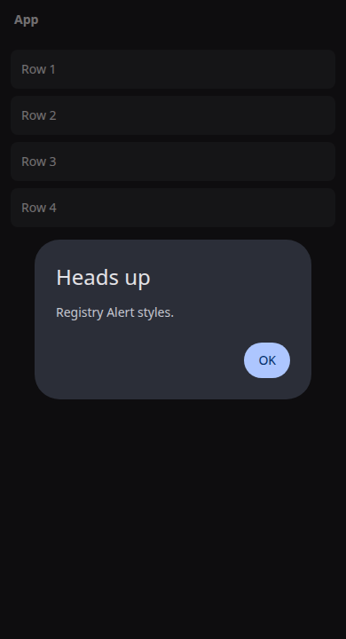

#### mobile material-dark (page)

## capacitor-app

### light-shell (Light shell)

#### desktop ios-light (frame)

#### desktop ios-dark (frame)

#### desktop material-light (frame)

#### desktop material-dark (frame)

#### mobile ios-light (frame)

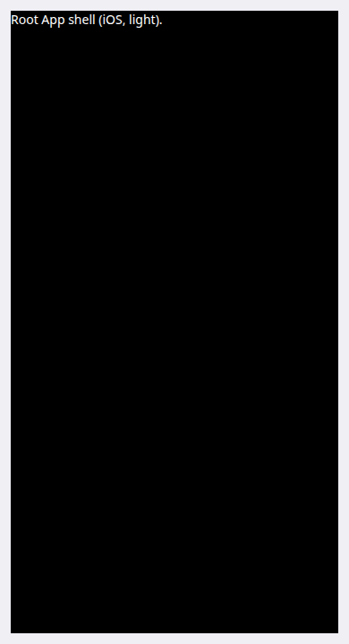

#### mobile ios-light (page)

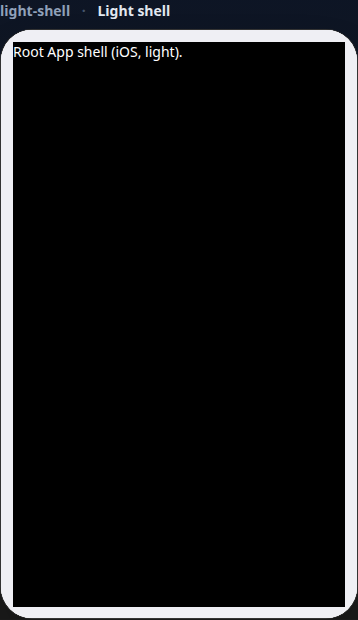

#### mobile ios-dark (frame)

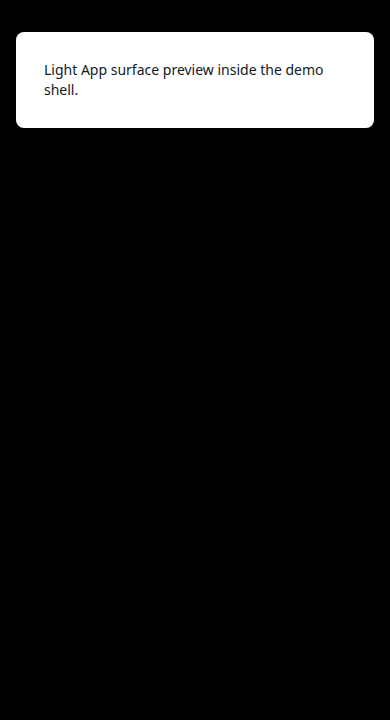

#### mobile ios-dark (page)

#### mobile material-light (frame)

#### mobile material-light (page)

#### mobile material-dark (frame)

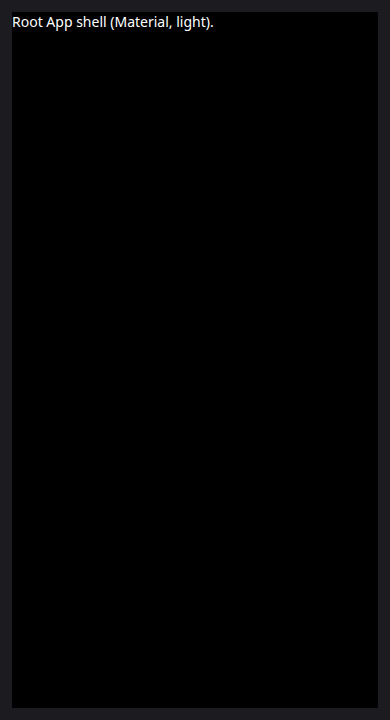

#### mobile material-dark (page)

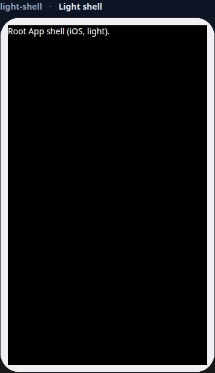

### dark-shell (Dark shell)

#### desktop ios-light (frame)

#### desktop ios-dark (frame)

#### desktop material-light (frame)

#### desktop material-dark (frame)

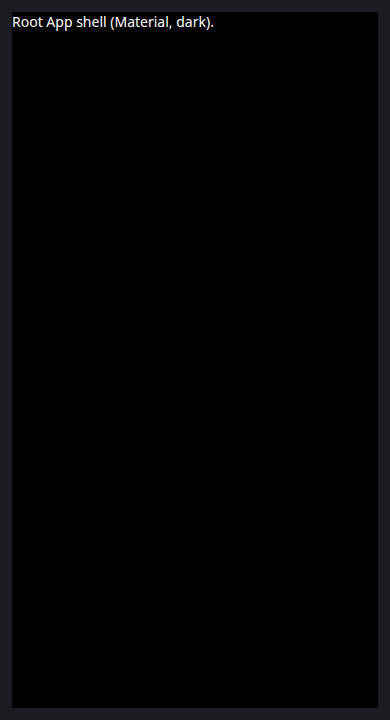

#### mobile ios-light (frame)

#### mobile ios-light (page)

#### mobile ios-dark (frame)

#### mobile ios-dark (page)

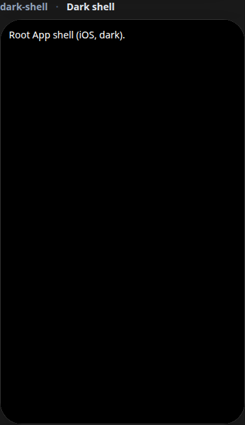

#### mobile material-light (frame)

#### mobile material-light (page)

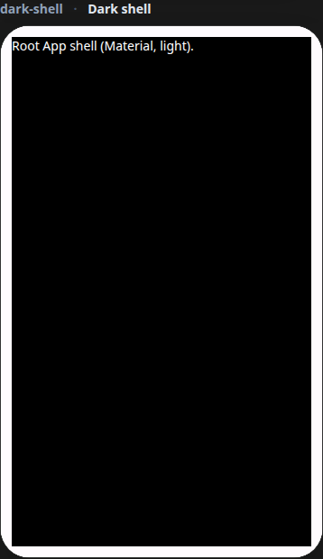

#### mobile material-dark (frame)

#### mobile material-dark (page)

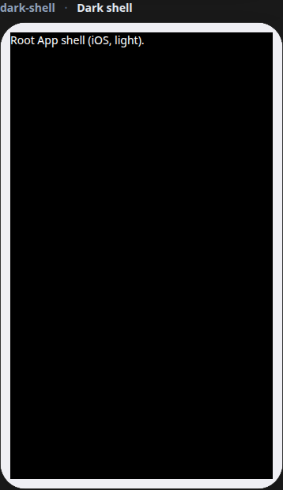

### with-block (With block)

#### desktop ios-light (frame)

#### desktop ios-dark (frame)

#### desktop material-light (frame)

#### desktop material-dark (frame)

#### mobile ios-light (frame)

#### mobile ios-light (page)

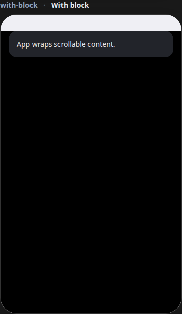

#### mobile ios-dark (frame)

#### mobile ios-dark (page)

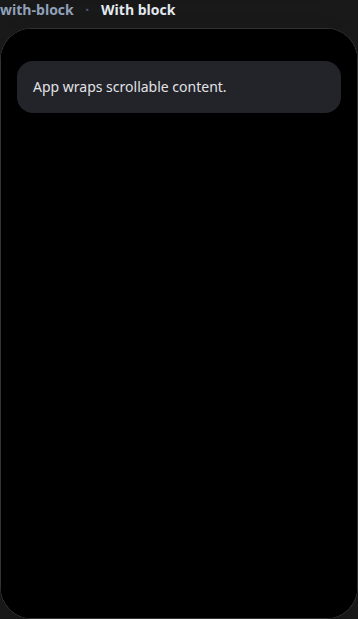

#### mobile material-light (frame)

#### mobile material-light (page)

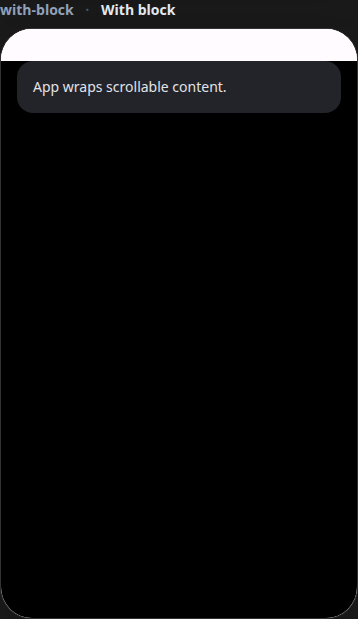

#### mobile material-dark (frame)

#### mobile material-dark (page)

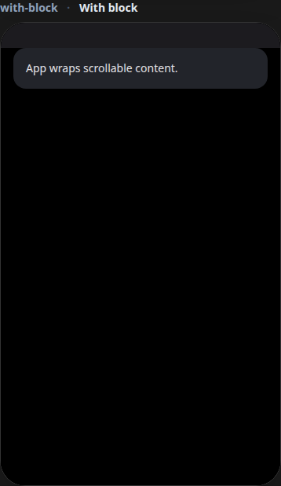

## capacitor-avatar

### initials (Initials)

#### desktop ios-light (frame)

#### desktop ios-dark (frame)

#### desktop material-light (frame)

#### desktop material-dark (frame)

#### mobile ios-light (frame)

#### mobile ios-light (page)

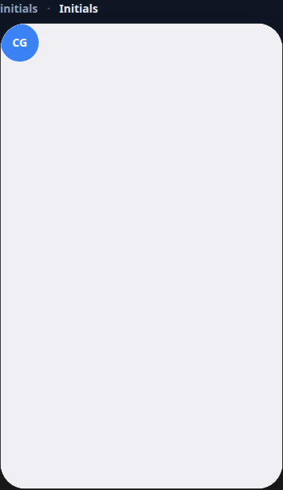

#### mobile ios-dark (frame)

#### mobile ios-dark (page)

#### mobile material-light (frame)

#### mobile material-light (page)

#### mobile material-dark (frame)

#### mobile material-dark (page)

### small (Small)

#### desktop ios-light (frame)

#### desktop ios-dark (frame)

#### desktop material-light (frame)

#### desktop material-dark (frame)

#### mobile ios-light (frame)

#### mobile ios-light (page)

#### mobile ios-dark (frame)

#### mobile ios-dark (page)

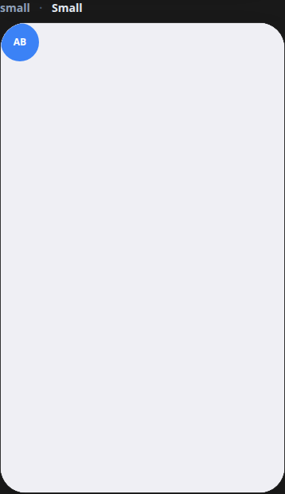

#### mobile material-light (frame)

#### mobile material-light (page)

#### mobile material-dark (frame)

#### mobile material-dark (page)

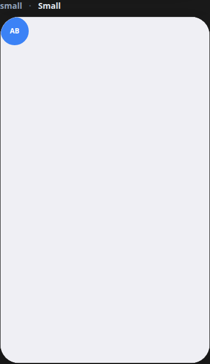

### large (Large)

#### desktop ios-light (frame)

#### desktop ios-dark (frame)

#### desktop material-light (frame)

#### desktop material-dark (frame)

#### mobile ios-light (frame)

#### mobile ios-light (page)

#### mobile ios-dark (frame)

#### mobile ios-dark (page)

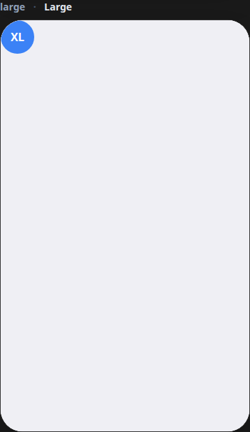

#### mobile material-light (frame)

#### mobile material-light (page)

#### mobile material-dark (frame)

#### mobile material-dark (page)

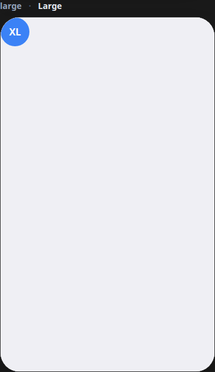

## capacitor-badge

### count (Count)

#### desktop ios-light (frame)

#### desktop ios-dark (frame)

#### desktop material-light (frame)

#### desktop material-dark (frame)

#### mobile ios-light (frame)

#### mobile ios-light (page)

#### mobile ios-dark (frame)

#### mobile ios-dark (page)

#### mobile material-light (frame)

#### mobile material-light (page)

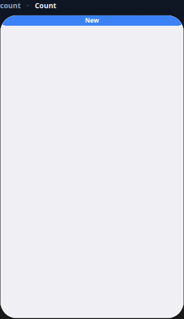

#### mobile material-dark (frame)

#### mobile material-dark (page)

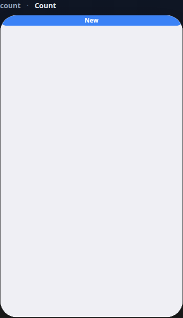

### color (Color)

#### desktop ios-light (frame)

#### desktop ios-dark (frame)

#### desktop material-light (frame)

#### desktop material-dark (frame)

#### mobile ios-light (frame)

#### mobile ios-light (page)

#### mobile ios-dark (frame)

#### mobile ios-dark (page)

#### mobile material-light (frame)

#### mobile material-light (page)

#### mobile material-dark (frame)

#### mobile material-dark (page)

### on-avatar (On avatar)

#### desktop ios-light (frame)

#### desktop ios-dark (frame)

#### desktop material-light (frame)

#### desktop material-dark (frame)

#### mobile ios-light (frame)

#### mobile ios-light (page)

#### mobile ios-dark (frame)

#### mobile ios-dark (page)

#### mobile material-light (frame)

#### mobile material-light (page)

#### mobile material-dark (frame)

#### mobile material-dark (page)

## capacitor-block

### inset-strong (Inset strong)

#### desktop ios-light (frame)

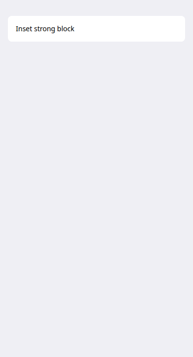

#### desktop ios-dark (frame)

#### desktop material-light (frame)

#### desktop material-dark (frame)

#### mobile ios-light (frame)

#### mobile ios-light (page)

#### mobile ios-dark (frame)

#### mobile ios-dark (page)

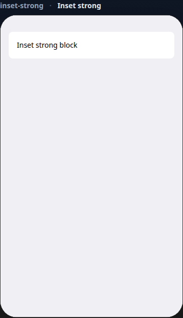

#### mobile material-light (frame)

#### mobile material-light (page)

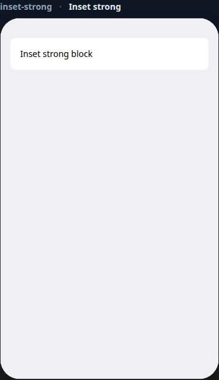

#### mobile material-dark (frame)

#### mobile material-dark (page)

### outline (Outline)

#### desktop ios-light (frame)

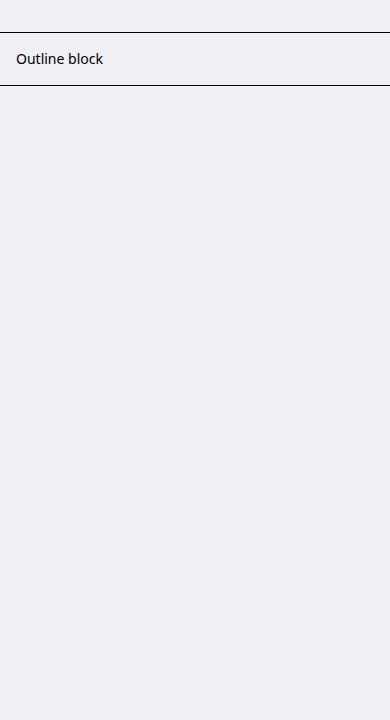

#### desktop ios-dark (frame)

#### desktop material-light (frame)

#### desktop material-dark (frame)

#### mobile ios-light (frame)

#### mobile ios-light (page)

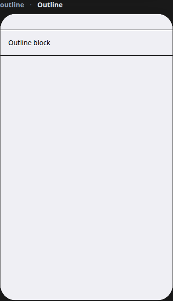

#### mobile ios-dark (frame)

#### mobile ios-dark (page)

#### mobile material-light (frame)

#### mobile material-light (page)

#### mobile material-dark (frame)

#### mobile material-dark (page)

### plain (Plain)

#### desktop ios-light (frame)

#### desktop ios-dark (frame)

#### desktop material-light (frame)

#### desktop material-dark (frame)

#### mobile ios-light (frame)

#### mobile ios-light (page)

#### mobile ios-dark (frame)

#### mobile ios-dark (page)

#### mobile material-light (frame)

#### mobile material-light (page)

#### mobile material-dark (frame)

#### mobile material-dark (page)

## capacitor-block-footer

### with-footer (With footer)

#### desktop ios-light (frame)

#### desktop ios-dark (frame)

#### desktop material-light (frame)

#### desktop material-dark (frame)

#### mobile ios-light (frame)

#### mobile ios-light (page)

#### mobile ios-dark (frame)

#### mobile ios-dark (page)

#### mobile material-light (frame)

#### mobile material-light (page)

#### mobile material-dark (frame)

#### mobile material-dark (page)

### footer-note (Footer note)

#### desktop ios-light (frame)

#### desktop ios-dark (frame)

#### desktop material-light (frame)

#### desktop material-dark (frame)

#### mobile ios-light (frame)

#### mobile ios-light (page)

#### mobile ios-dark (frame)

#### mobile ios-dark (page)

#### mobile material-light (frame)

#### mobile material-light (page)

#### mobile material-dark (frame)

#### mobile material-dark (page)

## capacitor-block-header

### with-header (With header)

#### desktop ios-light (frame)

#### desktop ios-dark (frame)

#### desktop material-light (frame)

#### desktop material-dark (frame)

#### mobile ios-light (frame)

#### mobile ios-light (page)

#### mobile ios-dark (frame)

#### mobile ios-dark (page)

#### mobile material-light (frame)

#### mobile material-light (page)

#### mobile material-dark (frame)

#### mobile material-dark (page)

### section-title (Section title)

#### desktop ios-light (frame)

#### desktop ios-dark (frame)

#### desktop material-light (frame)

#### desktop material-dark (frame)

#### mobile ios-light (frame)

#### mobile ios-light (page)

#### mobile ios-dark (frame)

#### mobile ios-dark (page)

#### mobile material-light (frame)

#### mobile material-light (page)

#### mobile material-dark (frame)

#### mobile material-dark (page)

## capacitor-block-title

### standalone (Standalone)

#### desktop ios-light (frame)

#### desktop ios-dark (frame)

#### desktop material-light (frame)

#### desktop material-dark (frame)

#### mobile ios-light (frame)

#### mobile ios-light (page)

#### mobile ios-dark (frame)

#### mobile ios-dark (page)

#### mobile material-light (frame)

#### mobile material-light (page)

#### mobile material-dark (frame)

#### mobile material-dark (page)

### with-body (With body)

#### desktop ios-light (frame)

#### desktop ios-dark (frame)

#### desktop material-light (frame)

#### desktop material-dark (frame)

#### mobile ios-light (frame)

#### mobile ios-light (page)

#### mobile ios-dark (frame)

#### mobile ios-dark (page)

#### mobile material-light (frame)

#### mobile material-light (page)

#### mobile material-dark (frame)

#### mobile material-dark (page)

## capacitor-breadcrumbs

### trail (Trail)

#### desktop ios-light (frame)

#### desktop ios-dark (frame)

#### desktop material-light (frame)

#### desktop material-dark (frame)

#### mobile ios-light (frame)

#### mobile ios-light (page)

#### mobile ios-dark (frame)

#### mobile ios-dark (page)

#### mobile material-light (frame)

#### mobile material-light (page)

#### mobile material-dark (frame)

#### mobile material-dark (page)

### compact (Compact)

#### desktop ios-light (frame)

#### desktop ios-dark (frame)

#### desktop material-light (frame)

#### desktop material-dark (frame)

#### mobile ios-light (frame)

#### mobile ios-light (page)

#### mobile ios-dark (frame)

#### mobile ios-dark (page)

#### mobile material-light (frame)

#### mobile material-light (page)

#### mobile material-dark (frame)

#### mobile material-dark (page)

## capacitor-breadcrumbs-collapsed

### collapsed-middle (Collapsed middle)

#### desktop ios-light (frame)

#### desktop ios-dark (frame)

#### desktop material-light (frame)

#### desktop material-dark (frame)

#### mobile ios-light (frame)

#### mobile ios-light (page)

#### mobile ios-dark (frame)

#### mobile ios-dark (page)

#### mobile material-light (frame)

#### mobile material-light (page)

#### mobile material-dark (frame)

#### mobile material-dark (page)

### long-trail (Long trail)

#### desktop ios-light (frame)

#### desktop ios-dark (frame)

#### desktop material-light (frame)

#### desktop material-dark (frame)

#### mobile ios-light (frame)

#### mobile ios-light (page)

#### mobile ios-dark (frame)

#### mobile ios-dark (page)

#### mobile material-light (frame)

#### mobile material-light (page)

#### mobile material-dark (frame)

#### mobile material-dark (page)

## capacitor-breadcrumbs-item

### link (Link)

#### desktop ios-light (frame)

#### desktop ios-dark (frame)

#### desktop material-light (frame)

#### desktop material-dark (frame)

#### mobile ios-light (frame)

#### mobile ios-light (page)

#### mobile ios-dark (frame)

#### mobile ios-dark (page)

#### mobile material-light (frame)

#### mobile material-light (page)

#### mobile material-dark (frame)

#### mobile material-dark (page)

### active (Active)

#### desktop ios-light (frame)

#### desktop ios-dark (frame)

#### desktop material-light (frame)

#### desktop material-dark (frame)

#### mobile ios-light (frame)

#### mobile ios-light (page)

#### mobile ios-dark (frame)

#### mobile ios-dark (page)

#### mobile material-light (frame)

#### mobile material-light (page)

#### mobile material-dark (frame)

#### mobile material-dark (page)

## capacitor-breadcrumbs-separator

### between-items (Between items)

#### desktop ios-light (frame)

#### desktop ios-dark (frame)

#### desktop material-light (frame)

#### desktop material-dark (frame)

#### mobile ios-light (frame)

#### mobile ios-light (page)

#### mobile ios-dark (frame)

#### mobile ios-dark (page)

#### mobile material-light (frame)

#### mobile material-light (page)

#### mobile material-dark (frame)

#### mobile material-dark (page)

### multi-separator (Multi separator)

#### desktop ios-light (frame)

#### desktop ios-dark (frame)

#### desktop material-light (frame)

#### desktop material-dark (frame)

#### mobile ios-light (frame)

#### mobile ios-light (page)

#### mobile ios-dark (frame)

#### mobile ios-dark (page)

#### mobile material-light (frame)

#### mobile material-light (page)

#### mobile material-dark (frame)

#### mobile material-dark (page)

## capacitor-button

### solid (Solid)

#### desktop ios-light (frame)

#### desktop ios-dark (frame)

#### desktop material-light (frame)

#### desktop material-dark (frame)

#### mobile ios-light (frame)

#### mobile ios-light (page)

#### mobile ios-dark (frame)

#### mobile ios-dark (page)

#### mobile material-light (frame)

#### mobile material-light (page)

#### mobile material-dark (frame)

#### mobile material-dark (page)

### outline (Outline)

#### desktop ios-light (frame)

#### desktop ios-dark (frame)

#### desktop material-light (frame)

#### desktop material-dark (frame)

#### mobile ios-light (frame)

#### mobile ios-light (page)

#### mobile ios-dark (frame)

#### mobile ios-dark (page)

#### mobile material-light (frame)

#### mobile material-light (page)

#### mobile material-dark (frame)

#### mobile material-dark (page)

### clear (Clear)

#### desktop ios-light (frame)

#### desktop ios-dark (frame)

#### desktop material-light (frame)

#### desktop material-dark (frame)

#### mobile ios-light (frame)

#### mobile ios-light (page)

#### mobile ios-dark (frame)

#### mobile ios-dark (page)

#### mobile material-light (frame)

#### mobile material-light (page)

#### mobile material-dark (frame)

#### mobile material-dark (page)

### tonal (Tonal)

#### desktop ios-light (frame)

#### desktop ios-dark (frame)

#### desktop material-light (frame)

#### desktop material-dark (frame)

#### mobile ios-light (frame)

#### mobile ios-light (page)

#### mobile ios-dark (frame)

#### mobile ios-dark (page)

#### mobile material-light (frame)

#### mobile material-light (page)

#### mobile material-dark (frame)

#### mobile material-dark (page)

### small (Small)

#### desktop ios-light (frame)

#### desktop ios-dark (frame)

#### desktop material-light (frame)

#### desktop material-dark (frame)

#### mobile ios-light (frame)

#### mobile ios-light (page)

#### mobile ios-dark (frame)

#### mobile ios-dark (page)

#### mobile material-light (frame)

#### mobile material-light (page)

#### mobile material-dark (frame)

#### mobile material-dark (page)

### large (Large)

#### desktop ios-light (frame)

#### desktop ios-dark (frame)

#### desktop material-light (frame)

#### desktop material-dark (frame)

#### mobile ios-light (frame)

#### mobile ios-light (page)

#### mobile ios-dark (frame)

#### mobile ios-dark (page)

#### mobile material-light (frame)

#### mobile material-light (page)

#### mobile material-dark (frame)

#### mobile material-dark (page)

### raised (Raised)

#### desktop ios-light (frame)

#### desktop ios-dark (frame)

#### desktop material-light (frame)

#### desktop material-dark (frame)

#### mobile ios-light (frame)

#### mobile ios-light (page)

#### mobile ios-dark (frame)

#### mobile ios-dark (page)

#### mobile material-light (frame)

#### mobile material-light (page)

#### mobile material-dark (frame)

#### mobile material-dark (page)

### disabled (Disabled)

#### desktop ios-light (frame)

#### desktop ios-dark (frame)

#### desktop material-light (frame)

#### desktop material-dark (frame)

#### mobile ios-light (frame)

#### mobile ios-light (page)

#### mobile ios-dark (frame)

#### mobile ios-dark (page)

#### mobile material-light (frame)

#### mobile material-light (page)

#### mobile material-dark (frame)

#### mobile material-dark (page)

### with-icon (With icon)

#### desktop ios-light (frame)

#### desktop ios-dark (frame)

#### desktop material-light (frame)

#### desktop material-dark (frame)

#### mobile ios-light (frame)

#### mobile ios-light (page)

#### mobile ios-dark (frame)

#### mobile ios-dark (page)

#### mobile material-light (frame)

#### mobile material-light (page)

#### mobile material-dark (frame)

#### mobile material-dark (page)

### block (Block)

#### desktop ios-light (frame)

#### desktop ios-dark (frame)

#### desktop material-light (frame)

#### desktop material-dark (frame)

#### mobile ios-light (frame)

#### mobile ios-light (page)

#### mobile ios-dark (frame)

#### mobile ios-dark (page)

#### mobile material-light (frame)

#### mobile material-light (page)

#### mobile material-dark (frame)

#### mobile material-dark (page)

### fill-color (Fill color)

#### desktop ios-light (frame)

#### desktop ios-dark (frame)

#### desktop material-light (frame)

#### desktop material-dark (frame)

#### mobile ios-light (frame)

#### mobile ios-light (page)

#### mobile ios-dark (frame)

#### mobile ios-dark (page)

#### mobile material-light (frame)

#### mobile material-light (page)

#### mobile material-dark (frame)

#### mobile material-dark (page)

### outline-color (Outline color)

#### desktop ios-light (frame)

#### desktop ios-dark (frame)

#### desktop material-light (frame)

#### desktop material-dark (frame)

#### mobile ios-light (frame)

#### mobile ios-light (page)

#### mobile ios-dark (frame)

#### mobile ios-dark (page)

#### mobile material-light (frame)

#### mobile material-light (page)

#### mobile material-dark (frame)

#### mobile material-dark (page)

## capacitor-card

### feed (Feed card)

#### desktop ios-light (frame)

#### desktop ios-dark (frame)

#### desktop material-light (frame)

#### desktop material-dark (frame)

#### mobile ios-light (frame)

#### mobile ios-light (page)

#### mobile ios-dark (frame)

#### mobile ios-dark (page)

#### mobile material-light (frame)

#### mobile material-light (page)

#### mobile material-dark (frame)

#### mobile material-dark (page)

### media (Media card)

#### desktop ios-light (frame)

#### desktop ios-dark (frame)

#### desktop material-light (frame)

#### desktop material-dark (frame)

#### mobile ios-light (frame)

#### mobile ios-light (page)

#### mobile ios-dark (frame)

#### mobile ios-dark (page)

#### mobile material-light (frame)

#### mobile material-light (page)

#### mobile material-dark (frame)

#### mobile material-dark (page)

### outline (Outline card)

#### desktop ios-light (frame)

#### desktop ios-dark (frame)

#### desktop material-light (frame)

#### desktop material-dark (frame)

#### mobile ios-light (frame)

#### mobile ios-light (page)

#### mobile ios-dark (frame)

#### mobile ios-dark (page)

#### mobile material-light (frame)

#### mobile material-light (page)

#### mobile material-dark (frame)

#### mobile material-dark (page)

## capacitor-checkbox

### off (Off)

#### desktop ios-light (frame)

#### desktop ios-dark (frame)

#### desktop material-light (frame)

#### desktop material-dark (frame)

#### mobile ios-light (frame)

#### mobile ios-light (page)

#### mobile ios-dark (frame)

#### mobile ios-dark (page)

#### mobile material-light (frame)

#### mobile material-light (page)

#### mobile material-dark (frame)

#### mobile material-dark (page)

### on (On)

#### desktop ios-light (frame)

#### desktop ios-dark (frame)

#### desktop material-light (frame)

#### desktop material-dark (frame)

#### mobile ios-light (frame)

#### mobile ios-light (page)

#### mobile ios-dark (frame)

#### mobile ios-dark (page)

#### mobile material-light (frame)

#### mobile material-light (page)

#### mobile material-dark (frame)

#### mobile material-dark (page)

### disabled (Disabled)

#### desktop ios-light (frame)

#### desktop ios-dark (frame)

#### desktop material-light (frame)

#### desktop material-dark (frame)

#### mobile ios-light (frame)

#### mobile ios-light (page)

#### mobile ios-dark (frame)

#### mobile ios-dark (page)

#### mobile material-light (frame)

#### mobile material-light (page)

#### mobile material-dark (frame)

#### mobile material-dark (page)

## capacitor-chip

### filled (Filled)

#### desktop ios-light (frame)

#### desktop ios-dark (frame)

#### desktop material-light (frame)

#### desktop material-dark (frame)

#### mobile ios-light (frame)

#### mobile ios-light (page)

#### mobile ios-dark (frame)

#### mobile ios-dark (page)

#### mobile material-light (frame)

#### mobile material-light (page)

#### mobile material-dark (frame)

#### mobile material-dark (page)

### removable (Removable)

#### desktop ios-light (frame)

#### desktop ios-dark (frame)

#### desktop material-light (frame)

#### desktop material-dark (frame)

#### mobile ios-light (frame)

#### mobile ios-light (page)

#### mobile ios-dark (frame)

#### mobile ios-dark (page)

#### mobile material-light (frame)

#### mobile material-light (page)

#### mobile material-dark (frame)

#### mobile material-dark (page)

### outline (Outline)

#### desktop ios-light (frame)

#### desktop ios-dark (frame)

#### desktop material-light (frame)

#### desktop material-dark (frame)

#### mobile ios-light (frame)

#### mobile ios-light (page)

#### mobile ios-dark (frame)

#### mobile ios-dark (page)

#### mobile material-light (frame)

#### mobile material-light (page)

#### mobile material-dark (frame)

#### mobile material-dark (page)

## capacitor-datetime

### closed (Closed)

#### desktop ios-light (frame)

#### desktop ios-dark (frame)

#### desktop material-light (frame)

#### desktop material-dark (frame)

#### mobile ios-light (frame)

#### mobile ios-light (page)

#### mobile ios-dark (frame)

#### mobile ios-dark (page)

#### mobile material-light (frame)

#### mobile material-light (page)

#### mobile material-dark (frame)

#### mobile material-dark (page)

### open (Open)

#### desktop ios-light (frame)

#### desktop ios-dark (frame)

#### desktop material-light (frame)

#### desktop material-dark (frame)

#### mobile ios-light (frame)

#### mobile ios-light (page)

#### mobile ios-dark (frame)

#### mobile ios-dark (page)

#### mobile material-light (frame)

#### mobile material-light (page)

#### mobile material-dark (frame)

#### mobile material-dark (page)

## capacitor-dialog

### screen (Screen)

#### desktop ios-light (frame)

#### desktop ios-dark (frame)

#### desktop material-light (frame)

#### desktop material-dark (frame)

#### mobile ios-light (frame)

#### mobile ios-light (page)

#### mobile ios-dark (frame)

#### mobile ios-dark (page)

#### mobile material-light (frame)

#### mobile material-light (page)

#### mobile material-dark (frame)

#### mobile material-dark (page)

### open (Open)

#### desktop ios-light (frame)

#### desktop ios-dark (frame)

#### desktop material-light (frame)

#### desktop material-dark (frame)

#### mobile ios-light (frame)

#### mobile ios-light (page)

#### mobile ios-dark (frame)

#### mobile ios-dark (page)

#### mobile material-light (frame)

#### mobile material-light (page)

#### mobile material-dark (frame)

#### mobile material-dark (page)

## capacitor-dialog-button

### cancel-ok (Cancel + OK)

#### desktop ios-light (frame)

#### desktop ios-dark (frame)

#### desktop material-light (frame)

#### desktop material-dark (frame)

#### mobile ios-light (frame)

#### mobile ios-light (page)

#### mobile ios-dark (frame)

#### mobile ios-dark (page)

#### mobile material-light (frame)

#### mobile material-light (page)

#### mobile material-dark (frame)

#### mobile material-dark (page)

### destructive (Destructive)

#### desktop ios-light (frame)

#### desktop ios-dark (frame)

#### desktop material-light (frame)

#### desktop material-dark (frame)

#### mobile ios-light (frame)

#### mobile ios-light (page)

#### mobile ios-dark (frame)

#### mobile ios-dark (page)

#### mobile material-light (frame)

#### mobile material-light (page)

#### mobile material-dark (frame)

#### mobile material-dark (page)

### stacked (Stacked)

#### desktop ios-light (frame)

#### desktop ios-dark (frame)

#### desktop material-light (frame)

#### desktop material-dark (frame)

#### mobile ios-light (frame)

#### mobile ios-light (page)

#### mobile ios-dark (frame)

#### mobile ios-dark (page)

#### mobile material-light (frame)

#### mobile material-light (page)

#### mobile material-dark (frame)

#### mobile material-dark (page)

## capacitor-fab

### closed (Closed)

#### desktop ios-light (frame)

#### desktop ios-dark (frame)

#### desktop material-light (frame)

#### desktop material-dark (frame)

#### mobile ios-light (frame)

#### mobile ios-light (page)

#### mobile ios-dark (frame)

#### mobile ios-dark (page)

#### mobile material-light (frame)

#### mobile material-light (page)

#### mobile material-dark (frame)

#### mobile material-dark (page)

### list-open (List open)

#### desktop ios-light (frame)

#### desktop ios-dark (frame)

#### desktop material-light (frame)

#### desktop material-dark (frame)

#### mobile ios-light (frame)

#### mobile ios-light (page)

#### mobile ios-dark (frame)

#### mobile ios-dark (page)

#### mobile material-light (frame)

#### mobile material-light (page)

#### mobile material-dark (frame)

#### mobile material-dark (page)

## capacitor-footer

### plain-footer (Plain footer)

#### desktop ios-light (frame)

#### desktop ios-dark (frame)

#### desktop material-light (frame)

#### desktop material-dark (frame)

#### mobile ios-light (frame)

#### mobile ios-light (page)

#### mobile ios-dark (frame)

#### mobile ios-dark (page)

#### mobile material-light (frame)

#### mobile material-light (page)

#### mobile material-dark (frame)

#### mobile material-dark (page)

### with-toolbar (With toolbar)

#### desktop ios-light (frame)

#### desktop ios-dark (frame)

#### desktop material-light (frame)

#### desktop material-dark (frame)

#### mobile ios-light (frame)

#### mobile ios-light (page)

#### mobile ios-dark (frame)

#### mobile ios-dark (page)

#### mobile material-light (frame)

#### mobile material-light (page)

#### mobile material-dark (frame)

#### mobile material-dark (page)

## capacitor-header

### plain-header (Plain header)

#### desktop ios-light (frame)

#### desktop ios-dark (frame)

#### desktop material-light (frame)

#### desktop material-dark (frame)

#### mobile ios-light (frame)

#### mobile ios-light (page)

#### mobile ios-dark (frame)

#### mobile ios-dark (page)

#### mobile material-light (frame)

#### mobile material-light (page)

#### mobile material-dark (frame)

#### mobile material-dark (page)

### with-navbar (With navbar)

#### desktop ios-light (frame)

#### desktop ios-dark (frame)

#### desktop material-light (frame)

#### desktop material-dark (frame)

#### mobile ios-light (frame)

#### mobile ios-light (page)

#### mobile ios-dark (frame)

#### mobile ios-dark (page)

#### mobile material-light (frame)

#### mobile material-light (page)

#### mobile material-dark (frame)

#### mobile material-dark (page)

## capacitor-icon

### navigation (Navigation)

#### desktop ios-light (frame)

#### desktop ios-dark (frame)

#### desktop material-light (frame)

#### desktop material-dark (frame)

#### mobile ios-light (frame)

#### mobile ios-light (page)

#### mobile ios-dark (frame)

#### mobile ios-dark (page)

#### mobile material-light (frame)

#### mobile material-light (page)

#### mobile material-dark (frame)

#### mobile material-dark (page)

### large (Large)

#### desktop ios-light (frame)

#### desktop ios-dark (frame)

#### desktop material-light (frame)

#### desktop material-dark (frame)

#### mobile ios-light (frame)

#### mobile ios-light (page)

#### mobile ios-dark (frame)

#### mobile ios-dark (page)

#### mobile material-light (frame)

#### mobile material-light (page)

#### mobile material-dark (frame)

#### mobile material-dark (page)

## capacitor-infinite-scroll

### idle (Idle)

#### desktop ios-light (frame)

#### desktop ios-dark (frame)

#### desktop material-light (frame)

#### desktop material-dark (frame)

#### mobile ios-light (frame)

#### mobile ios-light (page)

#### mobile ios-dark (frame)

#### mobile ios-dark (page)

#### mobile material-light (frame)

#### mobile material-light (page)

#### mobile material-dark (frame)

#### mobile material-dark (page)

### loading (Loading)

#### desktop ios-light (frame)

#### desktop ios-dark (frame)

#### desktop material-light (frame)

#### desktop material-dark (frame)

#### mobile ios-light (frame)

#### mobile ios-light (page)

#### mobile ios-dark (frame)

#### mobile ios-dark (page)

#### mobile material-light (frame)

#### mobile material-light (page)

#### mobile material-dark (frame)

#### mobile material-dark (page)

## capacitor-input-otp

### empty (Empty)

#### desktop ios-light (frame)

#### desktop ios-dark (frame)

#### desktop material-light (frame)

#### desktop material-dark (frame)

#### mobile ios-light (frame)

#### mobile ios-light (page)

#### mobile ios-dark (frame)

#### mobile ios-dark (page)

#### mobile material-light (frame)

#### mobile material-light (page)

#### mobile material-dark (frame)

#### mobile material-dark (page)

### filled (Filled)

#### desktop ios-light (frame)

#### desktop ios-dark (frame)

#### desktop material-light (frame)

#### desktop material-dark (frame)

#### mobile ios-light (frame)

#### mobile ios-light (page)

#### mobile ios-dark (frame)

#### mobile ios-dark (page)

#### mobile material-light (frame)

#### mobile material-light (page)

#### mobile material-dark (frame)

#### mobile material-dark (page)

## capacitor-item-sliding

### closed (Closed)

#### desktop ios-light (frame)

#### desktop ios-dark (frame)

#### desktop material-light (frame)

#### desktop material-dark (frame)

#### mobile ios-light (frame)

#### mobile ios-light (page)

#### mobile ios-dark (frame)

#### mobile ios-dark (page)

#### mobile material-light (frame)

#### mobile material-light (page)

#### mobile material-dark (frame)

#### mobile material-dark (page)

### swiped-open (Swiped open)

#### desktop ios-light (frame)

#### desktop ios-dark (frame)

#### desktop material-light (frame)

#### desktop material-dark (frame)

#### mobile ios-light (frame)

#### mobile ios-light (page)

#### mobile ios-dark (frame)

#### mobile ios-dark (page)

#### mobile material-light (frame)

#### mobile material-light (page)

#### mobile material-dark (frame)

#### mobile material-dark (page)

## capacitor-link

### text-link (Text link)

#### desktop ios-light (frame)

#### desktop ios-dark (frame)

#### desktop material-light (frame)

#### desktop material-dark (frame)

#### mobile ios-light (frame)

#### mobile ios-light (page)

#### mobile ios-dark (frame)

#### mobile ios-dark (page)

#### mobile material-light (frame)

#### mobile material-light (page)

#### mobile material-dark (frame)

#### mobile material-dark (page)

### toolbar (Toolbar)

#### desktop ios-light (frame)

#### desktop ios-dark (frame)

#### desktop material-light (frame)

#### desktop material-dark (frame)

#### mobile ios-light (frame)

#### mobile ios-light (page)

#### mobile ios-dark (frame)

#### mobile ios-dark (page)

#### mobile material-light (frame)

#### mobile material-light (page)

#### mobile material-dark (frame)

#### mobile material-dark (page)

## capacitor-list

### inset (Inset list)

#### desktop ios-light (frame)

#### desktop ios-dark (frame)

#### desktop material-light (frame)

#### desktop material-dark (frame)

#### mobile ios-light (frame)

#### mobile ios-light (page)

#### mobile ios-dark (frame)

#### mobile ios-dark (page)

#### mobile material-light (frame)

#### mobile material-light (page)

#### mobile material-dark (frame)

#### mobile material-dark (page)

### buttons (List buttons)

#### desktop ios-light (frame)

#### desktop ios-dark (frame)

#### desktop material-light (frame)

#### desktop material-dark (frame)

#### mobile ios-light (frame)

#### mobile ios-light (page)

#### mobile ios-dark (frame)

#### mobile ios-dark (page)

#### mobile material-light (frame)

#### mobile material-light (page)

#### mobile material-dark (frame)

#### mobile material-dark (page)

### media (Media rows)

#### desktop ios-light (frame)

#### desktop ios-dark (frame)

#### desktop material-light (frame)

#### desktop material-dark (frame)

#### mobile ios-light (frame)

#### mobile ios-light (page)

#### mobile ios-dark (frame)

#### mobile ios-dark (page)

#### mobile material-light (frame)

#### mobile material-light (page)

#### mobile material-dark (frame)

#### mobile material-dark (page)

## capacitor-list-button

### single (Single)

#### desktop ios-light (frame)

#### desktop ios-dark (frame)

#### desktop material-light (frame)

#### desktop material-dark (frame)

#### mobile ios-light (frame)

#### mobile ios-light (page)

#### mobile ios-dark (frame)

#### mobile ios-dark (page)

#### mobile material-light (frame)

#### mobile material-light (page)

#### mobile material-dark (frame)

#### mobile material-dark (page)

### pair (Pair)

#### desktop ios-light (frame)

#### desktop ios-dark (frame)

#### desktop material-light (frame)

#### desktop material-dark (frame)

#### mobile ios-light (frame)

#### mobile ios-light (page)

#### mobile ios-dark (frame)

#### mobile ios-dark (page)

#### mobile material-light (frame)

#### mobile material-light (page)

#### mobile material-dark (frame)

#### mobile material-dark (page)

## capacitor-list-group

### grouped (Grouped)

#### desktop ios-light (frame)

#### desktop ios-dark (frame)

#### desktop material-light (frame)

#### desktop material-dark (frame)

#### mobile ios-light (frame)

#### mobile ios-light (page)

#### mobile ios-dark (frame)

#### mobile ios-dark (page)

#### mobile material-light (frame)

#### mobile material-light (page)

#### mobile material-dark (frame)

#### mobile material-dark (page)

### nested (Nested)

#### desktop ios-light (frame)

#### desktop ios-dark (frame)

#### desktop material-light (frame)

#### desktop material-dark (frame)

#### mobile ios-light (frame)

#### mobile ios-light (page)

#### mobile ios-dark (frame)

#### mobile ios-dark (page)

#### mobile material-light (frame)

#### mobile material-light (page)

#### mobile material-dark (frame)

#### mobile material-dark (page)

## capacitor-list-input

### empty (Empty)

#### desktop ios-light (frame)

#### desktop ios-dark (frame)

#### desktop material-light (frame)

#### desktop material-dark (frame)

#### mobile ios-light (frame)

#### mobile ios-light (page)

#### mobile ios-dark (frame)

#### mobile ios-dark (page)

#### mobile material-light (frame)

#### mobile material-light (page)

#### mobile material-dark (frame)

#### mobile material-dark (page)

### filled (Filled)

#### desktop ios-light (frame)

#### desktop ios-dark (frame)

#### desktop material-light (frame)

#### desktop material-dark (frame)

#### mobile ios-light (frame)

#### mobile ios-light (page)

#### mobile ios-dark (frame)

#### mobile ios-dark (page)

#### mobile material-light (frame)

#### mobile material-light (page)

#### mobile material-dark (frame)

#### mobile material-dark (page)

### focused (Focused)

#### desktop ios-light (frame)

#### desktop ios-dark (frame)

#### desktop material-light (frame)

#### desktop material-dark (frame)

#### mobile ios-light (frame)

#### mobile ios-light (page)

#### mobile ios-dark (frame)

#### mobile ios-dark (page)

#### mobile material-light (frame)

#### mobile material-light (page)

#### mobile material-dark (frame)

#### mobile material-dark (page)

## capacitor-list-item

### standard (Standard)

#### desktop ios-light (frame)

#### desktop ios-dark (frame)

#### desktop material-light (frame)

#### desktop material-dark (frame)

#### mobile ios-light (frame)

#### mobile ios-light (page)

#### mobile ios-dark (frame)

#### mobile ios-dark (page)

#### mobile material-light (frame)

#### mobile material-light (page)

#### mobile material-dark (frame)

#### mobile material-dark (page)

### chevron (Chevron link)

#### desktop ios-light (frame)

#### desktop ios-dark (frame)

#### desktop material-light (frame)

#### desktop material-dark (frame)

#### mobile ios-light (frame)

#### mobile ios-light (page)

#### mobile ios-dark (frame)

#### mobile ios-dark (page)

#### mobile material-light (frame)

#### mobile material-light (page)

#### mobile material-dark (frame)

#### mobile material-dark (page)

### toggle-after (Toggle after)

#### desktop ios-light (frame)

#### desktop ios-dark (frame)

#### desktop material-light (frame)

#### desktop material-dark (frame)

#### mobile ios-light (frame)

#### mobile ios-light (page)

#### mobile ios-dark (frame)

#### mobile ios-dark (page)

#### mobile material-light (frame)

#### mobile material-light (page)

#### mobile material-dark (frame)

#### mobile material-dark (page)

### badge (Badge)

#### desktop ios-light (frame)

#### desktop ios-dark (frame)

#### desktop material-light (frame)

#### desktop material-dark (frame)

#### mobile ios-light (frame)

#### mobile ios-light (page)

#### mobile ios-dark (frame)

#### mobile ios-dark (page)

#### mobile material-light (frame)

#### mobile material-light (page)

#### mobile material-dark (frame)

#### mobile material-dark (page)

## capacitor-menu-list

### basic (Basic)

#### desktop ios-light (frame)

#### desktop ios-dark (frame)

#### desktop material-light (frame)

#### desktop material-dark (frame)

#### mobile ios-light (frame)

#### mobile ios-light (page)

#### mobile ios-dark (frame)

#### mobile ios-dark (page)

#### mobile material-light (frame)

#### mobile material-light (page)

#### mobile material-dark (frame)

#### mobile material-dark (page)

### with-icons (With icons)

#### desktop ios-light (frame)

#### desktop ios-dark (frame)

#### desktop material-light (frame)

#### desktop material-dark (frame)

#### mobile ios-light (frame)

#### mobile ios-light (page)

#### mobile ios-dark (frame)

#### mobile ios-dark (page)

#### mobile material-light (frame)

#### mobile material-light (page)

#### mobile material-dark (frame)

#### mobile material-dark (page)

## capacitor-menu-list-item

### basic-item (Basic item)

#### desktop ios-light (frame)

#### desktop ios-dark (frame)

#### desktop material-light (frame)

#### desktop material-dark (frame)

#### mobile ios-light (frame)

#### mobile ios-light (page)

#### mobile ios-dark (frame)

#### mobile ios-dark (page)

#### mobile material-light (frame)

#### mobile material-light (page)

#### mobile material-dark (frame)

#### mobile material-dark (page)

### selected (Selected)

#### desktop ios-light (frame)

#### desktop ios-dark (frame)

#### desktop material-light (frame)

#### desktop material-dark (frame)

#### mobile ios-light (frame)

#### mobile ios-light (page)

#### mobile ios-dark (frame)

#### mobile ios-dark (page)

#### mobile material-light (frame)

#### mobile material-light (page)

#### mobile material-dark (frame)

#### mobile material-dark (page)

## capacitor-message

### sent (Sent)

#### desktop ios-light (frame)

#### desktop ios-dark (frame)

#### desktop material-light (frame)

#### desktop material-dark (frame)

#### mobile ios-light (frame)

#### mobile ios-light (page)

#### mobile ios-dark (frame)

#### mobile ios-dark (page)

#### mobile material-light (frame)

#### mobile material-light (page)

#### mobile material-dark (frame)

#### mobile material-dark (page)

### received (Received)

#### desktop ios-light (frame)

#### desktop ios-dark (frame)

#### desktop material-light (frame)

#### desktop material-dark (frame)

#### mobile ios-light (frame)

#### mobile ios-light (page)

#### mobile ios-dark (frame)

#### mobile ios-dark (page)

#### mobile material-light (frame)

#### mobile material-light (page)

#### mobile material-dark (frame)

#### mobile material-dark (page)

### thread (Thread)

#### desktop ios-light (frame)

#### desktop ios-dark (frame)

#### desktop material-light (frame)

#### desktop material-dark (frame)

#### mobile ios-light (frame)

#### mobile ios-light (page)

#### mobile ios-dark (frame)

#### mobile ios-dark (page)

#### mobile material-light (frame)

#### mobile material-light (page)

#### mobile material-dark (frame)

#### mobile material-dark (page)

## capacitor-messagebar

### empty (Empty)

#### desktop ios-light (frame)

#### desktop ios-dark (frame)

#### desktop material-light (frame)

#### desktop material-dark (frame)

#### mobile ios-light (frame)

#### mobile ios-light (page)

#### mobile ios-dark (frame)

#### mobile ios-dark (page)

#### mobile material-light (frame)

#### mobile material-light (page)

#### mobile material-dark (frame)

#### mobile material-dark (page)

### composing (Composing)

#### desktop ios-light (frame)

#### desktop ios-dark (frame)

#### desktop material-light (frame)

#### desktop material-dark (frame)

#### mobile ios-light (frame)

#### mobile ios-light (page)

#### mobile ios-dark (frame)

#### mobile ios-dark (page)

#### mobile material-light (frame)

#### mobile material-light (page)

#### mobile material-dark (frame)

#### mobile material-dark (page)

## capacitor-messages

### single (Single)

#### desktop ios-light (frame)

#### desktop ios-dark (frame)

#### desktop material-light (frame)

#### desktop material-dark (frame)

#### mobile ios-light (frame)

#### mobile ios-light (page)

#### mobile ios-dark (frame)

#### mobile ios-dark (page)

#### mobile material-light (frame)

#### mobile material-light (page)

#### mobile material-dark (frame)

#### mobile material-dark (page)

### pair (Pair)

#### desktop ios-light (frame)

#### desktop ios-dark (frame)

#### desktop material-light (frame)

#### desktop material-dark (frame)

#### mobile ios-light (frame)

#### mobile ios-light (page)

#### mobile ios-dark (frame)

#### mobile ios-dark (page)

#### mobile material-light (frame)

#### mobile material-light (page)

#### mobile material-dark (frame)

#### mobile material-dark (page)

## capacitor-messages-title

### with-title (With title)

#### desktop ios-light (frame)

#### desktop ios-dark (frame)

#### desktop material-light (frame)

#### desktop material-dark (frame)

#### mobile ios-light (frame)

#### mobile ios-light (page)

#### mobile ios-dark (frame)

#### mobile ios-dark (page)

#### mobile material-light (frame)

#### mobile material-light (page)

#### mobile material-dark (frame)

#### mobile material-dark (page)

### group-chat (Group chat)

#### desktop ios-light (frame)

#### desktop ios-dark (frame)

#### desktop material-light (frame)

#### desktop material-dark (frame)

#### mobile ios-light (frame)

#### mobile ios-light (page)

#### mobile ios-dark (frame)

#### mobile ios-dark (page)

#### mobile material-light (frame)

#### mobile material-light (page)

#### mobile material-dark (frame)

#### mobile material-dark (page)

## capacitor-modal

### closed (Closed)

#### desktop ios-light (frame)

#### desktop ios-dark (frame)

#### desktop material-light (frame)

#### desktop material-dark (frame)

#### mobile ios-light (frame)

#### mobile ios-light (page)

#### mobile ios-dark (frame)

#### mobile ios-dark (page)

#### mobile material-light (frame)

#### mobile material-light (page)

#### mobile material-dark (frame)

#### mobile material-dark (page)

### open (Open)

#### desktop ios-light (frame)

#### desktop ios-dark (frame)

#### desktop material-light (frame)

#### desktop material-dark (frame)

#### mobile ios-light (frame)

#### mobile ios-light (page)

#### mobile ios-dark (frame)

#### mobile ios-dark (page)

#### mobile material-light (frame)

#### mobile material-light (page)

#### mobile material-dark (frame)

#### mobile material-dark (page)

### inline (Inline)

#### desktop ios-light (frame)

#### desktop ios-dark (frame)

#### desktop material-light (frame)

#### desktop material-dark (frame)

#### mobile ios-light (frame)

#### mobile ios-light (page)

#### mobile ios-dark (frame)

#### mobile ios-dark (page)

#### mobile material-light (frame)

#### mobile material-light (page)

#### mobile material-dark (frame)

#### mobile material-dark (page)

## capacitor-navbar

### standard (Standard)

#### desktop ios-light (frame)

#### desktop ios-dark (frame)

#### desktop material-light (frame)

#### desktop material-dark (frame)

#### mobile ios-light (frame)

#### mobile ios-light (page)

#### mobile ios-dark (frame)

#### mobile ios-dark (page)

#### mobile material-light (frame)

#### mobile material-light (page)

#### mobile material-dark (frame)

#### mobile material-dark (page)

### large-title (Large title)

#### desktop ios-light (frame)

#### desktop ios-dark (frame)

#### desktop material-light (frame)

#### desktop material-dark (frame)

#### mobile ios-light (frame)

#### mobile ios-light (page)

#### mobile ios-dark (frame)

#### mobile ios-dark (page)

#### mobile material-light (frame)

#### mobile material-light (page)

#### mobile material-dark (frame)

#### mobile material-dark (page)

### transparent (Transparent)

#### desktop ios-light (frame)

#### desktop ios-dark (frame)

#### desktop material-light (frame)

#### desktop material-dark (frame)

#### mobile ios-light (frame)

#### mobile ios-light (page)

#### mobile ios-dark (frame)

#### mobile ios-dark (page)

#### mobile material-light (frame)

#### mobile material-light (page)

#### mobile material-dark (frame)

#### mobile material-dark (page)

### with-back-link (With back link)

#### desktop ios-light (frame)

#### desktop ios-dark (frame)

#### desktop material-light (frame)

#### desktop material-dark (frame)

#### mobile ios-light (frame)

#### mobile ios-light (page)

#### mobile ios-dark (frame)

#### mobile ios-dark (page)

#### mobile material-light (frame)

#### mobile material-light (page)

#### mobile material-dark (frame)

#### mobile material-dark (page)

## capacitor-navbar-back-link

### with-text (With text)

#### desktop ios-light (frame)

#### desktop ios-dark (frame)

#### desktop material-light (frame)

#### desktop material-dark (frame)

#### mobile ios-light (frame)

#### mobile ios-light (page)

#### mobile ios-dark (frame)

#### mobile ios-dark (page)

#### mobile material-light (frame)

#### mobile material-light (page)

#### mobile material-dark (frame)

#### mobile material-dark (page)

### in-navbar (In navbar)

#### desktop ios-light (frame)

#### desktop ios-dark (frame)

#### desktop material-light (frame)

#### desktop material-dark (frame)

#### mobile ios-light (frame)

#### mobile ios-light (page)

#### mobile ios-dark (frame)

#### mobile ios-dark (page)

#### mobile material-light (frame)

#### mobile material-light (page)

#### mobile material-dark (frame)

#### mobile material-dark (page)

## capacitor-note

### body-note (Body note)

#### desktop ios-light (frame)

#### desktop ios-dark (frame)

#### desktop material-light (frame)

#### desktop material-dark (frame)

#### mobile ios-light (frame)

#### mobile ios-light (page)

#### mobile ios-dark (frame)

#### mobile ios-dark (page)

#### mobile material-light (frame)

#### mobile material-light (page)

#### mobile material-dark (frame)

#### mobile material-dark (page)

### secondary (Secondary)

#### desktop ios-light (frame)

#### desktop ios-dark (frame)

#### desktop material-light (frame)

#### desktop material-dark (frame)

#### mobile ios-light (frame)

#### mobile ios-light (page)

#### mobile ios-dark (frame)

#### mobile ios-dark (page)

#### mobile material-light (frame)

#### mobile material-light (page)

#### mobile material-dark (frame)

#### mobile material-dark (page)

## capacitor-notification

### closed (Closed)

#### desktop ios-light (frame)

#### desktop ios-dark (frame)

#### desktop material-light (frame)

#### desktop material-dark (frame)

#### mobile ios-light (frame)

#### mobile ios-light (page)

#### mobile ios-dark (frame)

#### mobile ios-dark (page)

#### mobile material-light (frame)

#### mobile material-light (page)

#### mobile material-dark (frame)

#### mobile material-dark (page)

### open (Open)

#### desktop ios-light (frame)

#### desktop ios-dark (frame)

#### desktop material-light (frame)

#### desktop material-dark (frame)

#### mobile ios-light (frame)

#### mobile ios-light (page)

#### mobile ios-dark (frame)

#### mobile ios-dark (page)

#### mobile material-light (frame)

#### mobile material-light (page)

#### mobile material-dark (frame)

#### mobile material-dark (page)

### inline-open (Inline open)

#### desktop ios-light (frame)

#### desktop ios-dark (frame)

#### desktop material-light (frame)

#### desktop material-dark (frame)

#### mobile ios-light (frame)

#### mobile ios-light (page)

#### mobile ios-dark (frame)

#### mobile ios-dark (page)

#### mobile material-light (frame)

#### mobile material-light (page)

#### mobile material-dark (frame)

#### mobile material-dark (page)

## capacitor-page

### scroll-content (Scroll content)

#### desktop ios-light (frame)

#### desktop ios-dark (frame)

#### desktop material-light (frame)

#### desktop material-dark (frame)

#### mobile ios-light (frame)

#### mobile ios-light (page)

#### mobile ios-dark (frame)

#### mobile ios-dark (page)

#### mobile material-light (frame)

#### mobile material-light (page)

#### mobile material-dark (frame)

#### mobile material-dark (page)

### with-navbar (With navbar)

#### desktop ios-light (frame)

#### desktop ios-dark (frame)

#### desktop material-light (frame)

#### desktop material-dark (frame)

#### mobile ios-light (frame)

#### mobile ios-light (page)

#### mobile ios-dark (frame)

#### mobile ios-dark (page)

#### mobile material-light (frame)

#### mobile material-light (page)

#### mobile material-dark (frame)

#### mobile material-dark (page)

## capacitor-panel

### screen (Screen)

#### desktop ios-light (frame)

#### desktop ios-dark (frame)

#### desktop material-light (frame)

#### desktop material-dark (frame)

#### mobile ios-light (frame)

#### mobile ios-light (page)

#### mobile ios-dark (frame)

#### mobile ios-dark (page)

#### mobile material-light (frame)

#### mobile material-light (page)

#### mobile material-dark (frame)

#### mobile material-dark (page)

### open (Open)

#### desktop ios-light (frame)

#### desktop ios-dark (frame)

#### desktop material-light (frame)

#### desktop material-dark (frame)

#### mobile ios-light (frame)

#### mobile ios-light (page)

#### mobile ios-dark (frame)

#### mobile ios-dark (page)

#### mobile material-light (frame)

#### mobile material-light (page)

#### mobile material-dark (frame)

#### mobile material-dark (page)

## capacitor-picker

### closed (Closed)

#### desktop ios-light (frame)

#### desktop ios-dark (frame)

#### desktop material-light (frame)

#### desktop material-dark (frame)

#### mobile ios-light (frame)

#### mobile ios-light (page)

#### mobile ios-dark (frame)

#### mobile ios-dark (page)

#### mobile material-light (frame)

#### mobile material-light (page)

#### mobile material-dark (frame)

#### mobile material-dark (page)

### open (Open)

#### desktop ios-light (frame)

#### desktop ios-dark (frame)

#### desktop material-light (frame)

#### desktop material-dark (frame)

#### mobile ios-light (frame)

#### mobile ios-light (page)

#### mobile ios-dark (frame)

#### mobile ios-dark (page)

#### mobile material-light (frame)

#### mobile material-light (page)

#### mobile material-dark (frame)

#### mobile material-dark (page)

### wheels (Wheels)

#### desktop ios-light (frame)

#### desktop ios-dark (frame)

#### desktop material-light (frame)

#### desktop material-dark (frame)

#### mobile ios-light (frame)

#### mobile ios-light (page)

#### mobile ios-dark (frame)

#### mobile ios-dark (page)

#### mobile material-light (frame)

#### mobile material-light (page)

#### mobile material-dark (frame)

#### mobile material-dark (page)

## capacitor-popover

### screen (Screen)

#### desktop ios-light (frame)

#### desktop ios-dark (frame)

#### desktop material-light (frame)

#### desktop material-dark (frame)

#### mobile ios-light (frame)

#### mobile ios-light (page)

#### mobile ios-dark (frame)

#### mobile ios-dark (page)

#### mobile material-light (frame)

#### mobile material-light (page)

#### mobile material-dark (frame)

#### mobile material-dark (page)

### open (Open)

#### desktop ios-light (frame)

#### desktop ios-dark (frame)

#### desktop material-light (frame)

#### desktop material-dark (frame)

#### mobile ios-light (frame)

#### mobile ios-light (page)

#### mobile ios-dark (frame)

#### mobile ios-dark (page)

#### mobile material-light (frame)

#### mobile material-light (page)

#### mobile material-dark (frame)

#### mobile material-dark (page)

## capacitor-popup

### screen (Screen)

#### desktop ios-light (frame)

#### desktop ios-dark (frame)

#### desktop material-light (frame)

#### desktop material-dark (frame)

#### mobile ios-light (frame)

#### mobile ios-light (page)

#### mobile ios-dark (frame)

#### mobile ios-dark (page)

#### mobile material-light (frame)

#### mobile material-light (page)

#### mobile material-dark (frame)

#### mobile material-dark (page)

### open (Open)

#### desktop ios-light (frame)

#### desktop ios-dark (frame)

#### desktop material-light (frame)

#### desktop material-dark (frame)

#### mobile ios-light (frame)

#### mobile ios-light (page)

#### mobile ios-dark (frame)

#### mobile ios-dark (page)

#### mobile material-light (frame)

#### mobile material-light (page)

#### mobile material-dark (frame)

#### mobile material-dark (page)

## capacitor-preloader

### spinner (Spinner)

#### desktop ios-light (frame)

#### desktop ios-dark (frame)

#### desktop material-light (frame)

#### desktop material-dark (frame)

#### mobile ios-light (frame)

#### mobile ios-light (page)

#### mobile ios-dark (frame)

#### mobile ios-dark (page)

#### mobile material-light (frame)

#### mobile material-light (page)

#### mobile material-dark (frame)

#### mobile material-dark (page)

### blue (Blue)

#### desktop ios-light (frame)

#### desktop ios-dark (frame)

#### desktop material-light (frame)

#### desktop material-dark (frame)

#### mobile ios-light (frame)

#### mobile ios-light (page)

#### mobile ios-dark (frame)

#### mobile ios-dark (page)

#### mobile material-light (frame)

#### mobile material-light (page)

#### mobile material-dark (frame)

#### mobile material-dark (page)

### large-green (Large green)

#### desktop ios-light (frame)

#### desktop ios-dark (frame)

#### desktop material-light (frame)

#### desktop material-dark (frame)

#### mobile ios-light (frame)

#### mobile ios-light (page)

#### mobile ios-dark (frame)

#### mobile ios-dark (page)

#### mobile material-light (frame)

#### mobile material-light (page)

#### mobile material-dark (frame)

#### mobile material-dark (page)

## capacitor-progressbar

### low (Low)

#### desktop ios-light (frame)

#### desktop ios-dark (frame)

#### desktop material-light (frame)

#### desktop material-dark (frame)

#### mobile ios-light (frame)

#### mobile ios-light (page)

#### mobile ios-dark (frame)

#### mobile ios-dark (page)

#### mobile material-light (frame)

#### mobile material-light (page)

#### mobile material-dark (frame)

#### mobile material-dark (page)

### high (High)

#### desktop ios-light (frame)

#### desktop ios-dark (frame)

#### desktop material-light (frame)

#### desktop material-dark (frame)

#### mobile ios-light (frame)

#### mobile ios-light (page)

#### mobile ios-dark (frame)

#### mobile ios-dark (page)

#### mobile material-light (frame)

#### mobile material-light (page)

#### mobile material-dark (frame)

#### mobile material-dark (page)

### indeterminate (Indeterminate)

#### desktop ios-light (frame)

#### desktop ios-dark (frame)

#### desktop material-light (frame)

#### desktop material-dark (frame)

#### mobile ios-light (frame)

#### mobile ios-light (page)

#### mobile ios-dark (frame)

#### mobile ios-dark (page)

#### mobile material-light (frame)

#### mobile material-light (page)

#### mobile material-dark (frame)

#### mobile material-dark (page)

## capacitor-radio

### option-a (Option A)

#### desktop ios-light (frame)

#### desktop ios-dark (frame)

#### desktop material-light (frame)

#### desktop material-dark (frame)

#### mobile ios-light (frame)

#### mobile ios-light (page)

#### mobile ios-dark (frame)

#### mobile ios-dark (page)

#### mobile material-light (frame)

#### mobile material-light (page)

#### mobile material-dark (frame)

#### mobile material-dark (page)

### option-b (Option B)

#### desktop ios-light (frame)

#### desktop ios-dark (frame)

#### desktop material-light (frame)

#### desktop material-dark (frame)

#### mobile ios-light (frame)

#### mobile ios-light (page)

#### mobile ios-dark (frame)

#### mobile ios-dark (page)

#### mobile material-light (frame)

#### mobile material-light (page)

#### mobile material-dark (frame)

#### mobile material-dark (page)

## capacitor-range

### single (Single)

#### desktop ios-light (frame)

#### desktop ios-dark (frame)

#### desktop material-light (frame)

#### desktop material-dark (frame)

#### mobile ios-light (frame)

#### mobile ios-light (page)

#### mobile ios-dark (frame)

#### mobile ios-dark (page)

#### mobile material-light (frame)

#### mobile material-light (page)

#### mobile material-dark (frame)

#### mobile material-dark (page)

### dual (Dual)

#### desktop ios-light (frame)

#### desktop ios-dark (frame)

#### desktop material-light (frame)

#### desktop material-dark (frame)

#### mobile ios-light (frame)

#### mobile ios-light (page)

#### mobile ios-dark (frame)

#### mobile ios-dark (page)

#### mobile material-light (frame)

#### mobile material-light (page)

#### mobile material-dark (frame)

#### mobile material-dark (page)

### with-pins (With pins)

#### desktop ios-light (frame)

#### desktop ios-dark (frame)

#### desktop material-light (frame)

#### desktop material-dark (frame)

#### mobile ios-light (frame)

#### mobile ios-light (page)

#### mobile ios-dark (frame)

#### mobile ios-dark (page)

#### mobile material-light (frame)

#### mobile material-light (page)

#### mobile material-dark (frame)

#### mobile material-dark (page)

## capacitor-refresher

### idle (Idle)

#### desktop ios-light (frame)

#### desktop ios-dark (frame)

#### desktop material-light (frame)

#### desktop material-dark (frame)

#### mobile ios-light (frame)

#### mobile ios-light (page)

#### mobile ios-dark (frame)

#### mobile ios-dark (page)

#### mobile material-light (frame)

#### mobile material-light (page)

#### mobile material-dark (frame)

#### mobile material-dark (page)

### pulling (Pulling)

#### desktop ios-light (frame)

#### desktop ios-dark (frame)

#### desktop material-light (frame)

#### desktop material-dark (frame)

#### mobile ios-light (frame)

#### mobile ios-light (page)

#### mobile ios-dark (frame)

#### mobile ios-dark (page)

#### mobile material-light (frame)

#### mobile material-light (page)

#### mobile material-dark (frame)

#### mobile material-dark (page)

## capacitor-reorder

### two-rows (Two rows)

#### desktop ios-light (frame)

#### desktop ios-dark (frame)

#### desktop material-light (frame)

#### desktop material-dark (frame)

#### mobile ios-light (frame)

#### mobile ios-light (page)

#### mobile ios-dark (frame)

#### mobile ios-dark (page)

#### mobile material-light (frame)

#### mobile material-light (page)

#### mobile material-dark (frame)

#### mobile material-dark (page)

### three-rows (Three rows)

#### desktop ios-light (frame)

#### desktop ios-dark (frame)

#### desktop material-light (frame)

#### desktop material-dark (frame)

#### mobile ios-light (frame)

#### mobile ios-light (page)

#### mobile ios-dark (frame)

#### mobile ios-dark (page)

#### mobile material-light (frame)

#### mobile material-light (page)

#### mobile material-dark (frame)

#### mobile material-dark (page)

## capacitor-searchbar

### empty (Empty)

#### desktop ios-light (frame)

#### desktop ios-dark (frame)

#### desktop material-light (frame)

#### desktop material-dark (frame)

#### mobile ios-light (frame)

#### mobile ios-light (page)

#### mobile ios-dark (frame)

#### mobile ios-dark (page)

#### mobile material-light (frame)

#### mobile material-light (page)

#### mobile material-dark (frame)

#### mobile material-dark (page)

### filled (Filled)

#### desktop ios-light (frame)

#### desktop ios-dark (frame)

#### desktop material-light (frame)

#### desktop material-dark (frame)

#### mobile ios-light (frame)

#### mobile ios-light (page)

#### mobile ios-dark (frame)

#### mobile ios-dark (page)

#### mobile material-light (frame)

#### mobile material-light (page)

#### mobile material-dark (frame)

#### mobile material-dark (page)

### focused (Focused)

#### desktop ios-light (frame)

#### desktop ios-dark (frame)

#### desktop material-light (frame)

#### desktop material-dark (frame)

#### mobile ios-light (frame)

#### mobile ios-light (page)

#### mobile ios-dark (frame)

#### mobile ios-dark (page)

#### mobile material-light (frame)

#### mobile material-light (page)

#### mobile material-dark (frame)

#### mobile material-dark (page)

### with-cancel (With cancel)

#### desktop ios-light (frame)

#### desktop ios-dark (frame)

#### desktop material-light (frame)

#### desktop material-dark (frame)

#### mobile ios-light (frame)

#### mobile ios-light (page)

#### mobile ios-dark (frame)

#### mobile ios-dark (page)

#### mobile material-light (frame)

#### mobile material-light (page)

#### mobile material-dark (frame)

#### mobile material-dark (page)

## capacitor-segmented

### one-selected (One selected)

#### desktop ios-light (frame)

#### desktop ios-dark (frame)

#### desktop material-light (frame)

#### desktop material-dark (frame)

#### mobile ios-light (frame)

#### mobile ios-light (page)

#### mobile ios-dark (frame)

#### mobile ios-dark (page)

#### mobile material-light (frame)

#### mobile material-light (page)

#### mobile material-dark (frame)

#### mobile material-dark (page)

### two-selected (Two selected)

#### desktop ios-light (frame)

#### desktop ios-dark (frame)

#### desktop material-light (frame)

#### desktop material-dark (frame)

#### mobile ios-light (frame)

#### mobile ios-light (page)

#### mobile ios-dark (frame)

#### mobile ios-dark (page)

#### mobile material-light (frame)

#### mobile material-light (page)

#### mobile material-dark (frame)

#### mobile material-dark (page)

## capacitor-segmented-button

### a-selected (A selected)

#### desktop ios-light (frame)

#### desktop ios-dark (frame)

#### desktop material-light (frame)

#### desktop material-dark (frame)

#### mobile ios-light (frame)

#### mobile ios-light (page)

#### mobile ios-dark (frame)

#### mobile ios-dark (page)

#### mobile material-light (frame)

#### mobile material-light (page)

#### mobile material-dark (frame)

#### mobile material-dark (page)

### b-selected (B selected)

#### desktop ios-light (frame)

#### desktop ios-dark (frame)

#### desktop material-light (frame)

#### desktop material-dark (frame)

#### mobile ios-light (frame)

#### mobile ios-light (page)

#### mobile ios-dark (frame)

#### mobile ios-dark (page)

#### mobile material-light (frame)

#### mobile material-light (page)

#### mobile material-dark (frame)

#### mobile material-dark (page)

## capacitor-select

### closed (Closed)

#### desktop ios-light (frame)

#### desktop ios-dark (frame)

#### desktop material-light (frame)

#### desktop material-dark (frame)

#### mobile ios-light (frame)

#### mobile ios-light (page)

#### mobile ios-dark (frame)

#### mobile ios-dark (page)

#### mobile material-light (frame)

#### mobile material-light (page)

#### mobile material-dark (frame)

#### mobile material-dark (page)

### open (Open)

#### desktop ios-light (frame)

#### desktop ios-dark (frame)

#### desktop material-light (frame)

#### desktop material-dark (frame)

#### mobile ios-light (frame)

#### mobile ios-light (page)

#### mobile ios-dark (frame)

#### mobile ios-dark (page)

#### mobile material-light (frame)

#### mobile material-light (page)

#### mobile material-dark (frame)

#### mobile material-dark (page)

## capacitor-sheet

### screen (Screen)

#### desktop ios-light (frame)

#### desktop ios-dark (frame)

#### desktop material-light (frame)

#### desktop material-dark (frame)

#### mobile ios-light (frame)

#### mobile ios-light (page)

#### mobile ios-dark (frame)

#### mobile ios-dark (page)

#### mobile material-light (frame)

#### mobile material-light (page)

#### mobile material-dark (frame)

#### mobile material-dark (page)

### open (Open)

#### desktop ios-light (frame)

#### desktop ios-dark (frame)

#### desktop material-light (frame)

#### desktop material-dark (frame)

#### mobile ios-light (frame)

#### mobile ios-light (page)

#### mobile ios-dark (frame)

#### mobile ios-dark (page)

#### mobile material-light (frame)

#### mobile material-light (page)

#### mobile material-dark (frame)

#### mobile material-dark (page)

## capacitor-skeleton

### line (Line)

#### desktop ios-light (frame)

#### desktop ios-dark (frame)

#### desktop material-light (frame)

#### desktop material-dark (frame)

#### mobile ios-light (frame)

#### mobile ios-light (page)

#### mobile ios-dark (frame)

#### mobile ios-dark (page)

#### mobile material-light (frame)

#### mobile material-light (page)

#### mobile material-dark (frame)

#### mobile material-dark (page)

### avatar-row (Avatar row)

#### desktop ios-light (frame)

#### desktop ios-dark (frame)

#### desktop material-light (frame)

#### desktop material-dark (frame)

#### mobile ios-light (frame)

#### mobile ios-light (page)

#### mobile ios-dark (frame)

#### mobile ios-dark (page)

#### mobile material-light (frame)

#### mobile material-light (page)

#### mobile material-dark (frame)

#### mobile material-dark (page)

## capacitor-split-pane

### two-pane (Two pane)

#### desktop ios-light (frame)

#### desktop ios-dark (frame)

#### desktop material-light (frame)

#### desktop material-dark (frame)

#### mobile ios-light (frame)

#### mobile ios-light (page)

#### mobile ios-dark (frame)

#### mobile ios-dark (page)

#### mobile material-light (frame)

#### mobile material-light (page)

#### mobile material-dark (frame)

#### mobile material-dark (page)

### master-detail (Master detail)

#### desktop ios-light (frame)

#### desktop ios-dark (frame)

#### desktop material-light (frame)

#### desktop material-dark (frame)

#### mobile ios-light (frame)

#### mobile ios-light (page)

#### mobile ios-dark (frame)

#### mobile ios-dark (page)

#### mobile material-light (frame)

#### mobile material-light (page)

#### mobile material-dark (frame)

#### mobile material-dark (page)

## capacitor-stepper

### min (Min)

#### desktop ios-light (frame)

#### desktop ios-dark (frame)

#### desktop material-light (frame)

#### desktop material-dark (frame)

#### mobile ios-light (frame)

#### mobile ios-light (page)

#### mobile ios-dark (frame)

#### mobile ios-dark (page)

#### mobile material-light (frame)

#### mobile material-light (page)

#### mobile material-dark (frame)

#### mobile material-dark (page)

### max (Max)

#### desktop ios-light (frame)

#### desktop ios-dark (frame)

#### desktop material-light (frame)

#### desktop material-dark (frame)

#### mobile ios-light (frame)

#### mobile ios-light (page)

#### mobile ios-dark (frame)

#### mobile ios-dark (page)

#### mobile material-light (frame)

#### mobile material-light (page)

#### mobile material-dark (frame)

#### mobile material-dark (page)

### disabled (Disabled)

#### desktop ios-light (frame)

#### desktop ios-dark (frame)

#### desktop material-light (frame)

#### desktop material-dark (frame)

#### mobile ios-light (frame)

#### mobile ios-light (page)

#### mobile ios-dark (frame)

#### mobile ios-dark (page)

#### mobile material-light (frame)

#### mobile material-light (page)

#### mobile material-dark (frame)

#### mobile material-dark (page)

## capacitor-tab

### tab-a (Tab A selected)

#### desktop ios-light (frame)

#### desktop ios-dark (frame)

#### desktop material-light (frame)

#### desktop material-dark (frame)

#### mobile ios-light (frame)

#### mobile ios-light (page)

#### mobile ios-dark (frame)

#### mobile ios-dark (page)

#### mobile material-light (frame)

#### mobile material-light (page)

#### mobile material-dark (frame)

#### mobile material-dark (page)

### tab-b (Tab B selected)

#### desktop ios-light (frame)

#### desktop ios-dark (frame)

#### desktop material-light (frame)

#### desktop material-dark (frame)

#### mobile ios-light (frame)

#### mobile ios-light (page)

#### mobile ios-dark (frame)

#### mobile ios-dark (page)

#### mobile material-light (frame)

#### mobile material-light (page)

#### mobile material-dark (frame)

#### mobile material-dark (page)

## capacitor-tabbar

### two-tabs (Two tabs)

#### desktop ios-light (frame)

#### desktop ios-dark (frame)

#### desktop material-light (frame)

#### desktop material-dark (frame)

#### mobile ios-light (frame)

#### mobile ios-light (page)

#### mobile ios-dark (frame)

#### mobile ios-dark (page)

#### mobile material-light (frame)

#### mobile material-light (page)

#### mobile material-dark (frame)

#### mobile material-dark (page)

### three-tabs (Three tabs)

#### desktop ios-light (frame)

#### desktop ios-dark (frame)

#### desktop material-light (frame)

#### desktop material-dark (frame)

#### mobile ios-light (frame)

#### mobile ios-light (page)

#### mobile ios-dark (frame)

#### mobile ios-dark (page)

#### mobile material-light (frame)

#### mobile material-light (page)

#### mobile material-dark (frame)

#### mobile material-dark (page)

## capacitor-tabbar-link

### inactive (Inactive)

#### desktop ios-light (frame)

#### desktop ios-dark (frame)

#### desktop material-light (frame)

#### desktop material-dark (frame)

#### mobile ios-light (frame)

#### mobile ios-light (page)

#### mobile ios-dark (frame)

#### mobile ios-dark (page)

#### mobile material-light (frame)

#### mobile material-light (page)

#### mobile material-dark (frame)

#### mobile material-dark (page)

### active (Active)

#### desktop ios-light (frame)

#### desktop ios-dark (frame)

#### desktop material-light (frame)

#### desktop material-dark (frame)

#### mobile ios-light (frame)

#### mobile ios-light (page)

#### mobile ios-dark (frame)

#### mobile ios-dark (page)

#### mobile material-light (frame)

#### mobile material-light (page)

#### mobile material-dark (frame)

#### mobile material-dark (page)

### badge (Badge)

#### desktop ios-light (frame)

#### desktop ios-dark (frame)

#### desktop material-light (frame)

#### desktop material-dark (frame)

#### mobile ios-light (frame)

#### mobile ios-light (page)

#### mobile ios-dark (frame)

#### mobile ios-dark (page)

#### mobile material-light (frame)

#### mobile material-light (page)

#### mobile material-dark (frame)

#### mobile material-dark (page)

## capacitor-table

### sample (Sample)

#### desktop ios-light (frame)

#### desktop ios-dark (frame)

#### desktop material-light (frame)

#### desktop material-dark (frame)

#### mobile ios-light (frame)

#### mobile ios-light (page)

#### mobile ios-dark (frame)

#### mobile ios-dark (page)

#### mobile material-light (frame)

#### mobile material-light (page)

#### mobile material-dark (frame)

#### mobile material-dark (page)

### compact (Compact)

#### desktop ios-light (frame)

#### desktop ios-dark (frame)

#### desktop material-light (frame)

#### desktop material-dark (frame)

#### mobile ios-light (frame)

#### mobile ios-light (page)

#### mobile ios-dark (frame)

#### mobile ios-dark (page)

#### mobile material-light (frame)

#### mobile material-light (page)

#### mobile material-dark (frame)

#### mobile material-dark (page)

## capacitor-table-body

### single-row (Single row)

#### desktop ios-light (frame)

#### desktop ios-dark (frame)

#### desktop material-light (frame)

#### desktop material-dark (frame)

#### mobile ios-light (frame)

#### mobile ios-light (page)

#### mobile ios-dark (frame)

#### mobile ios-dark (page)

#### mobile material-light (frame)

#### mobile material-light (page)

#### mobile material-dark (frame)

#### mobile material-dark (page)

### two-rows (Two rows)

#### desktop ios-light (frame)

#### desktop ios-dark (frame)

#### desktop material-light (frame)

#### desktop material-dark (frame)

#### mobile ios-light (frame)

#### mobile ios-light (page)

#### mobile ios-dark (frame)

#### mobile ios-dark (page)

#### mobile material-light (frame)

#### mobile material-light (page)

#### mobile material-dark (frame)

#### mobile material-dark (page)

## capacitor-table-cell

### body-cell (Body cell)

#### desktop ios-light (frame)

#### desktop ios-dark (frame)

#### desktop material-light (frame)

#### desktop material-dark (frame)

#### mobile ios-light (frame)

#### mobile ios-light (page)

#### mobile ios-dark (frame)

#### mobile ios-dark (page)

#### mobile material-light (frame)

#### mobile material-light (page)

#### mobile material-dark (frame)

#### mobile material-dark (page)

### header-cell (Header cell)

#### desktop ios-light (frame)

#### desktop ios-dark (frame)

#### desktop material-light (frame)

#### desktop material-dark (frame)

#### mobile ios-light (frame)

#### mobile ios-light (page)

#### mobile ios-dark (frame)

#### mobile ios-dark (page)

#### mobile material-light (frame)

#### mobile material-light (page)

#### mobile material-dark (frame)

#### mobile material-dark (page)

## capacitor-table-head

### header (Header)

#### desktop ios-light (frame)

#### desktop ios-dark (frame)

#### desktop material-light (frame)

#### desktop material-dark (frame)

#### mobile ios-light (frame)

#### mobile ios-light (page)

#### mobile ios-dark (frame)

#### mobile ios-dark (page)

#### mobile material-light (frame)

#### mobile material-light (page)

#### mobile material-dark (frame)

#### mobile material-dark (page)

### multi-column (Multi column)

#### desktop ios-light (frame)

#### desktop ios-dark (frame)

#### desktop material-light (frame)

#### desktop material-dark (frame)

#### mobile ios-light (frame)

#### mobile ios-light (page)

#### mobile ios-dark (frame)

#### mobile ios-dark (page)

#### mobile material-light (frame)

#### mobile material-light (page)

#### mobile material-dark (frame)

#### mobile material-dark (page)

## capacitor-table-row

### single (Single)

#### desktop ios-light (frame)

#### desktop ios-dark (frame)

#### desktop material-light (frame)

#### desktop material-dark (frame)

#### mobile ios-light (frame)

#### mobile ios-light (page)

#### mobile ios-dark (frame)

#### mobile ios-dark (page)

#### mobile material-light (frame)

#### mobile material-light (page)

#### mobile material-dark (frame)

#### mobile material-dark (page)

### values (Values)

#### desktop ios-light (frame)

#### desktop ios-dark (frame)

#### desktop material-light (frame)

#### desktop material-dark (frame)

#### mobile ios-light (frame)

#### mobile ios-light (page)

#### mobile ios-dark (frame)

#### mobile ios-dark (page)

#### mobile material-light (frame)

#### mobile material-light (page)

#### mobile material-dark (frame)

#### mobile material-dark (page)

## capacitor-tabs

### tab-one (One selected)

#### desktop ios-light (frame)

#### desktop ios-dark (frame)

#### desktop material-light (frame)

#### desktop material-dark (frame)

#### mobile ios-light (frame)

#### mobile ios-light (page)

#### mobile ios-dark (frame)

#### mobile ios-dark (page)

#### mobile material-light (frame)

#### mobile material-light (page)

#### mobile material-dark (frame)

#### mobile material-dark (page)

### tab-two (Two selected)

#### desktop ios-light (frame)

#### desktop ios-dark (frame)

#### desktop material-light (frame)

#### desktop material-dark (frame)

#### mobile ios-light (frame)

#### mobile ios-light (page)

#### mobile ios-dark (frame)

#### mobile ios-dark (page)

#### mobile material-light (frame)

#### mobile material-light (page)

#### mobile material-dark (frame)

#### mobile material-dark (page)

## capacitor-textarea

### empty (Empty)

#### desktop ios-light (frame)

#### desktop ios-dark (frame)

#### desktop material-light (frame)

#### desktop material-dark (frame)

#### mobile ios-light (frame)

#### mobile ios-light (page)

#### mobile ios-dark (frame)

#### mobile ios-dark (page)

#### mobile material-light (frame)

#### mobile material-light (page)

#### mobile material-dark (frame)

#### mobile material-dark (page)

### filled (Filled)

#### desktop ios-light (frame)

#### desktop ios-dark (frame)

#### desktop material-light (frame)

#### desktop material-dark (frame)

#### mobile ios-light (frame)

#### mobile ios-light (page)

#### mobile ios-dark (frame)

#### mobile ios-dark (page)

#### mobile material-light (frame)

#### mobile material-light (page)

#### mobile material-dark (frame)

#### mobile material-dark (page)

## capacitor-thumbnail

### standalone (Standalone)

#### desktop ios-light (frame)

#### desktop ios-dark (frame)

#### desktop material-light (frame)

#### desktop material-dark (frame)

#### mobile ios-light (frame)

#### mobile ios-light (page)

#### mobile ios-dark (frame)

#### mobile ios-dark (page)

#### mobile material-light (frame)

#### mobile material-light (page)

#### mobile material-dark (frame)

#### mobile material-dark (page)

### in-list (In list)

#### desktop ios-light (frame)

#### desktop ios-dark (frame)

#### desktop material-light (frame)

#### desktop material-dark (frame)

#### mobile ios-light (frame)

#### mobile ios-light (page)

#### mobile ios-dark (frame)

#### mobile ios-dark (page)

#### mobile material-light (frame)

#### mobile material-light (page)

#### mobile material-dark (frame)

#### mobile material-dark (page)

## capacitor-toast

### screen (Screen)

#### desktop ios-light (frame)

#### desktop ios-dark (frame)

#### desktop material-light (frame)

#### desktop material-dark (frame)

#### mobile ios-light (frame)

#### mobile ios-light (page)

#### mobile ios-dark (frame)

#### mobile ios-dark (page)

#### mobile material-light (frame)

#### mobile material-light (page)

#### mobile material-dark (frame)

#### mobile material-dark (page)

### open (Open)

#### desktop ios-light (frame)

#### desktop ios-dark (frame)

#### desktop material-light (frame)

#### desktop material-dark (frame)

#### mobile ios-light (frame)

#### mobile ios-light (page)

#### mobile ios-dark (frame)

#### mobile ios-dark (page)

#### mobile material-light (frame)

#### mobile material-light (page)

#### mobile material-dark (frame)

#### mobile material-dark (page)

## capacitor-toggle

### off (Off)

#### desktop ios-light (frame)

#### desktop ios-dark (frame)

#### desktop material-light (frame)

#### desktop material-dark (frame)

#### mobile ios-light (frame)

#### mobile ios-light (page)

#### mobile ios-dark (frame)

#### mobile ios-dark (page)

#### mobile material-light (frame)

#### mobile material-light (page)

#### mobile material-dark (frame)

#### mobile material-dark (page)

### on (On)

#### desktop ios-light (frame)

#### desktop ios-dark (frame)

#### desktop material-light (frame)

#### desktop material-dark (frame)

#### mobile ios-light (frame)

#### mobile ios-light (page)

#### mobile ios-dark (frame)

#### mobile ios-dark (page)

#### mobile material-light (frame)

#### mobile material-light (page)

#### mobile material-dark (frame)

#### mobile material-dark (page)

### disabled (Disabled)

#### desktop ios-light (frame)

#### desktop ios-dark (frame)

#### desktop material-light (frame)

#### desktop material-dark (frame)

#### mobile ios-light (frame)

#### mobile ios-light (page)

#### mobile ios-dark (frame)

#### mobile ios-dark (page)

#### mobile material-light (frame)

#### mobile material-light (page)

#### mobile material-dark (frame)

#### mobile material-dark (page)

## capacitor-toolbar

### top (Top)

#### desktop ios-light (frame)

#### desktop ios-dark (frame)

#### desktop material-light (frame)

#### desktop material-dark (frame)

#### mobile ios-light (frame)

#### mobile ios-light (page)

#### mobile ios-dark (frame)

#### mobile ios-dark (page)

#### mobile material-light (frame)

#### mobile material-light (page)

#### mobile material-dark (frame)

#### mobile material-dark (page)

### actions (Actions)

#### desktop ios-light (frame)

#### desktop ios-dark (frame)

#### desktop material-light (frame)

#### desktop material-dark (frame)

#### mobile ios-light (frame)

#### mobile ios-light (page)

#### mobile ios-dark (frame)

#### mobile ios-dark (page)

#### mobile material-light (frame)

#### mobile material-light (page)

#### mobile material-dark (frame)

#### mobile material-dark (page)

## capacitor-touch-ripple

### on-button (On button)

#### desktop ios-light (frame)

#### desktop ios-dark (frame)

#### desktop material-light (frame)

#### desktop material-dark (frame)

#### mobile ios-light (frame)

#### mobile ios-light (page)

#### mobile ios-dark (frame)

#### mobile ios-dark (page)

#### mobile material-light (frame)

#### mobile material-light (page)

#### mobile material-dark (frame)

#### mobile material-dark (page)

### on-card (On card)

#### desktop ios-light (frame)

#### desktop ios-dark (frame)

#### desktop material-light (frame)

#### desktop material-dark (frame)

#### mobile ios-light (frame)

#### mobile ios-light (page)

#### mobile ios-dark (frame)

#### mobile ios-dark (page)

#### mobile material-light (frame)

#### mobile material-light (page)

#### mobile material-dark (frame)

#### mobile material-dark (page)

