# Tailwind Capacitor demo QA shots

Base URL: http://127.0.0.1:4321

Pass: 5144, Fail: 40

Each component lists every state with phone-frame and (on mobile) full 390px viewport page shots.

## Failures

- interaction failed on capacitor-actions: click: Timeout 5000ms exceeded.
Call log:
  - waiting for locator('[data-tc-demo-state="screen"] button.tc-demo-overlay-trigger').first()
    - locator resolved to <button type="button" class="tc-demo-overlay-trigger inline-flex min-h-11 w-full items-center justify-center rounded-lg bg-blue-700 px-4 text-sm font-semibold text-white">Open actions</button>
  - attempting click action
    2 × waiting for element to be visible, enabled and stable
      - element is visible, enabled and stable
      - scrolling into view if needed
      - done scrolling
      - 

 from <article class="tc-demo-state-block mb-6 last:mb-2">…</article> subtree intercepts pointer events
    - retrying click action
    - waiting 20ms
    - waiting for element to be visible, enabled and stable
    - element is visible, enabled and stable
    - scrolling into view if needed
    - done scrolling
    - 

 from <article class="tc-demo-state-block mb-6 last:mb-2">…</article> subtree intercepts pointer events
  2 × retrying click action
      - waiting 100ms
      - waiting for element to be visible, enabled and stable
      - element is visible, enabled and stable
      - scrolling into view if needed
      - done scrolling
      - <nav class="hidden items-center gap-0.5 md:flex lg:gap-1">…</nav> from <header class="sticky top-0 z-50 py-3">…</header> subtree intercepts pointer events
  2 × retrying click action
      - waiting 500ms
      - waiting for element to be visible, enabled and stable
      - element is visible, enabled and stable
      - scrolling into view if needed
      - done scrolling
      - 

 from <article class="tc-demo-state-block mb-6 last:mb-2">…</article> subtree intercepts pointer events
    - retrying click action
      - waiting 500ms
      - waiting for element to be visible, enabled and stable
      - element is visible, enabled and stable
      - scrolling into view if needed
      - done scrolling
      - 

 from <article class="tc-demo-state-block mb-6 last:mb-2">…</article> subtree intercepts pointer events
    - retrying click action
      - waiting 500ms
      - waiting for element to be visible, enabled and stable
      - element is visible, enabled and stable
      - scrolling into view if needed
      - done scrolling
      - <nav class="hidden items-center gap-0.5 md:flex lg:gap-1">…</nav> from <header class="sticky top-0 z-50 py-3">…</header> subtree intercepts pointer events
    - retrying click action
      - waiting 500ms
      - waiting for element to be visible, enabled and stable
      - element is visible, enabled and stable
      - scrolling into view if needed
      - done scrolling
      - <nav class="hidden items-center gap-0.5 md:flex lg:gap-1">…</nav> from <header class="sticky top-0 z-50 py-3">…</header> subtree intercepts pointer events
  - retrying click action
    - waiting 500ms

- interaction failed on capacitor-actions: click: Timeout 5000ms exceeded.
Call log:
  - waiting for locator('[data-tc-demo-state="screen"] button.tc-demo-overlay-trigger').first()
    - locator resolved to <button type="button" class="tc-demo-overlay-trigger inline-flex min-h-11 w-full items-center justify-center rounded-lg bg-blue-700 px-4 text-sm font-semibold text-white">Open actions</button>
  - attempting click action
    2 × waiting for element to be visible, enabled and stable
      - element is visible, enabled and stable
      - scrolling into view if needed
      - done scrolling
      - 

 from <article class="tc-demo-state-block mb-6 last:mb-2">…</article> subtree intercepts pointer events
    - retrying click action
    - waiting 20ms
    - waiting for element to be visible, enabled and stable
    - element is visible, enabled and stable
    - scrolling into view if needed
    - done scrolling
    - 

 from <article class="tc-demo-state-block mb-6 last:mb-2">…</article> subtree intercepts pointer events
  2 × retrying click action
      - waiting 100ms
      - waiting for element to be visible, enabled and stable
      - element is visible, enabled and stable
      - scrolling into view if needed
      - done scrolling
      - <nav class="hidden items-center gap-0.5 md:flex lg:gap-1">…</nav> from <header class="sticky top-0 z-50 py-3">…</header> subtree intercepts pointer events
  2 × retrying click action
      - waiting 500ms
      - waiting for element to be visible, enabled and stable
      - element is visible, enabled and stable
      - scrolling into view if needed
      - done scrolling
      - 

 from <article class="tc-demo-state-block mb-6 last:mb-2">…</article> subtree intercepts pointer events
    - retrying click action
      - waiting 500ms
      - waiting for element to be visible, enabled and stable
      - element is visible, enabled and stable
      - scrolling into view if needed
      - done scrolling
      - 

 from <article class="tc-demo-state-block mb-6 last:mb-2">…</article> subtree intercepts pointer events
    - retrying click action
      - waiting 500ms
      - waiting for element to be visible, enabled and stable
      - element is visible, enabled and stable
      - scrolling into view if needed
      - done scrolling
      - <nav class="hidden items-center gap-0.5 md:flex lg:gap-1">…</nav> from <header class="sticky top-0 z-50 py-3">…</header> subtree intercepts pointer events
    - retrying click action
      - waiting 500ms
      - waiting for element to be visible, enabled and stable
      - element is visible, enabled and stable
      - scrolling into view if needed
      - done scrolling
      - <nav class="hidden items-center gap-0.5 md:flex lg:gap-1">…</nav> from <header class="sticky top-0 z-50 py-3">…</header> subtree intercepts pointer events
  - retrying click action
    - waiting 500ms

- interaction failed on capacitor-actions: click: Timeout 5000ms exceeded.
Call log:
  - waiting for locator('[data-tc-demo-state="screen"] button.tc-demo-overlay-trigger').first()
    - locator resolved to <button type="button" class="tc-demo-overlay-trigger inline-flex min-h-11 w-full items-center justify-center rounded-lg bg-blue-700 px-4 text-sm font-semibold text-white">Open actions</button>
  - attempting click action
    2 × waiting for element to be visible, enabled and stable
      - element is visible, enabled and stable
      - scrolling into view if needed
      - done scrolling
      - 

 from <article class="tc-demo-state-block mb-6 last:mb-2">…</article> subtree intercepts pointer events
    - retrying click action
    - waiting 20ms
    - waiting for element to be visible, enabled and stable
    - element is visible, enabled and stable
    - scrolling into view if needed
    - done scrolling
    - 

 from <article class="tc-demo-state-block mb-6 last:mb-2">…</article> subtree intercepts pointer events
  2 × retrying click action
      - waiting 100ms
      - waiting for element to be visible, enabled and stable
      - element is visible, enabled and stable
      - scrolling into view if needed
      - done scrolling
      - <nav class="hidden items-center gap-0.5 md:flex lg:gap-1">…</nav> from <header class="sticky top-0 z-50 py-3">…</header> subtree intercepts pointer events
  2 × retrying click action
      - waiting 500ms
      - waiting for element to be visible, enabled and stable
      - element is visible, enabled and stable
      - scrolling into view if needed
      - done scrolling
      - 

 from <article class="tc-demo-state-block mb-6 last:mb-2">…</article> subtree intercepts pointer events
    - retrying click action
      - waiting 500ms
      - waiting for element to be visible, enabled and stable
      - element is visible, enabled and stable
      - scrolling into view if needed
      - done scrolling
      - 

 from <article class="tc-demo-state-block mb-6 last:mb-2">…</article> subtree intercepts pointer events
    - retrying click action
      - waiting 500ms
      - waiting for element to be visible, enabled and stable
      - element is visible, enabled and stable
      - scrolling into view if needed
      - done scrolling
      - <nav class="hidden items-center gap-0.5 md:flex lg:gap-1">…</nav> from <header class="sticky top-0 z-50 py-3">…</header> subtree intercepts pointer events
    - retrying click action
      - waiting 500ms
      - waiting for element to be visible, enabled and stable
      - element is visible, enabled and stable
      - scrolling into view if needed
      - done scrolling
      - <nav class="hidden items-center gap-0.5 md:flex lg:gap-1">…</nav> from <header class="sticky top-0 z-50 py-3">…</header> subtree intercepts pointer events
  - retrying click action
    - waiting 500ms

- interaction failed on capacitor-actions: click: Timeout 5000ms exceeded.
Call log:
  - waiting for locator('[data-tc-demo-state="screen"] button.tc-demo-overlay-trigger').first()
    - locator resolved to <button type="button" class="tc-demo-overlay-trigger inline-flex min-h-11 w-full items-center justify-center rounded-lg bg-blue-700 px-4 text-sm font-semibold text-white">Open actions</button>
  - attempting click action
    2 × waiting for element to be visible, enabled and stable
      - element is visible, enabled and stable
      - scrolling into view if needed
      - done scrolling
      - 

 from <article class="tc-demo-state-block mb-6 last:mb-2">…</article> subtree intercepts pointer events
    - retrying click action
    - waiting 20ms
    - waiting for element to be visible, enabled and stable
    - element is visible, enabled and stable
    - scrolling into view if needed
    - done scrolling
    - 

 from <article class="tc-demo-state-block mb-6 last:mb-2">…</article> subtree intercepts pointer events
  2 × retrying click action
      - waiting 100ms
      - waiting for element to be visible, enabled and stable
      - element is visible, enabled and stable
      - scrolling into view if needed
      - done scrolling
      - <nav class="hidden items-center gap-0.5 md:flex lg:gap-1">…</nav> from <header class="sticky top-0 z-50 py-3">…</header> subtree intercepts pointer events
  2 × retrying click action
      - waiting 500ms
      - waiting for element to be visible, enabled and stable
      - element is visible, enabled and stable
      - scrolling into view if needed
      - done scrolling
      - 

 from <article class="tc-demo-state-block mb-6 last:mb-2">…</article> subtree intercepts pointer events
    - retrying click action
      - waiting 500ms
      - waiting for element to be visible, enabled and stable
      - element is visible, enabled and stable
      - scrolling into view if needed
      - done scrolling
      - 

 from <article class="tc-demo-state-block mb-6 last:mb-2">…</article> subtree intercepts pointer events
    - retrying click action
      - waiting 500ms
      - waiting for element to be visible, enabled and stable
      - element is visible, enabled and stable
      - scrolling into view if needed
      - done scrolling
      - <nav class="hidden items-center gap-0.5 md:flex lg:gap-1">…</nav> from <header class="sticky top-0 z-50 py-3">…</header> subtree intercepts pointer events
    - retrying click action
      - waiting 500ms
      - waiting for element to be visible, enabled and stable
      - element is visible, enabled and stable
      - scrolling into view if needed
      - done scrolling
      - <nav class="hidden items-center gap-0.5 md:flex lg:gap-1">…</nav> from <header class="sticky top-0 z-50 py-3">…</header> subtree intercepts pointer events
  - retrying click action
    - waiting 500ms

- interaction failed on capacitor-actions: click: Timeout 5000ms exceeded.
Call log:
  - waiting for locator('[data-tc-demo-state="screen"] button.tc-demo-overlay-trigger').first()
    - locator resolved to <button type="button" class="tc-demo-overlay-trigger inline-flex min-h-11 w-full items-center justify-center rounded-lg bg-blue-700 px-4 text-sm font-semibold text-white">Open actions</button>
  - attempting click action
    2 × waiting for element to be visible, enabled and stable
      - element is visible, enabled and stable
      - scrolling into view if needed
      - done scrolling
      - 

 from <article class="tc-demo-state-block mb-6 last:mb-2">…</article> subtree intercepts pointer events
    - retrying click action
    - waiting 20ms
    - waiting for element to be visible, enabled and stable
    - element is visible, enabled and stable
    - scrolling into view if needed
    - done scrolling
    - 

 from <article class="tc-demo-state-block mb-6 last:mb-2">…</article> subtree intercepts pointer events
  2 × retrying click action
      - waiting 100ms
      - waiting for element to be visible, enabled and stable
      - element is visible, enabled and stable
      - scrolling into view if needed
      - done scrolling
      - 
…
 from <header class="sticky top-0 z-50 py-3">…</header> subtree intercepts pointer events
  2 × retrying click action
      - waiting 500ms
      - waiting for element to be visible, enabled and stable
      - element is visible, enabled and stable
      - scrolling into view if needed
      - done scrolling
      - 

 from <article class="tc-demo-state-block mb-6 last:mb-2">…</article> subtree intercepts pointer events
    - retrying click action
      - waiting 500ms
      - waiting for element to be visible, enabled and stable
      - element is visible, enabled and stable
      - scrolling into view if needed
      - done scrolling
      - 

 from <article class="tc-demo-state-block mb-6 last:mb-2">…</article> subtree intercepts pointer events
    - retrying click action
      - waiting 500ms
      - waiting for element to be visible, enabled and stable
      - element is visible, enabled and stable
      - scrolling into view if needed
      - done scrolling
      - 
…
 from <header class="sticky top-0 z-50 py-3">…</header> subtree intercepts pointer events
    - retrying click action
      - waiting 500ms
      - waiting for element to be visible, enabled and stable
      - element is visible, enabled and stable
      - scrolling into view if needed
      - done scrolling
      - 
…
 from <header class="sticky top-0 z-50 py-3">…</header> subtree intercepts pointer events
  - retrying click action
    - waiting 500ms

- interaction failed on capacitor-actions: click: Timeout 5000ms exceeded.
Call log:
  - waiting for locator('[data-tc-demo-state="screen"] button.tc-demo-overlay-trigger').first()
    - locator resolved to <button type="button" class="tc-demo-overlay-trigger inline-flex min-h-11 w-full items-center justify-center rounded-lg bg-blue-700 px-4 text-sm font-semibold text-white">Open actions</button>
  - attempting click action
    2 × waiting for element to be visible, enabled and stable
      - element is visible, enabled and stable
      - scrolling into view if needed
      - done scrolling
      - 

 from <article class="tc-demo-state-block mb-6 last:mb-2">…</article> subtree intercepts pointer events
    - retrying click action
    - waiting 20ms
    - waiting for element to be visible, enabled and stable
    - element is visible, enabled and stable
    - scrolling into view if needed
    - done scrolling
    - 

 from <article class="tc-demo-state-block mb-6 last:mb-2">…</article> subtree intercepts pointer events
  2 × retrying click action
      - waiting 100ms
      - waiting for element to be visible, enabled and stable
      - element is visible, enabled and stable
      - scrolling into view if needed
      - done scrolling
      - 
…
 from <header class="sticky top-0 z-50 py-3">…</header> subtree intercepts pointer events
  2 × retrying click action
      - waiting 500ms
      - waiting for element to be visible, enabled and stable
      - element is visible, enabled and stable
      - scrolling into view if needed
      - done scrolling
      - 

 from <article class="tc-demo-state-block mb-6 last:mb-2">…</article> subtree intercepts pointer events
    - retrying click action
      - waiting 500ms
      - waiting for element to be visible, enabled and stable
      - element is visible, enabled and stable
      - scrolling into view if needed
      - done scrolling
      - 

 from <article class="tc-demo-state-block mb-6 last:mb-2">…</article> subtree intercepts pointer events
    - retrying click action
      - waiting 500ms
      - waiting for element to be visible, enabled and stable
      - element is visible, enabled and stable
      - scrolling into view if needed
      - done scrolling
      - 
…
 from <header class="sticky top-0 z-50 py-3">…</header> subtree intercepts pointer events
    - retrying click action
      - waiting 500ms
      - waiting for element to be visible, enabled and stable
      - element is visible, enabled and stable
      - scrolling into view if needed
      - done scrolling
      - 
…
 from <header class="sticky top-0 z-50 py-3">…</header> subtree intercepts pointer events
  - retrying click action
    - waiting 500ms

- interaction failed on capacitor-actions: click: Timeout 5000ms exceeded.
Call log:
  - waiting for locator('[data-tc-demo-state="screen"] button.tc-demo-overlay-trigger').first()
    - locator resolved to <button type="button" class="tc-demo-overlay-trigger inline-flex min-h-11 w-full items-center justify-center rounded-lg bg-blue-700 px-4 text-sm font-semibold text-white">Open actions</button>
  - attempting click action
    2 × waiting for element to be visible, enabled and stable
      - element is visible, enabled and stable
      - scrolling into view if needed
      - done scrolling
      - 

 from <article class="tc-demo-state-block mb-6 last:mb-2">…</article> subtree intercepts pointer events
    - retrying click action
    - waiting 20ms
    - waiting for element to be visible, enabled and stable
    - element is visible, enabled and stable
    - scrolling into view if needed
    - done scrolling
    - 

 from <article class="tc-demo-state-block mb-6 last:mb-2">…</article> subtree intercepts pointer events
  2 × retrying click action
      - waiting 100ms
      - waiting for element to be visible, enabled and stable
      - element is visible, enabled and stable
      - scrolling into view if needed
      - done scrolling
      - 
…
 from <header class="sticky top-0 z-50 py-3">…</header> subtree intercepts pointer events
  2 × retrying click action
      - waiting 500ms
      - waiting for element to be visible, enabled and stable
      - element is visible, enabled and stable
      - scrolling into view if needed
      - done scrolling
      - 

 from <article class="tc-demo-state-block mb-6 last:mb-2">…</article> subtree intercepts pointer events
    - retrying click action
      - waiting 500ms
      - waiting for element to be visible, enabled and stable
      - element is visible, enabled and stable
      - scrolling into view if needed
      - done scrolling
      - 

 from <article class="tc-demo-state-block mb-6 last:mb-2">…</article> subtree intercepts pointer events
    - retrying click action
      - waiting 500ms
      - waiting for element to be visible, enabled and stable
      - element is visible, enabled and stable
      - scrolling into view if needed
      - done scrolling
      - 
…
 from <header class="sticky top-0 z-50 py-3">…</header> subtree intercepts pointer events
    - retrying click action
      - waiting 500ms
      - waiting for element to be visible, enabled and stable
      - element is visible, enabled and stable
      - scrolling into view if needed
      - done scrolling
      - 
…
 from <header class="sticky top-0 z-50 py-3">…</header> subtree intercepts pointer events
  - retrying click action
    - waiting 500ms

- interaction failed on capacitor-actions: click: Timeout 5000ms exceeded.
Call log:
  - waiting for locator('[data-tc-demo-state="screen"] button.tc-demo-overlay-trigger').first()
    - locator resolved to <button type="button" class="tc-demo-overlay-trigger inline-flex min-h-11 w-full items-center justify-center rounded-lg bg-blue-700 px-4 text-sm font-semibold text-white">Open actions</button>
  - attempting click action
    2 × waiting for element to be visible, enabled and stable
      - element is visible, enabled and stable
      - scrolling into view if needed
      - done scrolling
      - 

 from <article class="tc-demo-state-block mb-6 last:mb-2">…</article> subtree intercepts pointer events
    - retrying click action
    - waiting 20ms
    - waiting for element to be visible, enabled and stable
    - element is visible, enabled and stable
    - scrolling into view if needed
    - done scrolling
    - 

 from <article class="tc-demo-state-block mb-6 last:mb-2">…</article> subtree intercepts pointer events
  2 × retrying click action
      - waiting 100ms
      - waiting for element to be visible, enabled and stable
      - element is visible, enabled and stable
      - scrolling into view if needed
      - done scrolling
      - 
…
 from <header class="sticky top-0 z-50 py-3">…</header> subtree intercepts pointer events
  2 × retrying click action
      - waiting 500ms
      - waiting for element to be visible, enabled and stable
      - element is visible, enabled and stable
      - scrolling into view if needed
      - done scrolling
      - 

 from <article class="tc-demo-state-block mb-6 last:mb-2">…</article> subtree intercepts pointer events
    - retrying click action
      - waiting 500ms
      - waiting for element to be visible, enabled and stable
      - element is visible, enabled and stable
      - scrolling into view if needed
      - done scrolling
      - 

 from <article class="tc-demo-state-block mb-6 last:mb-2">…</article> subtree intercepts pointer events
    - retrying click action
      - waiting 500ms
      - waiting for element to be visible, enabled and stable
      - element is visible, enabled and stable
      - scrolling into view if needed
      - done scrolling
      - 
…
 from <header class="sticky top-0 z-50 py-3">…</header> subtree intercepts pointer events
    - retrying click action
      - waiting 500ms
      - waiting for element to be visible, enabled and stable
      - element is visible, enabled and stable
      - scrolling into view if needed
      - done scrolling
      - 
…
 from <header class="sticky top-0 z-50 py-3">…</header> subtree intercepts pointer events
  - retrying click action
    - waiting 500ms

- interaction failed on capacitor-dialog: click: Timeout 5000ms exceeded.
Call log:
  - waiting for locator('[data-tc-demo-state="screen"] button.tc-demo-overlay-trigger').first()
    - locator resolved to <button type="button" class="tc-demo-overlay-trigger inline-flex min-h-11 w-full items-center justify-center rounded-lg bg-blue-700 px-4 text-sm font-semibold text-white">Open dialog</button>
  - attempting click action
    2 × waiting for element to be visible, enabled and stable
      - element is visible, enabled and stable
      - scrolling into view if needed
      - done scrolling
      - 
…
 from <article class="tc-demo-state-block mb-6 last:mb-2">…</article> subtree intercepts pointer events
    - retrying click action
    - waiting 20ms
    - waiting for element to be visible, enabled and stable
    - element is visible, enabled and stable
    - scrolling into view if needed
    - done scrolling
    - 
…
 from <article class="tc-demo-state-block mb-6 last:mb-2">…</article> subtree intercepts pointer events
  2 × retrying click action
      - waiting 100ms
      - waiting for element to be visible, enabled and stable
      - element is visible, enabled and stable
      - scrolling into view if needed
      - done scrolling
      - <nav class="hidden items-center gap-0.5 md:flex lg:gap-1">…</nav> from <header class="sticky top-0 z-50 py-3">…</header> subtree intercepts pointer events
  2 × retrying click action
      - waiting 500ms
      - waiting for element to be visible, enabled and stable
      - element is visible, enabled and stable
      - scrolling into view if needed
      - done scrolling
      - 
…
 from <article class="tc-demo-state-block mb-6 last:mb-2">…</article> subtree intercepts pointer events
    - retrying click action
      - waiting 500ms
      - waiting for element to be visible, enabled and stable
      - element is visible, enabled and stable
      - scrolling into view if needed
      - done scrolling
      - 
…
 from <article class="tc-demo-state-block mb-6 last:mb-2">…</article> subtree intercepts pointer events
    - retrying click action
      - waiting 500ms
      - waiting for element to be visible, enabled and stable
      - element is visible, enabled and stable
      - scrolling into view if needed
      - done scrolling
      - <nav class="hidden items-center gap-0.5 md:flex lg:gap-1">…</nav> from <header class="sticky top-0 z-50 py-3">…</header> subtree intercepts pointer events
    - retrying click action
      - waiting 500ms
      - waiting for element to be visible, enabled and stable
      - element is visible, enabled and stable
      - scrolling into view if needed
      - done scrolling
      - <nav class="hidden items-center gap-0.5 md:flex lg:gap-1">…</nav> from <header class="sticky top-0 z-50 py-3">…</header> subtree intercepts pointer events
  - retrying click action
    - waiting 500ms

- interaction failed on capacitor-dialog: click: Timeout 5000ms exceeded.
Call log:
  - waiting for locator('[data-tc-demo-state="screen"] button.tc-demo-overlay-trigger').first()
    - locator resolved to <button type="button" class="tc-demo-overlay-trigger inline-flex min-h-11 w-full items-center justify-center rounded-lg bg-blue-700 px-4 text-sm font-semibold text-white">Open dialog</button>
  - attempting click action
    2 × waiting for element to be visible, enabled and stable
      - element is visible, enabled and stable
      - scrolling into view if needed
      - done scrolling
      - 
…
 from <article class="tc-demo-state-block mb-6 last:mb-2">…</article> subtree intercepts pointer events
    - retrying click action
    - waiting 20ms
    - waiting for element to be visible, enabled and stable
    - element is visible, enabled and stable
    - scrolling into view if needed
    - done scrolling
    - 
…
 from <article class="tc-demo-state-block mb-6 last:mb-2">…</article> subtree intercepts pointer events
  2 × retrying click action
      - waiting 100ms
      - waiting for element to be visible, enabled and stable
      - element is visible, enabled and stable
      - scrolling into view if needed
      - done scrolling
      - <nav class="hidden items-center gap-0.5 md:flex lg:gap-1">…</nav> from <header class="sticky top-0 z-50 py-3">…</header> subtree intercepts pointer events
  2 × retrying click action
      - waiting 500ms
      - waiting for element to be visible, enabled and stable
      - element is visible, enabled and stable
      - scrolling into view if needed
      - done scrolling
      - 
…
 from <article class="tc-demo-state-block mb-6 last:mb-2">…</article> subtree intercepts pointer events
    - retrying click action
      - waiting 500ms
      - waiting for element to be visible, enabled and stable
      - element is visible, enabled and stable
      - scrolling into view if needed
      - done scrolling
      - 
…
 from <article class="tc-demo-state-block mb-6 last:mb-2">…</article> subtree intercepts pointer events
    - retrying click action
      - waiting 500ms
      - waiting for element to be visible, enabled and stable
      - element is visible, enabled and stable
      - scrolling into view if needed
      - done scrolling
      - <nav class="hidden items-center gap-0.5 md:flex lg:gap-1">…</nav> from <header class="sticky top-0 z-50 py-3">…</header> subtree intercepts pointer events
    - retrying click action
      - waiting 500ms
      - waiting for element to be visible, enabled and stable
      - element is visible, enabled and stable
      - scrolling into view if needed
      - done scrolling
      - <nav class="hidden items-center gap-0.5 md:flex lg:gap-1">…</nav> from <header class="sticky top-0 z-50 py-3">…</header> subtree intercepts pointer events
  - retrying click action
    - waiting 500ms

- interaction failed on capacitor-dialog: click: Timeout 5000ms exceeded.
Call log:
  - waiting for locator('[data-tc-demo-state="screen"] button.tc-demo-overlay-trigger').first()
    - locator resolved to <button type="button" class="tc-demo-overlay-trigger inline-flex min-h-11 w-full items-center justify-center rounded-lg bg-blue-700 px-4 text-sm font-semibold text-white">Open dialog</button>
  - attempting click action
    2 × waiting for element to be visible, enabled and stable
      - element is visible, enabled and stable
      - scrolling into view if needed
      - done scrolling
      - 
…
 from <article class="tc-demo-state-block mb-6 last:mb-2">…</article> subtree intercepts pointer events
    - retrying click action
    - waiting 20ms
    - waiting for element to be visible, enabled and stable
    - element is visible, enabled and stable
    - scrolling into view if needed
    - done scrolling
    - 
…
 from <article class="tc-demo-state-block mb-6 last:mb-2">…</article> subtree intercepts pointer events
  2 × retrying click action
      - waiting 100ms
      - waiting for element to be visible, enabled and stable
      - element is visible, enabled and stable
      - scrolling into view if needed
      - done scrolling
      - <nav class="hidden items-center gap-0.5 md:flex lg:gap-1">…</nav> from <header class="sticky top-0 z-50 py-3">…</header> subtree intercepts pointer events
  2 × retrying click action
      - waiting 500ms
      - waiting for element to be visible, enabled and stable
      - element is visible, enabled and stable
      - scrolling into view if needed
      - done scrolling
      - 
…
 from <article class="tc-demo-state-block mb-6 last:mb-2">…</article> subtree intercepts pointer events
    - retrying click action
      - waiting 500ms
      - waiting for element to be visible, enabled and stable
      - element is visible, enabled and stable
      - scrolling into view if needed
      - done scrolling
      - 
…
 from <article class="tc-demo-state-block mb-6 last:mb-2">…</article> subtree intercepts pointer events
    - retrying click action
      - waiting 500ms
      - waiting for element to be visible, enabled and stable
      - element is visible, enabled and stable
      - scrolling into view if needed
      - done scrolling
      - <nav class="hidden items-center gap-0.5 md:flex lg:gap-1">…</nav> from <header class="sticky top-0 z-50 py-3">…</header> subtree intercepts pointer events
    - retrying click action
      - waiting 500ms
      - waiting for element to be visible, enabled and stable
      - element is visible, enabled and stable
      - scrolling into view if needed
      - done scrolling
      - <nav class="hidden items-center gap-0.5 md:flex lg:gap-1">…</nav> from <header class="sticky top-0 z-50 py-3">…</header> subtree intercepts pointer events
  - retrying click action
    - waiting 500ms

- interaction failed on capacitor-dialog: click: Timeout 5000ms exceeded.
Call log:
  - waiting for locator('[data-tc-demo-state="screen"] button.tc-demo-overlay-trigger').first()
    - locator resolved to <button type="button" class="tc-demo-overlay-trigger inline-flex min-h-11 w-full items-center justify-center rounded-lg bg-blue-700 px-4 text-sm font-semibold text-white">Open dialog</button>
  - attempting click action
    2 × waiting for element to be visible, enabled and stable
      - element is visible, enabled and stable
      - scrolling into view if needed
      - done scrolling
      - 
…
 from <article class="tc-demo-state-block mb-6 last:mb-2">…</article> subtree intercepts pointer events
    - retrying click action
    - waiting 20ms
    - waiting for element to be visible, enabled and stable
    - element is visible, enabled and stable
    - scrolling into view if needed
    - done scrolling
    - 
…
 from <article class="tc-demo-state-block mb-6 last:mb-2">…</article> subtree intercepts pointer events
  2 × retrying click action
      - waiting 100ms
      - waiting for element to be visible, enabled and stable
      - element is visible, enabled and stable
      - scrolling into view if needed
      - done scrolling
      - <nav class="hidden items-center gap-0.5 md:flex lg:gap-1">…</nav> from <header class="sticky top-0 z-50 py-3">…</header> subtree intercepts pointer events
  2 × retrying click action
      - waiting 500ms
      - waiting for element to be visible, enabled and stable
      - element is visible, enabled and stable
      - scrolling into view if needed
      - done scrolling
      - 
…
 from <article class="tc-demo-state-block mb-6 last:mb-2">…</article> subtree intercepts pointer events
    - retrying click action
      - waiting 500ms
      - waiting for element to be visible, enabled and stable
      - element is visible, enabled and stable
      - scrolling into view if needed
      - done scrolling
      - 
…
 from <article class="tc-demo-state-block mb-6 last:mb-2">…</article> subtree intercepts pointer events
    - retrying click action
      - waiting 500ms
      - waiting for element to be visible, enabled and stable
      - element is visible, enabled and stable
      - scrolling into view if needed
      - done scrolling
      - <nav class="hidden items-center gap-0.5 md:flex lg:gap-1">…</nav> from <header class="sticky top-0 z-50 py-3">…</header> subtree intercepts pointer events
    - retrying click action
      - waiting 500ms
      - waiting for element to be visible, enabled and stable
      - element is visible, enabled and stable
      - scrolling into view if needed
      - done scrolling
      - <nav class="hidden items-center gap-0.5 md:flex lg:gap-1">…</nav> from <header class="sticky top-0 z-50 py-3">…</header> subtree intercepts pointer events
  - retrying click action
    - waiting 500ms

- interaction failed on capacitor-dialog: click: Timeout 5000ms exceeded.
Call log:
  - waiting for locator('[data-tc-demo-state="screen"] button.tc-demo-overlay-trigger').first()
    - locator resolved to <button type="button" class="tc-demo-overlay-trigger inline-flex min-h-11 w-full items-center justify-center rounded-lg bg-blue-700 px-4 text-sm font-semibold text-white">Open dialog</button>
  - attempting click action
    2 × waiting for element to be visible, enabled and stable
      - element is visible, enabled and stable
      - scrolling into view if needed
      - done scrolling
      - 
Dialog
 from <article class="tc-demo-state-block mb-6 last:mb-2">…</article> subtree intercepts pointer events
    - retrying click action
    - waiting 20ms
    - waiting for element to be visible, enabled and stable
    - element is visible, enabled and stable
    - scrolling into view if needed
    - done scrolling
    - 
Dialog
 from <article class="tc-demo-state-block mb-6 last:mb-2">…</article> subtree intercepts pointer events
  2 × retrying click action
      - waiting 100ms
      - waiting for element to be visible, enabled and stable
      - element is visible, enabled and stable
      - scrolling into view if needed
      - done scrolling
      - 
…
 from <header class="sticky top-0 z-50 py-3">…</header> subtree intercepts pointer events
  2 × retrying click action
      - waiting 500ms
      - waiting for element to be visible, enabled and stable
      - element is visible, enabled and stable
      - scrolling into view if needed
      - done scrolling
      - 
Dialog
 from <article class="tc-demo-state-block mb-6 last:mb-2">…</article> subtree intercepts pointer events
    - retrying click action
      - waiting 500ms
      - waiting for element to be visible, enabled and stable
      - element is visible, enabled and stable
      - scrolling into view if needed
      - done scrolling
      - 
Dialog
 from <article class="tc-demo-state-block mb-6 last:mb-2">…</article> subtree intercepts pointer events
    - retrying click action
      - waiting 500ms
      - waiting for element to be visible, enabled and stable
      - element is visible, enabled and stable
      - scrolling into view if needed
      - done scrolling
      - 
…
 from <header class="sticky top-0 z-50 py-3">…</header> subtree intercepts pointer events
    - retrying click action
      - waiting 500ms
      - waiting for element to be visible, enabled and stable
      - element is visible, enabled and stable
      - scrolling into view if needed
      - done scrolling
      - 
…
 from <header class="sticky top-0 z-50 py-3">…</header> subtree intercepts pointer events
  - retrying click action
    - waiting 500ms

- interaction failed on capacitor-dialog: click: Timeout 5000ms exceeded.
Call log:
  - waiting for locator('[data-tc-demo-state="screen"] button.tc-demo-overlay-trigger').first()
    - locator resolved to <button type="button" class="tc-demo-overlay-trigger inline-flex min-h-11 w-full items-center justify-center rounded-lg bg-blue-700 px-4 text-sm font-semibold text-white">Open dialog</button>
  - attempting click action
    2 × waiting for element to be visible, enabled and stable
      - element is visible, enabled and stable
      - scrolling into view if needed
      - done scrolling
      - 
Dialog
 from <article class="tc-demo-state-block mb-6 last:mb-2">…</article> subtree intercepts pointer events
    - retrying click action
    - waiting 20ms
    - waiting for element to be visible, enabled and stable
    - element is visible, enabled and stable
    - scrolling into view if needed
    - done scrolling
    - 
Dialog
 from <article class="tc-demo-state-block mb-6 last:mb-2">…</article> subtree intercepts pointer events
  2 × retrying click action
      - waiting 100ms
      - waiting for element to be visible, enabled and stable
      - element is visible, enabled and stable
      - scrolling into view if needed
      - done scrolling
      - 
…
 from <header class="sticky top-0 z-50 py-3">…</header> subtree intercepts pointer events
  2 × retrying click action
      - waiting 500ms
      - waiting for element to be visible, enabled and stable
      - element is visible, enabled and stable
      - scrolling into view if needed
      - done scrolling
      - 
Dialog
 from <article class="tc-demo-state-block mb-6 last:mb-2">…</article> subtree intercepts pointer events
    - retrying click action
      - waiting 500ms
      - waiting for element to be visible, enabled and stable
      - element is visible, enabled and stable
      - scrolling into view if needed
      - done scrolling
      - 
Dialog
 from <article class="tc-demo-state-block mb-6 last:mb-2">…</article> subtree intercepts pointer events
    - retrying click action
      - waiting 500ms
      - waiting for element to be visible, enabled and stable
      - element is visible, enabled and stable
      - scrolling into view if needed
      - done scrolling
      - 
…
 from <header class="sticky top-0 z-50 py-3">…</header> subtree intercepts pointer events
    - retrying click action
      - waiting 500ms
      - waiting for element to be visible, enabled and stable
      - element is visible, enabled and stable
      - scrolling into view if needed
      - done scrolling
      - 
…
 from <header class="sticky top-0 z-50 py-3">…</header> subtree intercepts pointer events
  - retrying click action
    - waiting 500ms

- interaction failed on capacitor-dialog: click: Timeout 5000ms exceeded.
Call log:
  - waiting for locator('[data-tc-demo-state="screen"] button.tc-demo-overlay-trigger').first()
    - locator resolved to <button type="button" class="tc-demo-overlay-trigger inline-flex min-h-11 w-full items-center justify-center rounded-lg bg-blue-700 px-4 text-sm font-semibold text-white">Open dialog</button>
  - attempting click action
    2 × waiting for element to be visible, enabled and stable
      - element is visible, enabled and stable
      - scrolling into view if needed
      - done scrolling
      - 
Dialog
 from <article class="tc-demo-state-block mb-6 last:mb-2">…</article> subtree intercepts pointer events
    - retrying click action
    - waiting 20ms
    - waiting for element to be visible, enabled and stable
    - element is visible, enabled and stable
    - scrolling into view if needed
    - done scrolling
    - 
Dialog
 from <article class="tc-demo-state-block mb-6 last:mb-2">…</article> subtree intercepts pointer events
  2 × retrying click action
      - waiting 100ms
      - waiting for element to be visible, enabled and stable
      - element is visible, enabled and stable
      - scrolling into view if needed
      - done scrolling
      - 
…
 from <header class="sticky top-0 z-50 py-3">…</header> subtree intercepts pointer events
  2 × retrying click action
      - waiting 500ms
      - waiting for element to be visible, enabled and stable
      - element is visible, enabled and stable
      - scrolling into view if needed
      - done scrolling
      - 
Dialog
 from <article class="tc-demo-state-block mb-6 last:mb-2">…</article> subtree intercepts pointer events
    - retrying click action
      - waiting 500ms
      - waiting for element to be visible, enabled and stable
      - element is visible, enabled and stable
      - scrolling into view if needed
      - done scrolling
      - 
Dialog
 from <article class="tc-demo-state-block mb-6 last:mb-2">…</article> subtree intercepts pointer events
    - retrying click action
      - waiting 500ms
      - waiting for element to be visible, enabled and stable
      - element is visible, enabled and stable
      - scrolling into view if needed
      - done scrolling
      - 
…
 from <header class="sticky top-0 z-50 py-3">…</header> subtree intercepts pointer events
    - retrying click action
      - waiting 500ms
      - waiting for element to be visible, enabled and stable
      - element is visible, enabled and stable
      - scrolling into view if needed
      - done scrolling
      - 
…
 from <header class="sticky top-0 z-50 py-3">…</header> subtree intercepts pointer events
  - retrying click action
    - waiting 500ms

- interaction failed on capacitor-dialog: click: Timeout 5000ms exceeded.
Call log:
  - waiting for locator('[data-tc-demo-state="screen"] button.tc-demo-overlay-trigger').first()
    - locator resolved to <button type="button" class="tc-demo-overlay-trigger inline-flex min-h-11 w-full items-center justify-center rounded-lg bg-blue-700 px-4 text-sm font-semibold text-white">Open dialog</button>
  - attempting click action
    2 × waiting for element to be visible, enabled and stable
      - element is visible, enabled and stable
      - scrolling into view if needed
      - done scrolling
      - 
Dialog
 from <article class="tc-demo-state-block mb-6 last:mb-2">…</article> subtree intercepts pointer events
    - retrying click action
    - waiting 20ms
    - waiting for element to be visible, enabled and stable
    - element is visible, enabled and stable
    - scrolling into view if needed
    - done scrolling
    - 
Dialog
 from <article class="tc-demo-state-block mb-6 last:mb-2">…</article> subtree intercepts pointer events
  2 × retrying click action
      - waiting 100ms
      - waiting for element to be visible, enabled and stable
      - element is visible, enabled and stable
      - scrolling into view if needed
      - done scrolling
      - 
…
 from <header class="sticky top-0 z-50 py-3">…</header> subtree intercepts pointer events
  2 × retrying click action
      - waiting 500ms
      - waiting for element to be visible, enabled and stable
      - element is visible, enabled and stable
      - scrolling into view if needed
      - done scrolling
      - 
Dialog
 from <article class="tc-demo-state-block mb-6 last:mb-2">…</article> subtree intercepts pointer events
    - retrying click action
      - waiting 500ms
      - waiting for element to be visible, enabled and stable
      - element is visible, enabled and stable
      - scrolling into view if needed
      - done scrolling
      - 
Dialog
 from <article class="tc-demo-state-block mb-6 last:mb-2">…</article> subtree intercepts pointer events
    - retrying click action
      - waiting 500ms
      - waiting for element to be visible, enabled and stable
      - element is visible, enabled and stable
      - scrolling into view if needed
      - done scrolling
      - 
…
 from <header class="sticky top-0 z-50 py-3">…</header> subtree intercepts pointer events
    - retrying click action
      - waiting 500ms
      - waiting for element to be visible, enabled and stable
      - element is visible, enabled and stable
      - scrolling into view if needed
      - done scrolling
      - 
…
 from <header class="sticky top-0 z-50 py-3">…</header> subtree intercepts pointer events
  - retrying click action
    - waiting 500ms

- interaction failed on capacitor-panel: click: Timeout 5000ms exceeded.
Call log:
  - waiting for locator('[data-tc-demo-state="screen"] button.tc-demo-overlay-trigger').first()
    - locator resolved to <button type="button" class="tc-demo-overlay-trigger inline-flex min-h-11 w-full items-center justify-center rounded-lg bg-blue-700 px-4 text-sm font-semibold text-white">Open panel</button>
  - attempting click action
    2 × waiting for element to be visible, enabled and stable
      - element is visible, enabled and stable
      - scrolling into view if needed
      - done scrolling
      - 
…
 from <article class="tc-demo-state-block mb-6 last:mb-2">…</article> subtree intercepts pointer events
    - retrying click action
    - waiting 20ms
    - waiting for element to be visible, enabled and stable
    - element is visible, enabled and stable
    - scrolling into view if needed
    - done scrolling
    - 
…
 from <article class="tc-demo-state-block mb-6 last:mb-2">…</article> subtree intercepts pointer events
  2 × retrying click action
      - waiting 100ms
      - waiting for element to be visible, enabled and stable
      - element is visible, enabled and stable
      - scrolling into view if needed
      - done scrolling
      - <nav class="hidden items-center gap-0.5 md:flex lg:gap-1">…</nav> from <header class="sticky top-0 z-50 py-3">…</header> subtree intercepts pointer events
  2 × retrying click action
      - waiting 500ms
      - waiting for element to be visible, enabled and stable
      - element is visible, enabled and stable
      - scrolling into view if needed
      - done scrolling
      - 
…
 from <article class="tc-demo-state-block mb-6 last:mb-2">…</article> subtree intercepts pointer events
    - retrying click action
      - waiting 500ms
      - waiting for element to be visible, enabled and stable
      - element is visible, enabled and stable
      - scrolling into view if needed
      - done scrolling
      - 
…
 from <article class="tc-demo-state-block mb-6 last:mb-2">…</article> subtree intercepts pointer events
    - retrying click action
      - waiting 500ms
      - waiting for element to be visible, enabled and stable
      - element is visible, enabled and stable
      - scrolling into view if needed
      - done scrolling
      - <nav class="hidden items-center gap-0.5 md:flex lg:gap-1">…</nav> from <header class="sticky top-0 z-50 py-3">…</header> subtree intercepts pointer events
    - retrying click action
      - waiting 500ms
      - waiting for element to be visible, enabled and stable
      - element is visible, enabled and stable
      - scrolling into view if needed
      - done scrolling
      - <nav class="hidden items-center gap-0.5 md:flex lg:gap-1">…</nav> from <header class="sticky top-0 z-50 py-3">…</header> subtree intercepts pointer events
  - retrying click action
    - waiting 500ms

- interaction failed on capacitor-panel: click: Timeout 5000ms exceeded.
Call log:
  - waiting for locator('[data-tc-demo-state="screen"] button.tc-demo-overlay-trigger').first()
    - locator resolved to <button type="button" class="tc-demo-overlay-trigger inline-flex min-h-11 w-full items-center justify-center rounded-lg bg-blue-700 px-4 text-sm font-semibold text-white">Open panel</button>
  - attempting click action
    2 × waiting for element to be visible, enabled and stable
      - element is visible, enabled and stable
      - scrolling into view if needed
      - done scrolling
      - 
…
 from <article class="tc-demo-state-block mb-6 last:mb-2">…</article> subtree intercepts pointer events
    - retrying click action
    - waiting 20ms
    - waiting for element to be visible, enabled and stable
    - element is visible, enabled and stable
    - scrolling into view if needed
    - done scrolling
    - 
…
 from <article class="tc-demo-state-block mb-6 last:mb-2">…</article> subtree intercepts pointer events
  2 × retrying click action
      - waiting 100ms
      - waiting for element to be visible, enabled and stable
      - element is visible, enabled and stable
      - scrolling into view if needed
      - done scrolling
      - <nav class="hidden items-center gap-0.5 md:flex lg:gap-1">…</nav> from <header class="sticky top-0 z-50 py-3">…</header> subtree intercepts pointer events
  2 × retrying click action
      - waiting 500ms
      - waiting for element to be visible, enabled and stable
      - element is visible, enabled and stable
      - scrolling into view if needed
      - done scrolling
      - 
…
 from <article class="tc-demo-state-block mb-6 last:mb-2">…</article> subtree intercepts pointer events
    - retrying click action
      - waiting 500ms
      - waiting for element to be visible, enabled and stable
      - element is visible, enabled and stable
      - scrolling into view if needed
      - done scrolling
      - 
…
 from <article class="tc-demo-state-block mb-6 last:mb-2">…</article> subtree intercepts pointer events
    - retrying click action
      - waiting 500ms
      - waiting for element to be visible, enabled and stable
      - element is visible, enabled and stable
      - scrolling into view if needed
      - done scrolling
      - <nav class="hidden items-center gap-0.5 md:flex lg:gap-1">…</nav> from <header class="sticky top-0 z-50 py-3">…</header> subtree intercepts pointer events
    - retrying click action
      - waiting 500ms
      - waiting for element to be visible, enabled and stable
      - element is visible, enabled and stable
      - scrolling into view if needed
      - done scrolling
      - <nav class="hidden items-center gap-0.5 md:flex lg:gap-1">…</nav> from <header class="sticky top-0 z-50 py-3">…</header> subtree intercepts pointer events
  - retrying click action
    - waiting 500ms

- interaction failed on capacitor-panel: click: Timeout 5000ms exceeded.
Call log:
  - waiting for locator('[data-tc-demo-state="screen"] button.tc-demo-overlay-trigger').first()
    - locator resolved to <button type="button" class="tc-demo-overlay-trigger inline-flex min-h-11 w-full items-center justify-center rounded-lg bg-blue-700 px-4 text-sm font-semibold text-white">Open panel</button>
  - attempting click action
    2 × waiting for element to be visible, enabled and stable
      - element is visible, enabled and stable
      - scrolling into view if needed
      - done scrolling
      - 
…
 from <article class="tc-demo-state-block mb-6 last:mb-2">…</article> subtree intercepts pointer events
    - retrying click action
    - waiting 20ms
    - waiting for element to be visible, enabled and stable
    - element is visible, enabled and stable
    - scrolling into view if needed
    - done scrolling
    - 
…
 from <article class="tc-demo-state-block mb-6 last:mb-2">…</article> subtree intercepts pointer events
  2 × retrying click action
      - waiting 100ms
      - waiting for element to be visible, enabled and stable
      - element is visible, enabled and stable
      - scrolling into view if needed
      - done scrolling
      - <nav class="hidden items-center gap-0.5 md:flex lg:gap-1">…</nav> from <header class="sticky top-0 z-50 py-3">…</header> subtree intercepts pointer events
  2 × retrying click action
      - waiting 500ms
      - waiting for element to be visible, enabled and stable
      - element is visible, enabled and stable
      - scrolling into view if needed
      - done scrolling
      - 
…
 from <article class="tc-demo-state-block mb-6 last:mb-2">…</article> subtree intercepts pointer events
    - retrying click action
      - waiting 500ms
      - waiting for element to be visible, enabled and stable
      - element is visible, enabled and stable
      - scrolling into view if needed
      - done scrolling
      - 
…
 from <article class="tc-demo-state-block mb-6 last:mb-2">…</article> subtree intercepts pointer events
    - retrying click action
      - waiting 500ms
      - waiting for element to be visible, enabled and stable
      - element is visible, enabled and stable
      - scrolling into view if needed
      - done scrolling
      - <nav class="hidden items-center gap-0.5 md:flex lg:gap-1">…</nav> from <header class="sticky top-0 z-50 py-3">…</header> subtree intercepts pointer events
    - retrying click action
      - waiting 500ms
      - waiting for element to be visible, enabled and stable
      - element is visible, enabled and stable
      - scrolling into view if needed
      - done scrolling
      - <nav class="hidden items-center gap-0.5 md:flex lg:gap-1">…</nav> from <header class="sticky top-0 z-50 py-3">…</header> subtree intercepts pointer events
  - retrying click action
    - waiting 500ms

- interaction failed on capacitor-panel: click: Timeout 5000ms exceeded.
Call log:
  - waiting for locator('[data-tc-demo-state="screen"] button.tc-demo-overlay-trigger').first()
    - locator resolved to <button type="button" class="tc-demo-overlay-trigger inline-flex min-h-11 w-full items-center justify-center rounded-lg bg-blue-700 px-4 text-sm font-semibold text-white">Open panel</button>
  - attempting click action
    2 × waiting for element to be visible, enabled and stable
      - element is visible, enabled and stable
      - scrolling into view if needed
      - done scrolling
      - 
…
 from <article class="tc-demo-state-block mb-6 last:mb-2">…</article> subtree intercepts pointer events
    - retrying click action
    - waiting 20ms
    - waiting for element to be visible, enabled and stable
    - element is visible, enabled and stable
    - scrolling into view if needed
    - done scrolling
    - 
…
 from <article class="tc-demo-state-block mb-6 last:mb-2">…</article> subtree intercepts pointer events
  2 × retrying click action
      - waiting 100ms
      - waiting for element to be visible, enabled and stable
      - element is visible, enabled and stable
      - scrolling into view if needed
      - done scrolling
      - <nav class="hidden items-center gap-0.5 md:flex lg:gap-1">…</nav> from <header class="sticky top-0 z-50 py-3">…</header> subtree intercepts pointer events
  2 × retrying click action
      - waiting 500ms
      - waiting for element to be visible, enabled and stable
      - element is visible, enabled and stable
      - scrolling into view if needed
      - done scrolling
      - 
…
 from <article class="tc-demo-state-block mb-6 last:mb-2">…</article> subtree intercepts pointer events
    - retrying click action
      - waiting 500ms
      - waiting for element to be visible, enabled and stable
      - element is visible, enabled and stable
      - scrolling into view if needed
      - done scrolling
      - 
…
 from <article class="tc-demo-state-block mb-6 last:mb-2">…</article> subtree intercepts pointer events
    - retrying click action
      - waiting 500ms
      - waiting for element to be visible, enabled and stable
      - element is visible, enabled and stable
      - scrolling into view if needed
      - done scrolling
      - <nav class="hidden items-center gap-0.5 md:flex lg:gap-1">…</nav> from <header class="sticky top-0 z-50 py-3">…</header> subtree intercepts pointer events
    - retrying click action
      - waiting 500ms
      - waiting for element to be visible, enabled and stable
      - element is visible, enabled and stable
      - scrolling into view if needed
      - done scrolling
      - <nav class="hidden items-center gap-0.5 md:flex lg:gap-1">…</nav> from <header class="sticky top-0 z-50 py-3">…</header> subtree intercepts pointer events
  - retrying click action
    - waiting 500ms

- interaction failed on capacitor-panel: click: Timeout 5000ms exceeded.
Call log:
  - waiting for locator('[data-tc-demo-state="screen"] button.tc-demo-overlay-trigger').first()
    - locator resolved to <button type="button" class="tc-demo-overlay-trigger inline-flex min-h-11 w-full items-center justify-center rounded-lg bg-blue-700 px-4 text-sm font-semibold text-white">Open panel</button>
  - attempting click action
    2 × waiting for element to be visible, enabled and stable
      - element is visible, enabled and stable
      - scrolling into view if needed
      - done scrolling
      - 
…
 from <article class="tc-demo-state-block mb-6 last:mb-2">…</article> subtree intercepts pointer events
    - retrying click action
    - waiting 20ms
    - waiting for element to be visible, enabled and stable
    - element is visible, enabled and stable
    - scrolling into view if needed
    - done scrolling
    - 
…
 from <article class="tc-demo-state-block mb-6 last:mb-2">…</article> subtree intercepts pointer events
  2 × retrying click action
      - waiting 100ms
      - waiting for element to be visible, enabled and stable
      - element is visible, enabled and stable
      - scrolling into view if needed
      - done scrolling
      - 
…
 from <header class="sticky top-0 z-50 py-3">…</header> subtree intercepts pointer events
  2 × retrying click action
      - waiting 500ms
      - waiting for element to be visible, enabled and stable
      - element is visible, enabled and stable
      - scrolling into view if needed
      - done scrolling
      - 
…
 from <article class="tc-demo-state-block mb-6 last:mb-2">…</article> subtree intercepts pointer events
    - retrying click action
      - waiting 500ms
      - waiting for element to be visible, enabled and stable
      - element is visible, enabled and stable
      - scrolling into view if needed
      - done scrolling
      - 
…
 from <article class="tc-demo-state-block mb-6 last:mb-2">…</article> subtree intercepts pointer events
    - retrying click action
      - waiting 500ms
      - waiting for element to be visible, enabled and stable
      - element is visible, enabled and stable
      - scrolling into view if needed
      - done scrolling
      - 
…
 from <header class="sticky top-0 z-50 py-3">…</header> subtree intercepts pointer events
    - retrying click action
      - waiting 500ms
      - waiting for element to be visible, enabled and stable
      - element is visible, enabled and stable
      - scrolling into view if needed
      - done scrolling
      - 
…
 from <header class="sticky top-0 z-50 py-3">…</header> subtree intercepts pointer events
  - retrying click action
    - waiting 500ms

- interaction failed on capacitor-panel: click: Timeout 5000ms exceeded.
Call log:
  - waiting for locator('[data-tc-demo-state="screen"] button.tc-demo-overlay-trigger').first()
    - locator resolved to <button type="button" class="tc-demo-overlay-trigger inline-flex min-h-11 w-full items-center justify-center rounded-lg bg-blue-700 px-4 text-sm font-semibold text-white">Open panel</button>
  - attempting click action
    2 × waiting for element to be visible, enabled and stable
      - element is visible, enabled and stable
      - scrolling into view if needed
      - done scrolling
      - 
…
 from <article class="tc-demo-state-block mb-6 last:mb-2">…</article> subtree intercepts pointer events
    - retrying click action
    - waiting 20ms
    - waiting for element to be visible, enabled and stable
    - element is visible, enabled and stable
    - scrolling into view if needed
    - done scrolling
    - 
…
 from <article class="tc-demo-state-block mb-6 last:mb-2">…</article> subtree intercepts pointer events
  2 × retrying click action
      - waiting 100ms
      - waiting for element to be visible, enabled and stable
      - element is visible, enabled and stable
      - scrolling into view if needed
      - done scrolling
      - 
…
 from <header class="sticky top-0 z-50 py-3">…</header> subtree intercepts pointer events
  2 × retrying click action
      - waiting 500ms
      - waiting for element to be visible, enabled and stable
      - element is visible, enabled and stable
      - scrolling into view if needed
      - done scrolling
      - 
…
 from <article class="tc-demo-state-block mb-6 last:mb-2">…</article> subtree intercepts pointer events
    - retrying click action
      - waiting 500ms
      - waiting for element to be visible, enabled and stable
      - element is visible, enabled and stable
      - scrolling into view if needed
      - done scrolling
      - 
…
 from <article class="tc-demo-state-block mb-6 last:mb-2">…</article> subtree intercepts pointer events
    - retrying click action
      - waiting 500ms
      - waiting for element to be visible, enabled and stable
      - element is visible, enabled and stable
      - scrolling into view if needed
      - done scrolling
      - 
…
 from <header class="sticky top-0 z-50 py-3">…</header> subtree intercepts pointer events
    - retrying click action
      - waiting 500ms
      - waiting for element to be visible, enabled and stable
      - element is visible, enabled and stable
      - scrolling into view if needed
      - done scrolling
      - 
…
 from <header class="sticky top-0 z-50 py-3">…</header> subtree intercepts pointer events
  - retrying click action
    - waiting 500ms

- interaction failed on capacitor-panel: click: Timeout 5000ms exceeded.
Call log:
  - waiting for locator('[data-tc-demo-state="screen"] button.tc-demo-overlay-trigger').first()
    - locator resolved to <button type="button" class="tc-demo-overlay-trigger inline-flex min-h-11 w-full items-center justify-center rounded-lg bg-blue-700 px-4 text-sm font-semibold text-white">Open panel</button>
  - attempting click action
    2 × waiting for element to be visible, enabled and stable
      - element is visible, enabled and stable
      - scrolling into view if needed
      - done scrolling
      - 
…
 from <article class="tc-demo-state-block mb-6 last:mb-2">…</article> subtree intercepts pointer events
    - retrying click action
    - waiting 20ms
    - waiting for element to be visible, enabled and stable
    - element is visible, enabled and stable
    - scrolling into view if needed
    - done scrolling
    - 
…
 from <article class="tc-demo-state-block mb-6 last:mb-2">…</article> subtree intercepts pointer events
  2 × retrying click action
      - waiting 100ms
      - waiting for element to be visible, enabled and stable
      - element is visible, enabled and stable
      - scrolling into view if needed
      - done scrolling
      - 
…
 from <header class="sticky top-0 z-50 py-3">…</header> subtree intercepts pointer events
  2 × retrying click action
      - waiting 500ms
      - waiting for element to be visible, enabled and stable
      - element is visible, enabled and stable
      - scrolling into view if needed
      - done scrolling
      - 
…
 from <article class="tc-demo-state-block mb-6 last:mb-2">…</article> subtree intercepts pointer events
    - retrying click action
      - waiting 500ms
      - waiting for element to be visible, enabled and stable
      - element is visible, enabled and stable
      - scrolling into view if needed
      - done scrolling
      - 
…
 from <article class="tc-demo-state-block mb-6 last:mb-2">…</article> subtree intercepts pointer events
    - retrying click action
      - waiting 500ms
      - waiting for element to be visible, enabled and stable
      - element is visible, enabled and stable
      - scrolling into view if needed
      - done scrolling
      - 
…
 from <header class="sticky top-0 z-50 py-3">…</header> subtree intercepts pointer events
    - retrying click action
      - waiting 500ms
      - waiting for element to be visible, enabled and stable
      - element is visible, enabled and stable
      - scrolling into view if needed
      - done scrolling
      - 
…
 from <header class="sticky top-0 z-50 py-3">…</header> subtree intercepts pointer events
  - retrying click action
    - waiting 500ms

- interaction failed on capacitor-panel: click: Timeout 5000ms exceeded.
Call log:
  - waiting for locator('[data-tc-demo-state="screen"] button.tc-demo-overlay-trigger').first()
    - locator resolved to <button type="button" class="tc-demo-overlay-trigger inline-flex min-h-11 w-full items-center justify-center rounded-lg bg-blue-700 px-4 text-sm font-semibold text-white">Open panel</button>
  - attempting click action
    2 × waiting for element to be visible, enabled and stable
      - element is visible, enabled and stable
      - scrolling into view if needed
      - done scrolling
      - 
…
 from <article class="tc-demo-state-block mb-6 last:mb-2">…</article> subtree intercepts pointer events
    - retrying click action
    - waiting 20ms
    - waiting for element to be visible, enabled and stable
    - element is visible, enabled and stable
    - scrolling into view if needed
    - done scrolling
    - 
…
 from <article class="tc-demo-state-block mb-6 last:mb-2">…</article> subtree intercepts pointer events
  2 × retrying click action
      - waiting 100ms
      - waiting for element to be visible, enabled and stable
      - element is visible, enabled and stable
      - scrolling into view if needed
      - done scrolling
      - 
…
 from <header class="sticky top-0 z-50 py-3">…</header> subtree intercepts pointer events
  2 × retrying click action
      - waiting 500ms
      - waiting for element to be visible, enabled and stable
      - element is visible, enabled and stable
      - scrolling into view if needed
      - done scrolling
      - 
…
 from <article class="tc-demo-state-block mb-6 last:mb-2">…</article> subtree intercepts pointer events
    - retrying click action
      - waiting 500ms
      - waiting for element to be visible, enabled and stable
      - element is visible, enabled and stable
      - scrolling into view if needed
      - done scrolling
      - 
…
 from <article class="tc-demo-state-block mb-6 last:mb-2">…</article> subtree intercepts pointer events
    - retrying click action
      - waiting 500ms
      - waiting for element to be visible, enabled and stable
      - element is visible, enabled and stable
      - scrolling into view if needed
      - done scrolling
      - 
…
 from <header class="sticky top-0 z-50 py-3">…</header> subtree intercepts pointer events
    - retrying click action
      - waiting 500ms
      - waiting for element to be visible, enabled and stable
      - element is visible, enabled and stable
      - scrolling into view if needed
      - done scrolling
      - 
…
 from <header class="sticky top-0 z-50 py-3">…</header> subtree intercepts pointer events
  - retrying click action
    - waiting 500ms

- interaction failed on capacitor-popup: click: Timeout 5000ms exceeded.
Call log:
  - waiting for locator('[data-tc-demo-state="screen"] button.tc-demo-overlay-trigger').first()
    - locator resolved to <button type="button" class="tc-demo-overlay-trigger inline-flex min-h-11 w-full items-center justify-center rounded-lg bg-blue-700 px-4 text-sm font-semibold text-white">Open popup</button>
  - attempting click action
    2 × waiting for element to be visible, enabled and stable
      - element is visible, enabled and stable
      - scrolling into view if needed
      - done scrolling
      - 
…
 from <article class="tc-demo-state-block mb-6 last:mb-2">…</article> subtree intercepts pointer events
    - retrying click action
    - waiting 20ms
    - waiting for element to be visible, enabled and stable
    - element is visible, enabled and stable
    - scrolling into view if needed
    - done scrolling
    - 
…
 from <article class="tc-demo-state-block mb-6 last:mb-2">…</article> subtree intercepts pointer events
  2 × retrying click action
      - waiting 100ms
      - waiting for element to be visible, enabled and stable
      - element is visible, enabled and stable
      - scrolling into view if needed
      - done scrolling
      - <nav class="hidden items-center gap-0.5 md:flex lg:gap-1">…</nav> from <header class="sticky top-0 z-50 py-3">…</header> subtree intercepts pointer events
  2 × retrying click action
      - waiting 500ms
      - waiting for element to be visible, enabled and stable
      - element is visible, enabled and stable
      - scrolling into view if needed
      - done scrolling
      - 
…
 from <article class="tc-demo-state-block mb-6 last:mb-2">…</article> subtree intercepts pointer events
    - retrying click action
      - waiting 500ms
      - waiting for element to be visible, enabled and stable
      - element is visible, enabled and stable
      - scrolling into view if needed
      - done scrolling
      - 
…
 from <article class="tc-demo-state-block mb-6 last:mb-2">…</article> subtree intercepts pointer events
    - retrying click action
      - waiting 500ms
      - waiting for element to be visible, enabled and stable
      - element is visible, enabled and stable
      - scrolling into view if needed
      - done scrolling
      - <nav class="hidden items-center gap-0.5 md:flex lg:gap-1">…</nav> from <header class="sticky top-0 z-50 py-3">…</header> subtree intercepts pointer events
    - retrying click action
      - waiting 500ms
      - waiting for element to be visible, enabled and stable
      - element is visible, enabled and stable
      - scrolling into view if needed
      - done scrolling
      - <nav class="hidden items-center gap-0.5 md:flex lg:gap-1">…</nav> from <header class="sticky top-0 z-50 py-3">…</header> subtree intercepts pointer events
  - retrying click action
    - waiting 500ms

- interaction failed on capacitor-popup: click: Timeout 5000ms exceeded.
Call log:
  - waiting for locator('[data-tc-demo-state="screen"] button.tc-demo-overlay-trigger').first()
    - locator resolved to <button type="button" class="tc-demo-overlay-trigger inline-flex min-h-11 w-full items-center justify-center rounded-lg bg-blue-700 px-4 text-sm font-semibold text-white">Open popup</button>
  - attempting click action
    2 × waiting for element to be visible, enabled and stable
      - element is visible, enabled and stable
      - scrolling into view if needed
      - done scrolling
      - 
…
 from <article class="tc-demo-state-block mb-6 last:mb-2">…</article> subtree intercepts pointer events
    - retrying click action
    - waiting 20ms
    - waiting for element to be visible, enabled and stable
    - element is visible, enabled and stable
    - scrolling into view if needed
    - done scrolling
    - 
…
 from <article class="tc-demo-state-block mb-6 last:mb-2">…</article> subtree intercepts pointer events
  2 × retrying click action
      - waiting 100ms
      - waiting for element to be visible, enabled and stable
      - element is visible, enabled and stable
      - scrolling into view if needed
      - done scrolling
      - <nav class="hidden items-center gap-0.5 md:flex lg:gap-1">…</nav> from <header class="sticky top-0 z-50 py-3">…</header> subtree intercepts pointer events
  2 × retrying click action
      - waiting 500ms
      - waiting for element to be visible, enabled and stable
      - element is visible, enabled and stable
      - scrolling into view if needed
      - done scrolling
      - 
…
 from <article class="tc-demo-state-block mb-6 last:mb-2">…</article> subtree intercepts pointer events
    - retrying click action
      - waiting 500ms
      - waiting for element to be visible, enabled and stable
      - element is visible, enabled and stable
      - scrolling into view if needed
      - done scrolling
      - 
…
 from <article class="tc-demo-state-block mb-6 last:mb-2">…</article> subtree intercepts pointer events
    - retrying click action
      - waiting 500ms
      - waiting for element to be visible, enabled and stable
      - element is visible, enabled and stable
      - scrolling into view if needed
      - done scrolling
      - <nav class="hidden items-center gap-0.5 md:flex lg:gap-1">…</nav> from <header class="sticky top-0 z-50 py-3">…</header> subtree intercepts pointer events
    - retrying click action
      - waiting 500ms
      - waiting for element to be visible, enabled and stable
      - element is visible, enabled and stable
      - scrolling into view if needed
      - done scrolling
      - <nav class="hidden items-center gap-0.5 md:flex lg:gap-1">…</nav> from <header class="sticky top-0 z-50 py-3">…</header> subtree intercepts pointer events
  - retrying click action
    - waiting 500ms

- interaction failed on capacitor-popup: click: Timeout 5000ms exceeded.
Call log:
  - waiting for locator('[data-tc-demo-state="screen"] button.tc-demo-overlay-trigger').first()
    - locator resolved to <button type="button" class="tc-demo-overlay-trigger inline-flex min-h-11 w-full items-center justify-center rounded-lg bg-blue-700 px-4 text-sm font-semibold text-white">Open popup</button>
  - attempting click action
    2 × waiting for element to be visible, enabled and stable
      - element is visible, enabled and stable
      - scrolling into view if needed
      - done scrolling
      - 
…
 from <article class="tc-demo-state-block mb-6 last:mb-2">…</article> subtree intercepts pointer events
    - retrying click action
    - waiting 20ms
    - waiting for element to be visible, enabled and stable
    - element is visible, enabled and stable
    - scrolling into view if needed
    - done scrolling
    - 
…
 from <article class="tc-demo-state-block mb-6 last:mb-2">…</article> subtree intercepts pointer events
  2 × retrying click action
      - waiting 100ms
      - waiting for element to be visible, enabled and stable
      - element is visible, enabled and stable
      - scrolling into view if needed
      - done scrolling
      - <nav class="hidden items-center gap-0.5 md:flex lg:gap-1">…</nav> from <header class="sticky top-0 z-50 py-3">…</header> subtree intercepts pointer events
  2 × retrying click action
      - waiting 500ms
      - waiting for element to be visible, enabled and stable
      - element is visible, enabled and stable
      - scrolling into view if needed
      - done scrolling
      - 
…
 from <article class="tc-demo-state-block mb-6 last:mb-2">…</article> subtree intercepts pointer events
    - retrying click action
      - waiting 500ms
      - waiting for element to be visible, enabled and stable
      - element is visible, enabled and stable
      - scrolling into view if needed
      - done scrolling
      - 
…
 from <article class="tc-demo-state-block mb-6 last:mb-2">…</article> subtree intercepts pointer events
    - retrying click action
      - waiting 500ms
      - waiting for element to be visible, enabled and stable
      - element is visible, enabled and stable
      - scrolling into view if needed
      - done scrolling
      - <nav class="hidden items-center gap-0.5 md:flex lg:gap-1">…</nav> from <header class="sticky top-0 z-50 py-3">…</header> subtree intercepts pointer events
    - retrying click action
      - waiting 500ms
      - waiting for element to be visible, enabled and stable
      - element is visible, enabled and stable
      - scrolling into view if needed
      - done scrolling
      - <nav class="hidden items-center gap-0.5 md:flex lg:gap-1">…</nav> from <header class="sticky top-0 z-50 py-3">…</header> subtree intercepts pointer events
  - retrying click action
    - waiting 500ms

- interaction failed on capacitor-popup: click: Timeout 5000ms exceeded.
Call log:
  - waiting for locator('[data-tc-demo-state="screen"] button.tc-demo-overlay-trigger').first()
    - locator resolved to <button type="button" class="tc-demo-overlay-trigger inline-flex min-h-11 w-full items-center justify-center rounded-lg bg-blue-700 px-4 text-sm font-semibold text-white">Open popup</button>
  - attempting click action
    2 × waiting for element to be visible, enabled and stable
      - element is visible, enabled and stable
      - scrolling into view if needed
      - done scrolling
      - 
…
 from <article class="tc-demo-state-block mb-6 last:mb-2">…</article> subtree intercepts pointer events
    - retrying click action
    - waiting 20ms
    - waiting for element to be visible, enabled and stable
    - element is visible, enabled and stable
    - scrolling into view if needed
    - done scrolling
    - 
…
 from <article class="tc-demo-state-block mb-6 last:mb-2">…</article> subtree intercepts pointer events
  2 × retrying click action
      - waiting 100ms
      - waiting for element to be visible, enabled and stable
      - element is visible, enabled and stable
      - scrolling into view if needed
      - done scrolling
      - <nav class="hidden items-center gap-0.5 md:flex lg:gap-1">…</nav> from <header class="sticky top-0 z-50 py-3">…</header> subtree intercepts pointer events
  2 × retrying click action
      - waiting 500ms
      - waiting for element to be visible, enabled and stable
      - element is visible, enabled and stable
      - scrolling into view if needed
      - done scrolling
      - 
…
 from <article class="tc-demo-state-block mb-6 last:mb-2">…</article> subtree intercepts pointer events
    - retrying click action
      - waiting 500ms
      - waiting for element to be visible, enabled and stable
      - element is visible, enabled and stable
      - scrolling into view if needed
      - done scrolling
      - 
…
 from <article class="tc-demo-state-block mb-6 last:mb-2">…</article> subtree intercepts pointer events
    - retrying click action
      - waiting 500ms
      - waiting for element to be visible, enabled and stable
      - element is visible, enabled and stable
      - scrolling into view if needed
      - done scrolling
      - <nav class="hidden items-center gap-0.5 md:flex lg:gap-1">…</nav> from <header class="sticky top-0 z-50 py-3">…</header> subtree intercepts pointer events
    - retrying click action
      - waiting 500ms
      - waiting for element to be visible, enabled and stable
      - element is visible, enabled and stable
      - scrolling into view if needed
      - done scrolling
      - <nav class="hidden items-center gap-0.5 md:flex lg:gap-1">…</nav> from <header class="sticky top-0 z-50 py-3">…</header> subtree intercepts pointer events
  - retrying click action
    - waiting 500ms

- interaction failed on capacitor-popup: click: Timeout 5000ms exceeded.
Call log:
  - waiting for locator('[data-tc-demo-state="screen"] button.tc-demo-overlay-trigger').first()
    - locator resolved to <button type="button" class="tc-demo-overlay-trigger inline-flex min-h-11 w-full items-center justify-center rounded-lg bg-blue-700 px-4 text-sm font-semibold text-white">Open popup</button>
  - attempting click action
    2 × waiting for element to be visible, enabled and stable
      - element is visible, enabled and stable
      - scrolling into view if needed
      - done scrolling
      - 
…
 from <article class="tc-demo-state-block mb-6 last:mb-2">…</article> subtree intercepts pointer events
    - retrying click action
    - waiting 20ms
    - waiting for element to be visible, enabled and stable
    - element is visible, enabled and stable
    - scrolling into view if needed
    - done scrolling
    - 
…
 from <article class="tc-demo-state-block mb-6 last:mb-2">…</article> subtree intercepts pointer events
  2 × retrying click action
      - waiting 100ms
      - waiting for element to be visible, enabled and stable
      - element is visible, enabled and stable
      - scrolling into view if needed
      - done scrolling
      - 
…
 from <header class="sticky top-0 z-50 py-3">…</header> subtree intercepts pointer events
  2 × retrying click action
      - waiting 500ms
      - waiting for element to be visible, enabled and stable
      - element is visible, enabled and stable
      - scrolling into view if needed
      - done scrolling
      - 
…
 from <article class="tc-demo-state-block mb-6 last:mb-2">…</article> subtree intercepts pointer events
    - retrying click action
      - waiting 500ms
      - waiting for element to be visible, enabled and stable
      - element is visible, enabled and stable
      - scrolling into view if needed
      - done scrolling
      - 
…
 from <article class="tc-demo-state-block mb-6 last:mb-2">…</article> subtree intercepts pointer events
    - retrying click action
      - waiting 500ms
      - waiting for element to be visible, enabled and stable
      - element is visible, enabled and stable
      - scrolling into view if needed
      - done scrolling
      - 
…
 from <header class="sticky top-0 z-50 py-3">…</header> subtree intercepts pointer events
    - retrying click action
      - waiting 500ms
      - waiting for element to be visible, enabled and stable
      - element is visible, enabled and stable
      - scrolling into view if needed
      - done scrolling
      - 
…
 from <header class="sticky top-0 z-50 py-3">…</header> subtree intercepts pointer events
  - retrying click action
    - waiting 500ms

- interaction failed on capacitor-popup: click: Timeout 5000ms exceeded.
Call log:
  - waiting for locator('[data-tc-demo-state="screen"] button.tc-demo-overlay-trigger').first()
    - locator resolved to <button type="button" class="tc-demo-overlay-trigger inline-flex min-h-11 w-full items-center justify-center rounded-lg bg-blue-700 px-4 text-sm font-semibold text-white">Open popup</button>
  - attempting click action
    2 × waiting for element to be visible, enabled and stable
      - element is visible, enabled and stable
      - scrolling into view if needed
      - done scrolling
      - 
…
 from <article class="tc-demo-state-block mb-6 last:mb-2">…</article> subtree intercepts pointer events
    - retrying click action
    - waiting 20ms
    - waiting for element to be visible, enabled and stable
    - element is visible, enabled and stable
    - scrolling into view if needed
    - done scrolling
    - 
…
 from <article class="tc-demo-state-block mb-6 last:mb-2">…</article> subtree intercepts pointer events
  2 × retrying click action
      - waiting 100ms
      - waiting for element to be visible, enabled and stable
      - element is visible, enabled and stable
      - scrolling into view if needed
      - done scrolling
      - 
…
 from <header class="sticky top-0 z-50 py-3">…</header> subtree intercepts pointer events
  2 × retrying click action
      - waiting 500ms
      - waiting for element to be visible, enabled and stable
      - element is visible, enabled and stable
      - scrolling into view if needed
      - done scrolling
      - 
…
 from <article class="tc-demo-state-block mb-6 last:mb-2">…</article> subtree intercepts pointer events
    - retrying click action
      - waiting 500ms
      - waiting for element to be visible, enabled and stable
      - element is visible, enabled and stable
      - scrolling into view if needed
      - done scrolling
      - 
…
 from <article class="tc-demo-state-block mb-6 last:mb-2">…</article> subtree intercepts pointer events
    - retrying click action
      - waiting 500ms
      - waiting for element to be visible, enabled and stable
      - element is visible, enabled and stable
      - scrolling into view if needed
      - done scrolling
      - 
…
 from <header class="sticky top-0 z-50 py-3">…</header> subtree intercepts pointer events
    - retrying click action
      - waiting 500ms
      - waiting for element to be visible, enabled and stable
      - element is visible, enabled and stable
      - scrolling into view if needed
      - done scrolling
      - 
…
 from <header class="sticky top-0 z-50 py-3">…</header> subtree intercepts pointer events
  - retrying click action
    - waiting 500ms

- interaction failed on capacitor-popup: click: Timeout 5000ms exceeded.
Call log:
  - waiting for locator('[data-tc-demo-state="screen"] button.tc-demo-overlay-trigger').first()
    - locator resolved to <button type="button" class="tc-demo-overlay-trigger inline-flex min-h-11 w-full items-center justify-center rounded-lg bg-blue-700 px-4 text-sm font-semibold text-white">Open popup</button>
  - attempting click action
    2 × waiting for element to be visible, enabled and stable
      - element is visible, enabled and stable
      - scrolling into view if needed
      - done scrolling
      - 
…
 from <article class="tc-demo-state-block mb-6 last:mb-2">…</article> subtree intercepts pointer events
    - retrying click action
    - waiting 20ms
    - waiting for element to be visible, enabled and stable
    - element is visible, enabled and stable
    - scrolling into view if needed
    - done scrolling
    - 
…
 from <article class="tc-demo-state-block mb-6 last:mb-2">…</article> subtree intercepts pointer events
  2 × retrying click action
      - waiting 100ms
      - waiting for element to be visible, enabled and stable
      - element is visible, enabled and stable
      - scrolling into view if needed
      - done scrolling
      - 
…
 from <header class="sticky top-0 z-50 py-3">…</header> subtree intercepts pointer events
  2 × retrying click action
      - waiting 500ms
      - waiting for element to be visible, enabled and stable
      - element is visible, enabled and stable
      - scrolling into view if needed
      - done scrolling
      - 
…
 from <article class="tc-demo-state-block mb-6 last:mb-2">…</article> subtree intercepts pointer events
    - retrying click action
      - waiting 500ms
      - waiting for element to be visible, enabled and stable
      - element is visible, enabled and stable
      - scrolling into view if needed
      - done scrolling
      - 
…
 from <article class="tc-demo-state-block mb-6 last:mb-2">…</article> subtree intercepts pointer events
    - retrying click action
      - waiting 500ms
      - waiting for element to be visible, enabled and stable
      - element is visible, enabled and stable
      - scrolling into view if needed
      - done scrolling
      - 
…
 from <header class="sticky top-0 z-50 py-3">…</header> subtree intercepts pointer events
    - retrying click action
      - waiting 500ms
      - waiting for element to be visible, enabled and stable
      - element is visible, enabled and stable
      - scrolling into view if needed
      - done scrolling
      - 
…
 from <header class="sticky top-0 z-50 py-3">…</header> subtree intercepts pointer events
  - retrying click action
    - waiting 500ms

- interaction failed on capacitor-popup: click: Timeout 5000ms exceeded.
Call log:
  - waiting for locator('[data-tc-demo-state="screen"] button.tc-demo-overlay-trigger').first()
    - locator resolved to <button type="button" class="tc-demo-overlay-trigger inline-flex min-h-11 w-full items-center justify-center rounded-lg bg-blue-700 px-4 text-sm font-semibold text-white">Open popup</button>
  - attempting click action
    2 × waiting for element to be visible, enabled and stable
      - element is visible, enabled and stable
      - scrolling into view if needed
      - done scrolling
      - 
…
 from <article class="tc-demo-state-block mb-6 last:mb-2">…</article> subtree intercepts pointer events
    - retrying click action
    - waiting 20ms
    - waiting for element to be visible, enabled and stable
    - element is visible, enabled and stable
    - scrolling into view if needed
    - done scrolling
    - 
…
 from <article class="tc-demo-state-block mb-6 last:mb-2">…</article> subtree intercepts pointer events
  2 × retrying click action
      - waiting 100ms
      - waiting for element to be visible, enabled and stable
      - element is visible, enabled and stable
      - scrolling into view if needed
      - done scrolling
      - 
…
 from <header class="sticky top-0 z-50 py-3">…</header> subtree intercepts pointer events
  2 × retrying click action
      - waiting 500ms
      - waiting for element to be visible, enabled and stable
      - element is visible, enabled and stable
      - scrolling into view if needed
      - done scrolling
      - 
…
 from <article class="tc-demo-state-block mb-6 last:mb-2">…</article> subtree intercepts pointer events
    - retrying click action
      - waiting 500ms
      - waiting for element to be visible, enabled and stable
      - element is visible, enabled and stable
      - scrolling into view if needed
      - done scrolling
      - 
…
 from <article class="tc-demo-state-block mb-6 last:mb-2">…</article> subtree intercepts pointer events
    - retrying click action
      - waiting 500ms
      - waiting for element to be visible, enabled and stable
      - element is visible, enabled and stable
      - scrolling into view if needed
      - done scrolling
      - 
…
 from <header class="sticky top-0 z-50 py-3">…</header> subtree intercepts pointer events
    - retrying click action
      - waiting 500ms
      - waiting for element to be visible, enabled and stable
      - element is visible, enabled and stable
      - scrolling into view if needed
      - done scrolling
      - 
…
 from <header class="sticky top-0 z-50 py-3">…</header> subtree intercepts pointer events
  - retrying click action
    - waiting 500ms

- interaction failed on capacitor-sheet: click: Timeout 5000ms exceeded.
Call log:
  - waiting for locator('[data-tc-demo-state="screen"] button.tc-demo-overlay-trigger').first()
    - locator resolved to <button type="button" class="tc-demo-overlay-trigger inline-flex min-h-11 w-full items-center justify-center rounded-lg bg-blue-700 px-4 text-sm font-semibold text-white">Open sheet</button>
  - attempting click action
    2 × waiting for element to be visible, enabled and stable
      - element is visible, enabled and stable
      - scrolling into view if needed
      - done scrolling
      - 

 from <article class="tc-demo-state-block mb-6 last:mb-2">…</article> subtree intercepts pointer events
    - retrying click action
    - waiting 20ms
    - waiting for element to be visible, enabled and stable
    - element is visible, enabled and stable
    - scrolling into view if needed
    - done scrolling
    - 

 from <article class="tc-demo-state-block mb-6 last:mb-2">…</article> subtree intercepts pointer events
  2 × retrying click action
      - waiting 100ms
      - waiting for element to be visible, enabled and stable
      - element is visible, enabled and stable
      - scrolling into view if needed
      - done scrolling
      - <nav class="hidden items-center gap-0.5 md:flex lg:gap-1">…</nav> from <header class="sticky top-0 z-50 py-3">…</header> subtree intercepts pointer events
  2 × retrying click action
      - waiting 500ms
      - waiting for element to be visible, enabled and stable
      - element is visible, enabled and stable
      - scrolling into view if needed
      - done scrolling
      - 

 from <article class="tc-demo-state-block mb-6 last:mb-2">…</article> subtree intercepts pointer events
    - retrying click action
      - waiting 500ms
      - waiting for element to be visible, enabled and stable
      - element is visible, enabled and stable
      - scrolling into view if needed
      - done scrolling
      - 

 from <article class="tc-demo-state-block mb-6 last:mb-2">…</article> subtree intercepts pointer events
    - retrying click action
      - waiting 500ms
      - waiting for element to be visible, enabled and stable
      - element is visible, enabled and stable
      - scrolling into view if needed
      - done scrolling
      - <nav class="hidden items-center gap-0.5 md:flex lg:gap-1">…</nav> from <header class="sticky top-0 z-50 py-3">…</header> subtree intercepts pointer events
    - retrying click action
      - waiting 500ms
      - waiting for element to be visible, enabled and stable
      - element is visible, enabled and stable
      - scrolling into view if needed
      - done scrolling
      - <nav class="hidden items-center gap-0.5 md:flex lg:gap-1">…</nav> from <header class="sticky top-0 z-50 py-3">…</header> subtree intercepts pointer events
  - retrying click action
    - waiting 500ms

- interaction failed on capacitor-sheet: click: Timeout 5000ms exceeded.
Call log:
  - waiting for locator('[data-tc-demo-state="screen"] button.tc-demo-overlay-trigger').first()
    - locator resolved to <button type="button" class="tc-demo-overlay-trigger inline-flex min-h-11 w-full items-center justify-center rounded-lg bg-blue-700 px-4 text-sm font-semibold text-white">Open sheet</button>
  - attempting click action
    2 × waiting for element to be visible, enabled and stable
      - element is visible, enabled and stable
      - scrolling into view if needed
      - done scrolling
      - 

 from <article class="tc-demo-state-block mb-6 last:mb-2">…</article> subtree intercepts pointer events
    - retrying click action
    - waiting 20ms
    - waiting for element to be visible, enabled and stable
    - element is visible, enabled and stable
    - scrolling into view if needed
    - done scrolling
    - 

 from <article class="tc-demo-state-block mb-6 last:mb-2">…</article> subtree intercepts pointer events
  2 × retrying click action
      - waiting 100ms
      - waiting for element to be visible, enabled and stable
      - element is visible, enabled and stable
      - scrolling into view if needed
      - done scrolling
      - <nav class="hidden items-center gap-0.5 md:flex lg:gap-1">…</nav> from <header class="sticky top-0 z-50 py-3">…</header> subtree intercepts pointer events
  2 × retrying click action
      - waiting 500ms
      - waiting for element to be visible, enabled and stable
      - element is visible, enabled and stable
      - scrolling into view if needed
      - done scrolling
      - 

 from <article class="tc-demo-state-block mb-6 last:mb-2">…</article> subtree intercepts pointer events
    - retrying click action
      - waiting 500ms
      - waiting for element to be visible, enabled and stable
      - element is visible, enabled and stable
      - scrolling into view if needed
      - done scrolling
      - 

 from <article class="tc-demo-state-block mb-6 last:mb-2">…</article> subtree intercepts pointer events
    - retrying click action
      - waiting 500ms
      - waiting for element to be visible, enabled and stable
      - element is visible, enabled and stable
      - scrolling into view if needed
      - done scrolling
      - <nav class="hidden items-center gap-0.5 md:flex lg:gap-1">…</nav> from <header class="sticky top-0 z-50 py-3">…</header> subtree intercepts pointer events
    - retrying click action
      - waiting 500ms
      - waiting for element to be visible, enabled and stable
      - element is visible, enabled and stable
      - scrolling into view if needed
      - done scrolling
      - <nav class="hidden items-center gap-0.5 md:flex lg:gap-1">…</nav> from <header class="sticky top-0 z-50 py-3">…</header> subtree intercepts pointer events
  - retrying click action
    - waiting 500ms

- interaction failed on capacitor-sheet: click: Timeout 5000ms exceeded.
Call log:
  - waiting for locator('[data-tc-demo-state="screen"] button.tc-demo-overlay-trigger').first()
    - locator resolved to <button type="button" class="tc-demo-overlay-trigger inline-flex min-h-11 w-full items-center justify-center rounded-lg bg-blue-700 px-4 text-sm font-semibold text-white">Open sheet</button>
  - attempting click action
    2 × waiting for element to be visible, enabled and stable
      - element is visible, enabled and stable
      - scrolling into view if needed
      - done scrolling
      - 

 from <article class="tc-demo-state-block mb-6 last:mb-2">…</article> subtree intercepts pointer events
    - retrying click action
    - waiting 20ms
    - waiting for element to be visible, enabled and stable
    - element is visible, enabled and stable
    - scrolling into view if needed
    - done scrolling
    - 

 from <article class="tc-demo-state-block mb-6 last:mb-2">…</article> subtree intercepts pointer events
  2 × retrying click action
      - waiting 100ms
      - waiting for element to be visible, enabled and stable
      - element is visible, enabled and stable
      - scrolling into view if needed
      - done scrolling
      - <nav class="hidden items-center gap-0.5 md:flex lg:gap-1">…</nav> from <header class="sticky top-0 z-50 py-3">…</header> subtree intercepts pointer events
  2 × retrying click action
      - waiting 500ms
      - waiting for element to be visible, enabled and stable
      - element is visible, enabled and stable
      - scrolling into view if needed
      - done scrolling
      - 

 from <article class="tc-demo-state-block mb-6 last:mb-2">…</article> subtree intercepts pointer events
    - retrying click action
      - waiting 500ms
      - waiting for element to be visible, enabled and stable
      - element is visible, enabled and stable
      - scrolling into view if needed
      - done scrolling
      - 

 from <article class="tc-demo-state-block mb-6 last:mb-2">…</article> subtree intercepts pointer events
    - retrying click action
      - waiting 500ms
      - waiting for element to be visible, enabled and stable
      - element is visible, enabled and stable
      - scrolling into view if needed
      - done scrolling
      - <nav class="hidden items-center gap-0.5 md:flex lg:gap-1">…</nav> from <header class="sticky top-0 z-50 py-3">…</header> subtree intercepts pointer events
    - retrying click action
      - waiting 500ms
      - waiting for element to be visible, enabled and stable
      - element is visible, enabled and stable
      - scrolling into view if needed
      - done scrolling
      - <nav class="hidden items-center gap-0.5 md:flex lg:gap-1">…</nav> from <header class="sticky top-0 z-50 py-3">…</header> subtree intercepts pointer events
  - retrying click action
    - waiting 500ms

- interaction failed on capacitor-sheet: click: Timeout 5000ms exceeded.
Call log:
  - waiting for locator('[data-tc-demo-state="screen"] button.tc-demo-overlay-trigger').first()
    - locator resolved to <button type="button" class="tc-demo-overlay-trigger inline-flex min-h-11 w-full items-center justify-center rounded-lg bg-blue-700 px-4 text-sm font-semibold text-white">Open sheet</button>
  - attempting click action
    2 × waiting for element to be visible, enabled and stable
      - element is visible, enabled and stable
      - scrolling into view if needed
      - done scrolling
      - 

 from <article class="tc-demo-state-block mb-6 last:mb-2">…</article> subtree intercepts pointer events
    - retrying click action
    - waiting 20ms
    - waiting for element to be visible, enabled and stable
    - element is visible, enabled and stable
    - scrolling into view if needed
    - done scrolling
    - 

 from <article class="tc-demo-state-block mb-6 last:mb-2">…</article> subtree intercepts pointer events
  2 × retrying click action
      - waiting 100ms
      - waiting for element to be visible, enabled and stable
      - element is visible, enabled and stable
      - scrolling into view if needed
      - done scrolling
      - <nav class="hidden items-center gap-0.5 md:flex lg:gap-1">…</nav> from <header class="sticky top-0 z-50 py-3">…</header> subtree intercepts pointer events
  2 × retrying click action
      - waiting 500ms
      - waiting for element to be visible, enabled and stable
      - element is visible, enabled and stable
      - scrolling into view if needed
      - done scrolling
      - 

 from <article class="tc-demo-state-block mb-6 last:mb-2">…</article> subtree intercepts pointer events
    - retrying click action
      - waiting 500ms
      - waiting for element to be visible, enabled and stable
      - element is visible, enabled and stable
      - scrolling into view if needed
      - done scrolling
      - 

 from <article class="tc-demo-state-block mb-6 last:mb-2">…</article> subtree intercepts pointer events
    - retrying click action
      - waiting 500ms
      - waiting for element to be visible, enabled and stable
      - element is visible, enabled and stable
      - scrolling into view if needed
      - done scrolling
      - <nav class="hidden items-center gap-0.5 md:flex lg:gap-1">…</nav> from <header class="sticky top-0 z-50 py-3">…</header> subtree intercepts pointer events
    - retrying click action
      - waiting 500ms
      - waiting for element to be visible, enabled and stable
      - element is visible, enabled and stable
      - scrolling into view if needed
      - done scrolling
      - <nav class="hidden items-center gap-0.5 md:flex lg:gap-1">…</nav> from <header class="sticky top-0 z-50 py-3">…</header> subtree intercepts pointer events
  - retrying click action
    - waiting 500ms

- interaction failed on capacitor-sheet: click: Timeout 5000ms exceeded.
Call log:
  - waiting for locator('[data-tc-demo-state="screen"] button.tc-demo-overlay-trigger').first()
    - locator resolved to <button type="button" class="tc-demo-overlay-trigger inline-flex min-h-11 w-full items-center justify-center rounded-lg bg-blue-700 px-4 text-sm font-semibold text-white">Open sheet</button>
  - attempting click action
    2 × waiting for element to be visible, enabled and stable
      - element is visible, enabled and stable
      - scrolling into view if needed
      - done scrolling
      - 

 from <article class="tc-demo-state-block mb-6 last:mb-2">…</article> subtree intercepts pointer events
    - retrying click action
    - waiting 20ms
    - waiting for element to be visible, enabled and stable
    - element is visible, enabled and stable
    - scrolling into view if needed
    - done scrolling
    - 

 from <article class="tc-demo-state-block mb-6 last:mb-2">…</article> subtree intercepts pointer events
  2 × retrying click action
      - waiting 100ms
      - waiting for element to be visible, enabled and stable
      - element is visible, enabled and stable
      - scrolling into view if needed
      - done scrolling
      - 
…
 from <header class="sticky top-0 z-50 py-3">…</header> subtree intercepts pointer events
  2 × retrying click action
      - waiting 500ms
      - waiting for element to be visible, enabled and stable
      - element is visible, enabled and stable
      - scrolling into view if needed
      - done scrolling
      - 

 from <article class="tc-demo-state-block mb-6 last:mb-2">…</article> subtree intercepts pointer events
    - retrying click action
      - waiting 500ms
      - waiting for element to be visible, enabled and stable
      - element is visible, enabled and stable
      - scrolling into view if needed
      - done scrolling
      - 

 from <article class="tc-demo-state-block mb-6 last:mb-2">…</article> subtree intercepts pointer events
    - retrying click action
      - waiting 500ms
      - waiting for element to be visible, enabled and stable
      - element is visible, enabled and stable
      - scrolling into view if needed
      - done scrolling
      - 
…
 from <header class="sticky top-0 z-50 py-3">…</header> subtree intercepts pointer events
    - retrying click action
      - waiting 500ms
      - waiting for element to be visible, enabled and stable
      - element is visible, enabled and stable
      - scrolling into view if needed
      - done scrolling
      - 
…
 from <header class="sticky top-0 z-50 py-3">…</header> subtree intercepts pointer events
  - retrying click action
    - waiting 500ms

- interaction failed on capacitor-sheet: click: Timeout 5000ms exceeded.
Call log:
  - waiting for locator('[data-tc-demo-state="screen"] button.tc-demo-overlay-trigger').first()
    - locator resolved to <button type="button" class="tc-demo-overlay-trigger inline-flex min-h-11 w-full items-center justify-center rounded-lg bg-blue-700 px-4 text-sm font-semibold text-white">Open sheet</button>
  - attempting click action
    2 × waiting for element to be visible, enabled and stable
      - element is visible, enabled and stable
      - scrolling into view if needed
      - done scrolling
      - 

 from <article class="tc-demo-state-block mb-6 last:mb-2">…</article> subtree intercepts pointer events
    - retrying click action
    - waiting 20ms
    - waiting for element to be visible, enabled and stable
    - element is visible, enabled and stable
    - scrolling into view if needed
    - done scrolling
    - 

 from <article class="tc-demo-state-block mb-6 last:mb-2">…</article> subtree intercepts pointer events
  2 × retrying click action
      - waiting 100ms
      - waiting for element to be visible, enabled and stable
      - element is visible, enabled and stable
      - scrolling into view if needed
      - done scrolling
      - 
…
 from <header class="sticky top-0 z-50 py-3">…</header> subtree intercepts pointer events
  2 × retrying click action
      - waiting 500ms
      - waiting for element to be visible, enabled and stable
      - element is visible, enabled and stable
      - scrolling into view if needed
      - done scrolling
      - 

 from <article class="tc-demo-state-block mb-6 last:mb-2">…</article> subtree intercepts pointer events
    - retrying click action
      - waiting 500ms
      - waiting for element to be visible, enabled and stable
      - element is visible, enabled and stable
      - scrolling into view if needed
      - done scrolling
      - 

 from <article class="tc-demo-state-block mb-6 last:mb-2">…</article> subtree intercepts pointer events
    - retrying click action
      - waiting 500ms
      - waiting for element to be visible, enabled and stable
      - element is visible, enabled and stable
      - scrolling into view if needed
      - done scrolling
      - 
…
 from <header class="sticky top-0 z-50 py-3">…</header> subtree intercepts pointer events
    - retrying click action
      - waiting 500ms
      - waiting for element to be visible, enabled and stable
      - element is visible, enabled and stable
      - scrolling into view if needed
      - done scrolling
      - 
…
 from <header class="sticky top-0 z-50 py-3">…</header> subtree intercepts pointer events
  - retrying click action
    - waiting 500ms

- interaction failed on capacitor-sheet: click: Timeout 5000ms exceeded.
Call log:
  - waiting for locator('[data-tc-demo-state="screen"] button.tc-demo-overlay-trigger').first()
    - locator resolved to <button type="button" class="tc-demo-overlay-trigger inline-flex min-h-11 w-full items-center justify-center rounded-lg bg-blue-700 px-4 text-sm font-semibold text-white">Open sheet</button>
  - attempting click action
    2 × waiting for element to be visible, enabled and stable
      - element is visible, enabled and stable
      - scrolling into view if needed
      - done scrolling
      - 

 from <article class="tc-demo-state-block mb-6 last:mb-2">…</article> subtree intercepts pointer events
    - retrying click action
    - waiting 20ms
    - waiting for element to be visible, enabled and stable
    - element is visible, enabled and stable
    - scrolling into view if needed
    - done scrolling
    - 

 from <article class="tc-demo-state-block mb-6 last:mb-2">…</article> subtree intercepts pointer events
  2 × retrying click action
      - waiting 100ms
      - waiting for element to be visible, enabled and stable
      - element is visible, enabled and stable
      - scrolling into view if needed
      - done scrolling
      - 
…
 from <header class="sticky top-0 z-50 py-3">…</header> subtree intercepts pointer events
  2 × retrying click action
      - waiting 500ms
      - waiting for element to be visible, enabled and stable
      - element is visible, enabled and stable
      - scrolling into view if needed
      - done scrolling
      - 

 from <article class="tc-demo-state-block mb-6 last:mb-2">…</article> subtree intercepts pointer events
    - retrying click action
      - waiting 500ms
      - waiting for element to be visible, enabled and stable
      - element is visible, enabled and stable
      - scrolling into view if needed
      - done scrolling
      - 

 from <article class="tc-demo-state-block mb-6 last:mb-2">…</article> subtree intercepts pointer events
    - retrying click action
      - waiting 500ms
      - waiting for element to be visible, enabled and stable
      - element is visible, enabled and stable
      - scrolling into view if needed
      - done scrolling
      - 
…
 from <header class="sticky top-0 z-50 py-3">…</header> subtree intercepts pointer events
    - retrying click action
      - waiting 500ms
      - waiting for element to be visible, enabled and stable
      - element is visible, enabled and stable
      - scrolling into view if needed
      - done scrolling
      - 
…
 from <header class="sticky top-0 z-50 py-3">…</header> subtree intercepts pointer events
  - retrying click action
    - waiting 500ms

- interaction failed on capacitor-sheet: click: Timeout 5000ms exceeded.
Call log:
  - waiting for locator('[data-tc-demo-state="screen"] button.tc-demo-overlay-trigger').first()
    - locator resolved to <button type="button" class="tc-demo-overlay-trigger inline-flex min-h-11 w-full items-center justify-center rounded-lg bg-blue-700 px-4 text-sm font-semibold text-white">Open sheet</button>
  - attempting click action
    2 × waiting for element to be visible, enabled and stable
      - element is visible, enabled and stable
      - scrolling into view if needed
      - done scrolling
      - 

 from <article class="tc-demo-state-block mb-6 last:mb-2">…</article> subtree intercepts pointer events
    - retrying click action
    - waiting 20ms
    - waiting for element to be visible, enabled and stable
    - element is visible, enabled and stable
    - scrolling into view if needed
    - done scrolling
    - 

 from <article class="tc-demo-state-block mb-6 last:mb-2">…</article> subtree intercepts pointer events
  2 × retrying click action
      - waiting 100ms
      - waiting for element to be visible, enabled and stable
      - element is visible, enabled and stable
      - scrolling into view if needed
      - done scrolling
      - 
…
 from <header class="sticky top-0 z-50 py-3">…</header> subtree intercepts pointer events
  2 × retrying click action
      - waiting 500ms
      - waiting for element to be visible, enabled and stable
      - element is visible, enabled and stable
      - scrolling into view if needed
      - done scrolling
      - 

 from <article class="tc-demo-state-block mb-6 last:mb-2">…</article> subtree intercepts pointer events
    - retrying click action
      - waiting 500ms
      - waiting for element to be visible, enabled and stable
      - element is visible, enabled and stable
      - scrolling into view if needed
      - done scrolling
      - 

 from <article class="tc-demo-state-block mb-6 last:mb-2">…</article> subtree intercepts pointer events
    - retrying click action
      - waiting 500ms
      - waiting for element to be visible, enabled and stable
      - element is visible, enabled and stable
      - scrolling into view if needed
      - done scrolling
      - 
…
 from <header class="sticky top-0 z-50 py-3">…</header> subtree intercepts pointer events
    - retrying click action
      - waiting 500ms
      - waiting for element to be visible, enabled and stable
      - element is visible, enabled and stable
      - scrolling into view if needed
      - done scrolling
      - 
…
 from <header class="sticky top-0 z-50 py-3">…</header> subtree intercepts pointer events
  - retrying click action
    - waiting 500ms

## foundation

### packages (Packages)

#### desktop ios-light (frame)

#### desktop ios-dark (frame)

#### desktop material-light (frame)

#### desktop material-dark (frame)

#### mobile ios-light (frame)

#### mobile ios-light (page)

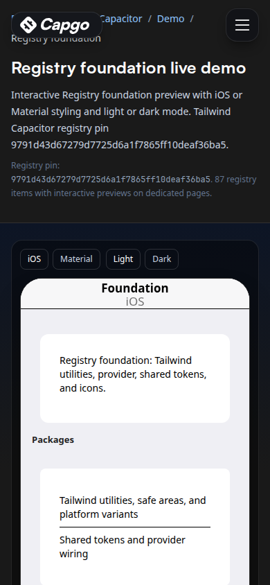

#### mobile ios-dark (frame)

#### mobile ios-dark (page)

#### mobile material-light (frame)

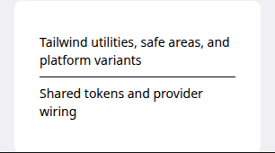

#### mobile material-light (page)

#### mobile material-dark (frame)

#### mobile material-dark (page)

### icons (Icons)

#### desktop ios-light (frame)

#### desktop ios-dark (frame)

#### desktop material-light (frame)

#### desktop material-dark (frame)

#### mobile ios-light (frame)

#### mobile ios-light (page)

#### mobile ios-dark (frame)

#### mobile ios-dark (page)

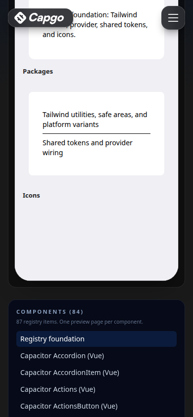

#### mobile material-light (frame)

#### mobile material-light (page)

#### mobile material-dark (frame)

#### mobile material-dark (page)

## capacitor-accordion

### default (Default)

#### desktop ios-light (frame)

#### desktop ios-dark (frame)

#### desktop material-light (frame)

#### desktop material-dark (frame)

#### mobile ios-light (frame)

#### mobile ios-light (page)

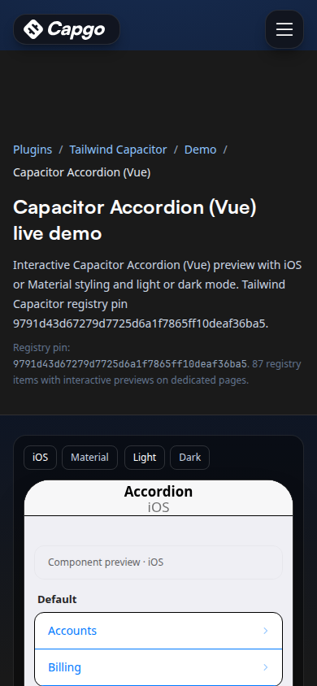

#### mobile ios-dark (frame)

#### mobile ios-dark (page)

#### mobile material-light (frame)

#### mobile material-light (page)

#### mobile material-dark (frame)

#### mobile material-dark (page)

### alternate (Alternate)

#### desktop ios-light (frame)

#### desktop ios-dark (frame)

#### desktop material-light (frame)

#### desktop material-dark (frame)

#### mobile ios-light (frame)

#### mobile ios-light (page)

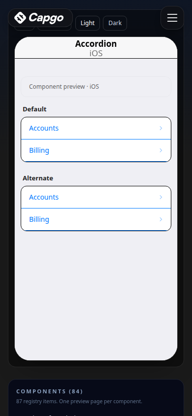

#### mobile ios-dark (frame)

#### mobile ios-dark (page)

#### mobile material-light (frame)

#### mobile material-light (page)

#### mobile material-dark (frame)

#### mobile material-dark (page)

## capacitor-accordion-item

### default (Default)

#### desktop ios-light (frame)

#### desktop ios-dark (frame)

#### desktop material-light (frame)

#### desktop material-dark (frame)

#### mobile ios-light (frame)

#### mobile ios-light (page)

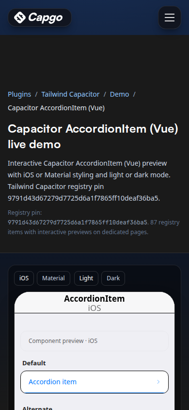

#### mobile ios-dark (frame)

#### mobile ios-dark (page)

#### mobile material-light (frame)

#### mobile material-light (page)

#### mobile material-dark (frame)

#### mobile material-dark (page)

### alternate (Alternate)

#### desktop ios-light (frame)

#### desktop ios-dark (frame)

#### desktop material-light (frame)

#### desktop material-dark (frame)

#### mobile ios-light (frame)

#### mobile ios-light (page)

#### mobile ios-dark (frame)

#### mobile ios-dark (page)

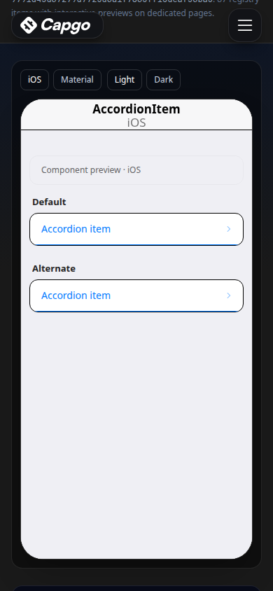

#### mobile material-light (frame)

#### mobile material-light (page)

#### mobile material-dark (frame)

#### mobile material-dark (page)

## capacitor-actions

### screen (Screen)

#### desktop ios-light (frame)

#### desktop ios-dark (frame)

#### desktop material-light (frame)

#### desktop material-dark (frame)

#### mobile ios-light (frame)

#### mobile ios-light (page)

#### mobile ios-dark (frame)

#### mobile ios-dark (page)

#### mobile material-light (frame)

#### mobile material-light (page)

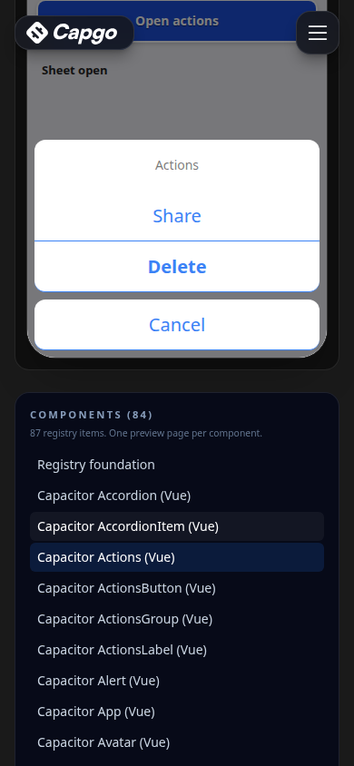

#### mobile material-dark (frame)

#### mobile material-dark (page)

### sheet-open (Sheet open)

#### desktop ios-light (frame)

#### desktop ios-dark (frame)

#### desktop material-light (frame)

#### desktop material-dark (frame)

#### mobile ios-light (frame)

#### mobile ios-light (page)

#### mobile ios-dark (frame)

#### mobile ios-dark (page)

#### mobile material-light (frame)

#### mobile material-light (page)

#### mobile material-dark (frame)

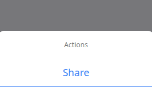

#### mobile material-dark (page)

## capacitor-actions-button

### screen (Screen)

#### desktop ios-light (frame)

#### desktop ios-dark (frame)

#### desktop material-light (frame)

#### desktop material-dark (frame)

#### mobile ios-light (frame)

#### mobile ios-light (page)

#### mobile ios-dark (frame)

#### mobile ios-dark (page)

#### mobile material-light (frame)

#### mobile material-light (page)

#### mobile material-dark (frame)

#### mobile material-dark (page)

### sheet-open (Sheet open)

#### desktop ios-light (frame)

#### desktop ios-dark (frame)

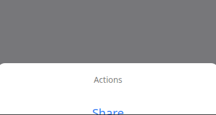

#### desktop material-light (frame)

#### desktop material-dark (frame)

#### mobile ios-light (frame)

#### mobile ios-light (page)

#### mobile ios-dark (frame)

#### mobile ios-dark (page)

#### mobile material-light (frame)

#### mobile material-light (page)

#### mobile material-dark (frame)

#### mobile material-dark (page)

### primary-row (Primary row)

#### desktop ios-light (frame)

#### desktop ios-dark (frame)

#### desktop material-light (frame)

#### desktop material-dark (frame)

#### mobile ios-light (frame)

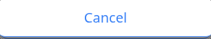

#### mobile ios-light (page)

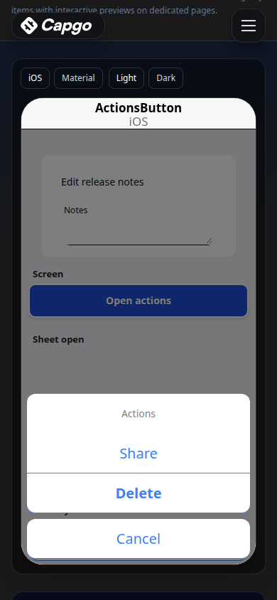

#### mobile ios-dark (frame)

#### mobile ios-dark (page)

#### mobile material-light (frame)

#### mobile material-light (page)

#### mobile material-dark (frame)

#### mobile material-dark (page)

## capacitor-actions-group

### screen (Screen)

#### desktop ios-light (frame)

#### desktop ios-dark (frame)

#### desktop material-light (frame)

#### desktop material-dark (frame)

#### mobile ios-light (frame)

#### mobile ios-light (page)

#### mobile ios-dark (frame)

#### mobile ios-dark (page)

#### mobile material-light (frame)

#### mobile material-light (page)

#### mobile material-dark (frame)

#### mobile material-dark (page)

### sheet-open (Sheet open)

#### desktop ios-light (frame)

#### desktop ios-dark (frame)

#### desktop material-light (frame)

#### desktop material-dark (frame)

#### mobile ios-light (frame)

#### mobile ios-light (page)

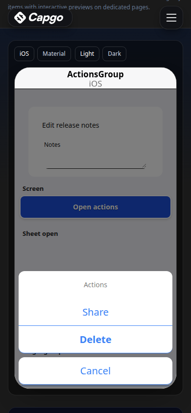

#### mobile ios-dark (frame)

#### mobile ios-dark (page)

#### mobile material-light (frame)

#### mobile material-light (page)

#### mobile material-dark (frame)

#### mobile material-dark (page)

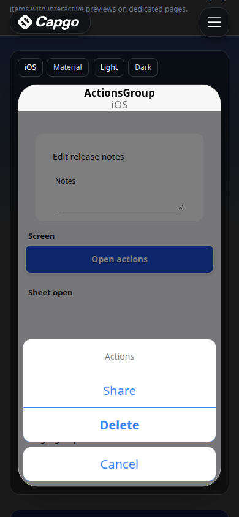

### single-group (Single group)

#### desktop ios-light (frame)

#### desktop ios-dark (frame)

#### desktop material-light (frame)

#### desktop material-dark (frame)

#### mobile ios-light (frame)

#### mobile ios-light (page)

#### mobile ios-dark (frame)

#### mobile ios-dark (page)

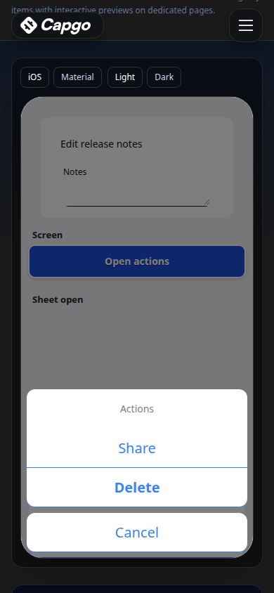

#### mobile material-light (frame)

#### mobile material-light (page)

#### mobile material-dark (frame)

#### mobile material-dark (page)

## capacitor-actions-label

### screen (Screen)

#### desktop ios-light (frame)

#### desktop ios-dark (frame)

#### desktop material-light (frame)

#### desktop material-dark (frame)

#### mobile ios-light (frame)

#### mobile ios-light (page)

#### mobile ios-dark (frame)

#### mobile ios-dark (page)

#### mobile material-light (frame)

#### mobile material-light (page)

#### mobile material-dark (frame)

#### mobile material-dark (page)

### sheet-open (Sheet open)

#### desktop ios-light (frame)

#### desktop ios-dark (frame)

#### desktop material-light (frame)

#### desktop material-dark (frame)

#### mobile ios-light (frame)

#### mobile ios-light (page)

#### mobile ios-dark (frame)

#### mobile ios-dark (page)

#### mobile material-light (frame)

#### mobile material-light (page)

#### mobile material-dark (frame)

#### mobile material-dark (page)

### section-label (Section label)

#### desktop ios-light (frame)

#### desktop ios-dark (frame)

#### desktop material-light (frame)

#### desktop material-dark (frame)

#### mobile ios-light (frame)

#### mobile ios-light (page)

#### mobile ios-dark (frame)

#### mobile ios-dark (page)

#### mobile material-light (frame)

#### mobile material-light (page)

#### mobile material-dark (frame)

#### mobile material-dark (page)

## capacitor-alert

### default (Default)

#### desktop ios-light (frame)

#### desktop ios-dark (frame)

#### desktop material-light (frame)

#### desktop material-dark (frame)

#### mobile ios-light (frame)

#### mobile ios-light (page)

#### mobile ios-dark (frame)

#### mobile ios-dark (page)

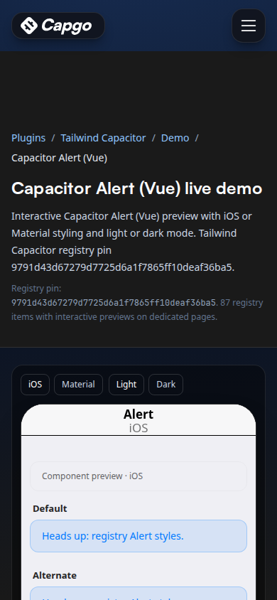

#### mobile material-light (frame)

#### mobile material-light (page)

#### mobile material-dark (frame)

#### mobile material-dark (page)

### alternate (Alternate)

#### desktop ios-light (frame)

#### desktop ios-dark (frame)

#### desktop material-light (frame)

#### desktop material-dark (frame)

#### mobile ios-light (frame)

#### mobile ios-light (page)

#### mobile ios-dark (frame)

#### mobile ios-dark (page)

#### mobile material-light (frame)

#### mobile material-light (page)

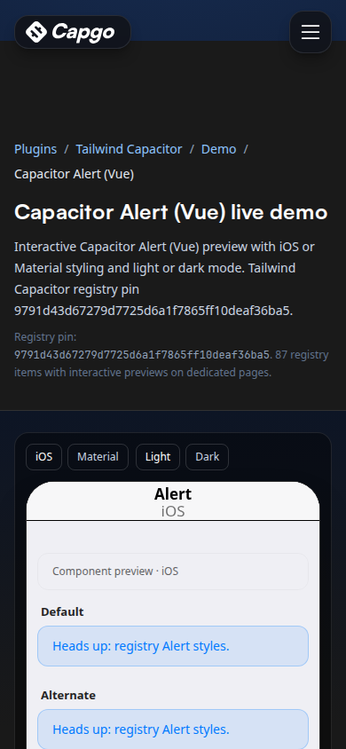

#### mobile material-dark (frame)

#### mobile material-dark (page)

## capacitor-app

### default (Default)

#### desktop ios-light (frame)

#### desktop ios-dark (frame)

#### desktop material-light (frame)

#### desktop material-dark (frame)

#### mobile ios-light (frame)

#### mobile ios-light (page)

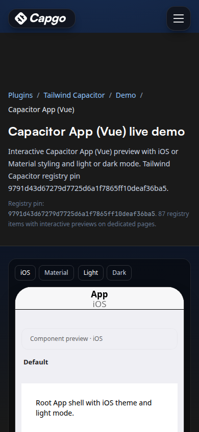

#### mobile ios-dark (frame)

#### mobile ios-dark (page)

#### mobile material-light (frame)

#### mobile material-light (page)

#### mobile material-dark (frame)

#### mobile material-dark (page)

### alternate (Alternate)

#### desktop ios-light (frame)

#### desktop ios-dark (frame)

#### desktop material-light (frame)

#### desktop material-dark (frame)

#### mobile ios-light (frame)

#### mobile ios-light (page)

#### mobile ios-dark (frame)

#### mobile ios-dark (page)

#### mobile material-light (frame)

#### mobile material-light (page)

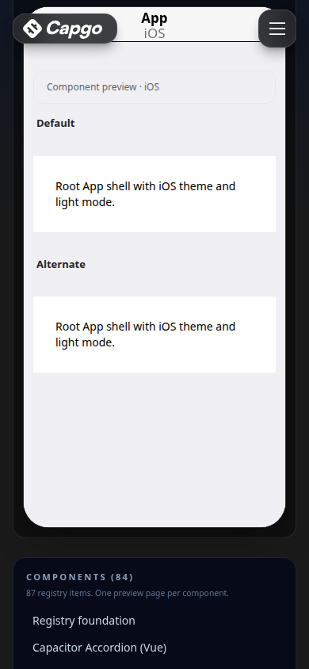

#### mobile material-dark (frame)

#### mobile material-dark (page)

## capacitor-avatar

### default (Default)

#### desktop ios-light (frame)

#### desktop ios-dark (frame)

#### desktop material-light (frame)

#### desktop material-dark (frame)

#### mobile ios-light (frame)

#### mobile ios-light (page)

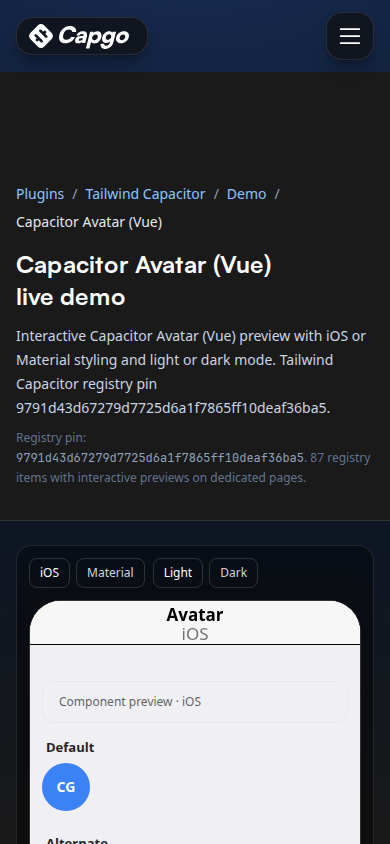

#### mobile ios-dark (frame)

#### mobile ios-dark (page)

#### mobile material-light (frame)

#### mobile material-light (page)

#### mobile material-dark (frame)

#### mobile material-dark (page)

### alternate (Alternate)

#### desktop ios-light (frame)

#### desktop ios-dark (frame)

#### desktop material-light (frame)

#### desktop material-dark (frame)

#### mobile ios-light (frame)

#### mobile ios-light (page)

#### mobile ios-dark (frame)

#### mobile ios-dark (page)

#### mobile material-light (frame)

#### mobile material-light (page)

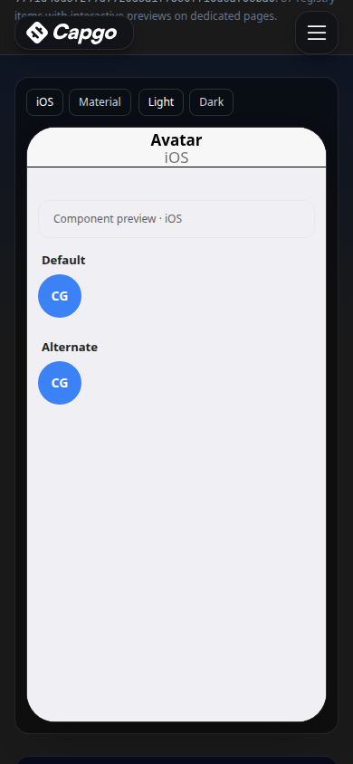

#### mobile material-dark (frame)

#### mobile material-dark (page)

## capacitor-badge

### default (Default)

#### desktop ios-light (frame)

#### desktop ios-dark (frame)

#### desktop material-light (frame)

#### desktop material-dark (frame)

#### mobile ios-light (frame)

#### mobile ios-light (page)

#### mobile ios-dark (frame)

#### mobile ios-dark (page)

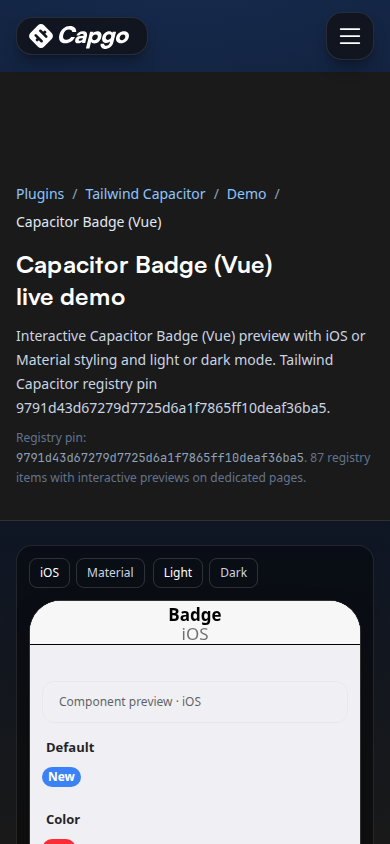

#### mobile material-light (frame)

#### mobile material-light (page)

#### mobile material-dark (frame)

#### mobile material-dark (page)

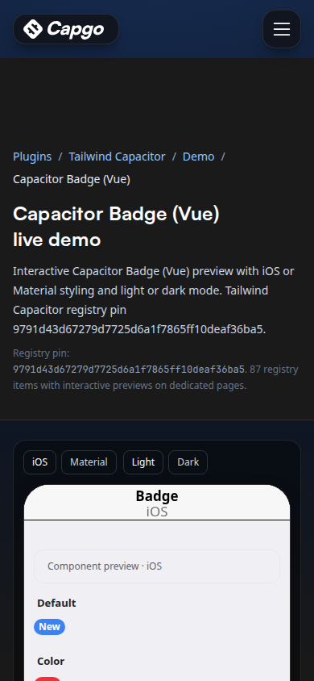

### color (Color)

#### desktop ios-light (frame)

#### desktop ios-dark (frame)

#### desktop material-light (frame)

#### desktop material-dark (frame)

#### mobile ios-light (frame)

#### mobile ios-light (page)

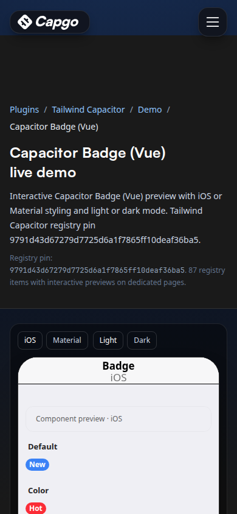

#### mobile ios-dark (frame)

#### mobile ios-dark (page)

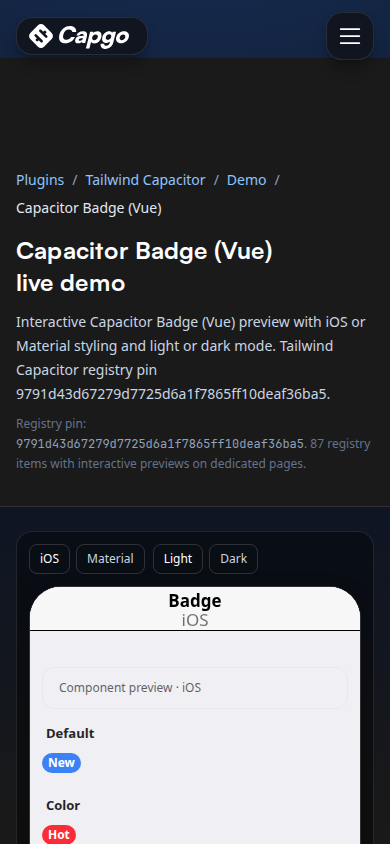

#### mobile material-light (frame)

#### mobile material-light (page)

#### mobile material-dark (frame)

#### mobile material-dark (page)

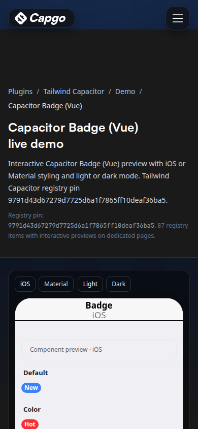

### on-avatar (On avatar)

#### desktop ios-light (frame)

#### desktop ios-dark (frame)

#### desktop material-light (frame)

#### desktop material-dark (frame)

#### mobile ios-light (frame)

#### mobile ios-light (page)

#### mobile ios-dark (frame)

#### mobile ios-dark (page)

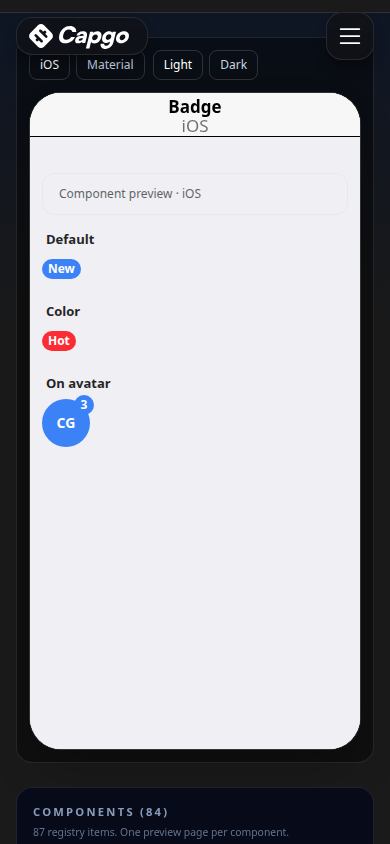

#### mobile material-light (frame)

#### mobile material-light (page)

#### mobile material-dark (frame)

#### mobile material-dark (page)

## capacitor-block

### default (Default)

#### desktop ios-light (frame)

#### desktop ios-dark (frame)

#### desktop material-light (frame)

#### desktop material-dark (frame)

#### mobile ios-light (frame)

#### mobile ios-light (page)

#### mobile ios-dark (frame)

#### mobile ios-dark (page)

#### mobile material-light (frame)

#### mobile material-light (page)

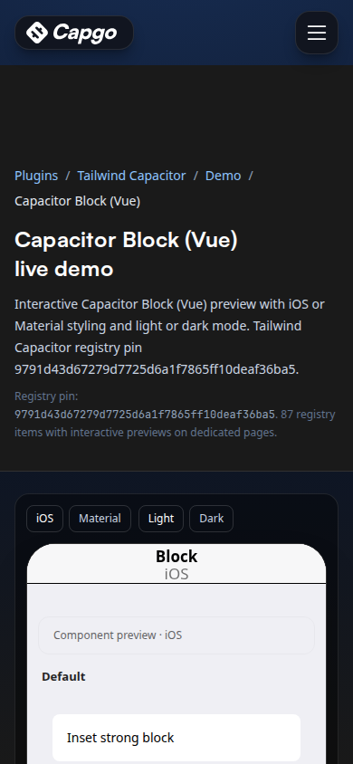

#### mobile material-dark (frame)

#### mobile material-dark (page)

### alternate (Alternate)

#### desktop ios-light (frame)

#### desktop ios-dark (frame)

#### desktop material-light (frame)

#### desktop material-dark (frame)

#### mobile ios-light (frame)

#### mobile ios-light (page)

#### mobile ios-dark (frame)

#### mobile ios-dark (page)

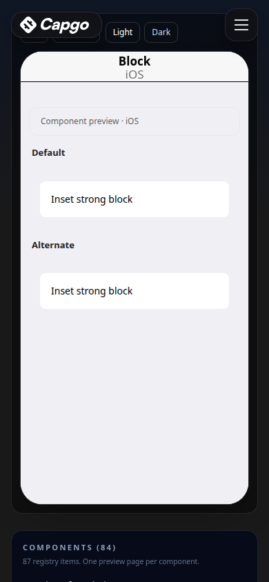

#### mobile material-light (frame)

#### mobile material-light (page)

#### mobile material-dark (frame)

#### mobile material-dark (page)

## capacitor-block-footer

### default (Default)

#### desktop ios-light (frame)

#### desktop ios-dark (frame)

#### desktop material-light (frame)

#### desktop material-dark (frame)

#### mobile ios-light (frame)

#### mobile ios-light (page)

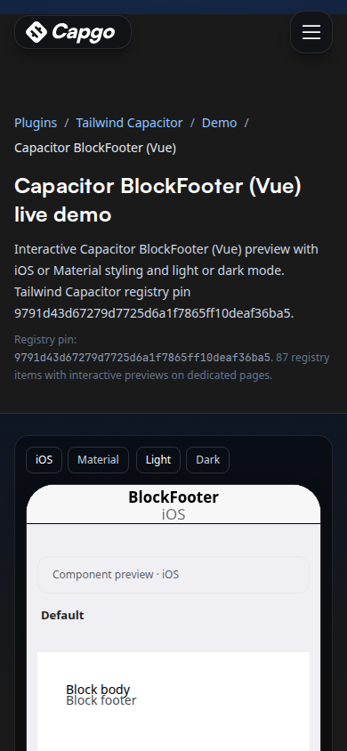

#### mobile ios-dark (frame)

#### mobile ios-dark (page)

#### mobile material-light (frame)

#### mobile material-light (page)

#### mobile material-dark (frame)

#### mobile material-dark (page)

### alternate (Alternate)

#### desktop ios-light (frame)

#### desktop ios-dark (frame)

#### desktop material-light (frame)

#### desktop material-dark (frame)

#### mobile ios-light (frame)

#### mobile ios-light (page)

#### mobile ios-dark (frame)

#### mobile ios-dark (page)

#### mobile material-light (frame)

#### mobile material-light (page)

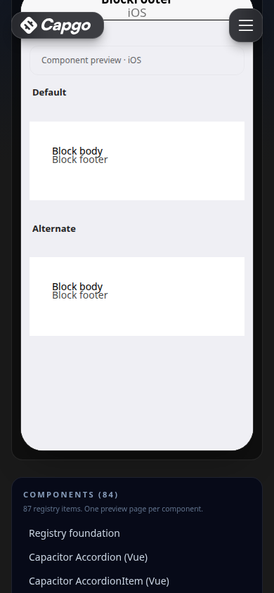

#### mobile material-dark (frame)

#### mobile material-dark (page)

## capacitor-block-header

### default (Default)

#### desktop ios-light (frame)

#### desktop ios-dark (frame)

#### desktop material-light (frame)

#### desktop material-dark (frame)

#### mobile ios-light (frame)

#### mobile ios-light (page)

#### mobile ios-dark (frame)

#### mobile ios-dark (page)

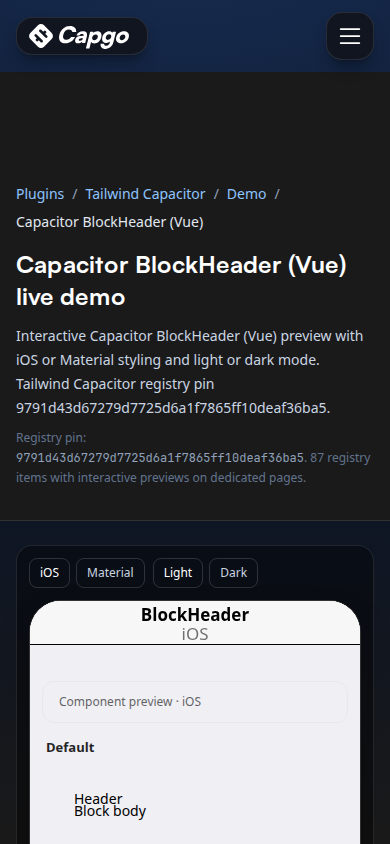

#### mobile material-light (frame)

#### mobile material-light (page)

#### mobile material-dark (frame)

#### mobile material-dark (page)

### alternate (Alternate)

#### desktop ios-light (frame)

#### desktop ios-dark (frame)

#### desktop material-light (frame)

#### desktop material-dark (frame)

#### mobile ios-light (frame)

#### mobile ios-light (page)

#### mobile ios-dark (frame)

#### mobile ios-dark (page)

#### mobile material-light (frame)

#### mobile material-light (page)

#### mobile material-dark (frame)

#### mobile material-dark (page)

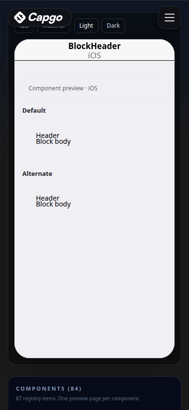

## capacitor-block-title

### default (Default)

#### desktop ios-light (frame)

#### desktop ios-dark (frame)

#### desktop material-light (frame)

#### desktop material-dark (frame)

#### mobile ios-light (frame)

#### mobile ios-light (page)

#### mobile ios-dark (frame)

#### mobile ios-dark (page)

#### mobile material-light (frame)

#### mobile material-light (page)

#### mobile material-dark (frame)

#### mobile material-dark (page)

### alternate (Alternate)

#### desktop ios-light (frame)

#### desktop ios-dark (frame)

#### desktop material-light (frame)

#### desktop material-dark (frame)

#### mobile ios-light (frame)

#### mobile ios-light (page)

#### mobile ios-dark (frame)

#### mobile ios-dark (page)

#### mobile material-light (frame)

#### mobile material-light (page)

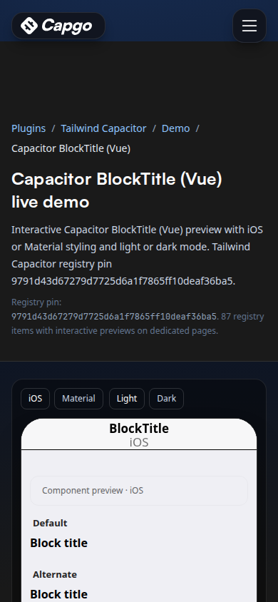

#### mobile material-dark (frame)

#### mobile material-dark (page)

## capacitor-breadcrumbs

### default (Default)

#### desktop ios-light (frame)

#### desktop ios-dark (frame)

#### desktop material-light (frame)

#### desktop material-dark (frame)

#### mobile ios-light (frame)

#### mobile ios-light (page)

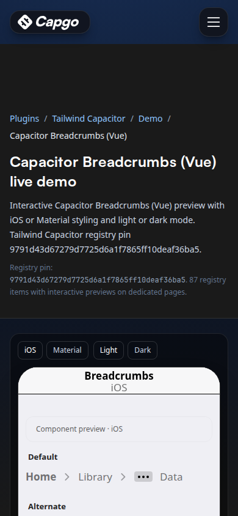

#### mobile ios-dark (frame)

#### mobile ios-dark (page)

#### mobile material-light (frame)

#### mobile material-light (page)

#### mobile material-dark (frame)

#### mobile material-dark (page)

### alternate (Alternate)

#### desktop ios-light (frame)

#### desktop ios-dark (frame)

#### desktop material-light (frame)

#### desktop material-dark (frame)

#### mobile ios-light (frame)

#### mobile ios-light (page)

#### mobile ios-dark (frame)

#### mobile ios-dark (page)

#### mobile material-light (frame)

#### mobile material-light (page)

#### mobile material-dark (frame)

#### mobile material-dark (page)

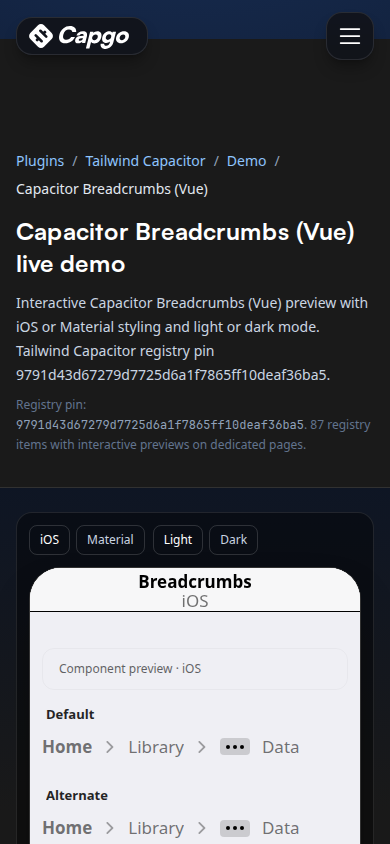

## capacitor-breadcrumbs-collapsed

### default (Default)

#### desktop ios-light (frame)

#### desktop ios-dark (frame)

#### desktop material-light (frame)

#### desktop material-dark (frame)

#### mobile ios-light (frame)

#### mobile ios-light (page)

#### mobile ios-dark (frame)

#### mobile ios-dark (page)

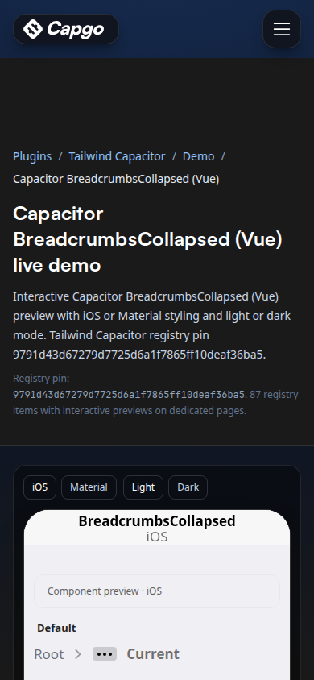

#### mobile material-light (frame)

#### mobile material-light (page)

#### mobile material-dark (frame)

#### mobile material-dark (page)

### alternate (Alternate)

#### desktop ios-light (frame)

#### desktop ios-dark (frame)

#### desktop material-light (frame)

#### desktop material-dark (frame)

#### mobile ios-light (frame)

#### mobile ios-light (page)

#### mobile ios-dark (frame)

#### mobile ios-dark (page)

#### mobile material-light (frame)

#### mobile material-light (page)

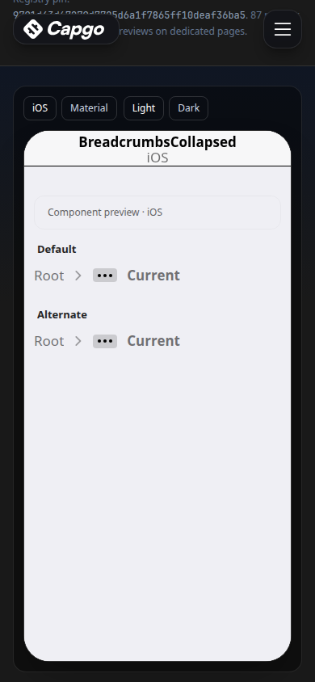

#### mobile material-dark (frame)

#### mobile material-dark (page)

## capacitor-breadcrumbs-item

### default (Default)

#### desktop ios-light (frame)

#### desktop ios-dark (frame)

#### desktop material-light (frame)

#### desktop material-dark (frame)

#### mobile ios-light (frame)

#### mobile ios-light (page)

#### mobile ios-dark (frame)

#### mobile ios-dark (page)

#### mobile material-light (frame)

#### mobile material-light (page)

#### mobile material-dark (frame)

#### mobile material-dark (page)

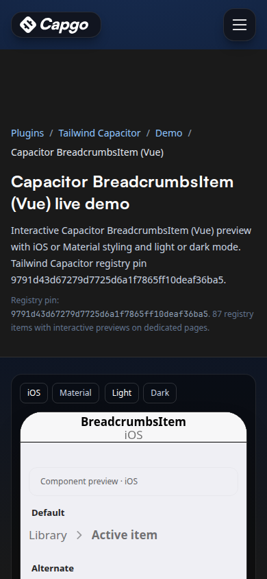

### alternate (Alternate)

#### desktop ios-light (frame)

#### desktop ios-dark (frame)

#### desktop material-light (frame)

#### desktop material-dark (frame)

#### mobile ios-light (frame)

#### mobile ios-light (page)

#### mobile ios-dark (frame)

#### mobile ios-dark (page)

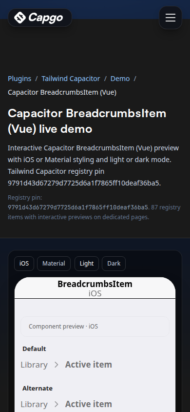

#### mobile material-light (frame)

#### mobile material-light (page)

#### mobile material-dark (frame)

#### mobile material-dark (page)

## capacitor-breadcrumbs-separator

### default (Default)

#### desktop ios-light (frame)

#### desktop ios-dark (frame)

#### desktop material-light (frame)

#### desktop material-dark (frame)

#### mobile ios-light (frame)

#### mobile ios-light (page)

#### mobile ios-dark (frame)

#### mobile ios-dark (page)

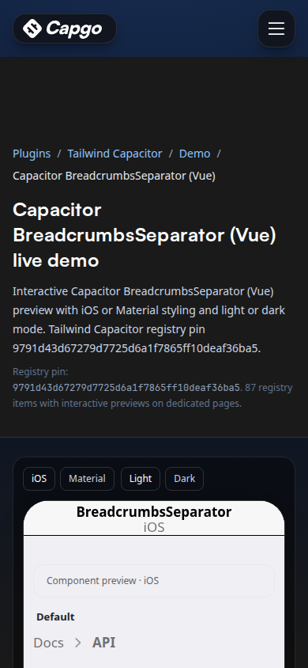

#### mobile material-light (frame)

#### mobile material-light (page)

#### mobile material-dark (frame)

#### mobile material-dark (page)

### alternate (Alternate)

#### desktop ios-light (frame)

#### desktop ios-dark (frame)

#### desktop material-light (frame)

#### desktop material-dark (frame)

#### mobile ios-light (frame)

#### mobile ios-light (page)

#### mobile ios-dark (frame)

#### mobile ios-dark (page)

#### mobile material-light (frame)

#### mobile material-light (page)

#### mobile material-dark (frame)

#### mobile material-dark (page)

## capacitor-button

### solid (Solid)

#### desktop ios-light (frame)

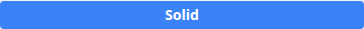

#### desktop ios-dark (frame)

#### desktop material-light (frame)

#### desktop material-dark (frame)

#### mobile ios-light (frame)

#### mobile ios-light (page)

#### mobile ios-dark (frame)

#### mobile ios-dark (page)

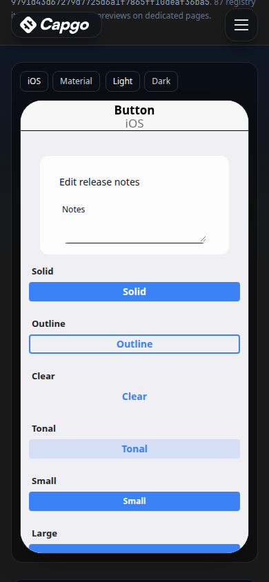

#### mobile material-light (frame)

#### mobile material-light (page)

#### mobile material-dark (frame)

#### mobile material-dark (page)

### outline (Outline)

#### desktop ios-light (frame)

#### desktop ios-dark (frame)

#### desktop material-light (frame)

#### desktop material-dark (frame)

#### mobile ios-light (frame)

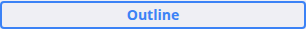

#### mobile ios-light (page)

#### mobile ios-dark (frame)

#### mobile ios-dark (page)

#### mobile material-light (frame)

#### mobile material-light (page)

#### mobile material-dark (frame)

#### mobile material-dark (page)

### clear (Clear)

#### desktop ios-light (frame)

#### desktop ios-dark (frame)

#### desktop material-light (frame)

#### desktop material-dark (frame)

#### mobile ios-light (frame)

#### mobile ios-light (page)

#### mobile ios-dark (frame)

#### mobile ios-dark (page)

#### mobile material-light (frame)

#### mobile material-light (page)

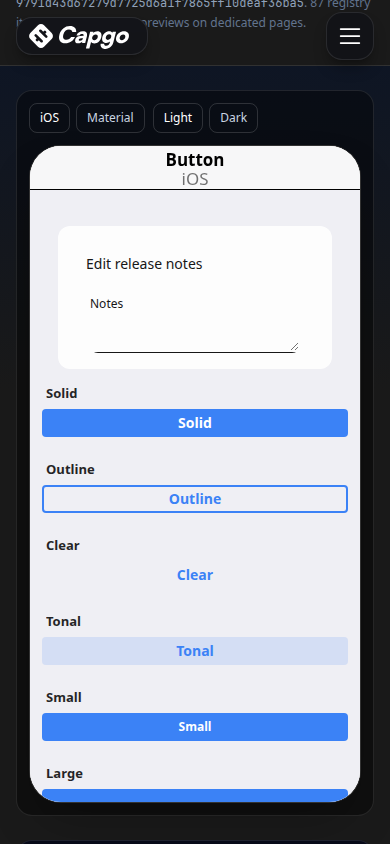

#### mobile material-dark (frame)

#### mobile material-dark (page)

### tonal (Tonal)

#### desktop ios-light (frame)

#### desktop ios-dark (frame)

#### desktop material-light (frame)

#### desktop material-dark (frame)

#### mobile ios-light (frame)

#### mobile ios-light (page)

#### mobile ios-dark (frame)

#### mobile ios-dark (page)

#### mobile material-light (frame)

#### mobile material-light (page)

#### mobile material-dark (frame)

#### mobile material-dark (page)

### small (Small)

#### desktop ios-light (frame)

#### desktop ios-dark (frame)

#### desktop material-light (frame)

#### desktop material-dark (frame)

#### mobile ios-light (frame)

#### mobile ios-light (page)

#### mobile ios-dark (frame)

#### mobile ios-dark (page)

#### mobile material-light (frame)

#### mobile material-light (page)

#### mobile material-dark (frame)

#### mobile material-dark (page)

### large (Large)

#### desktop ios-light (frame)

#### desktop ios-dark (frame)

#### desktop material-light (frame)

#### desktop material-dark (frame)

#### mobile ios-light (frame)

#### mobile ios-light (page)

#### mobile ios-dark (frame)

#### mobile ios-dark (page)

#### mobile material-light (frame)

#### mobile material-light (page)

#### mobile material-dark (frame)

#### mobile material-dark (page)

### raised (Raised)

#### desktop ios-light (frame)

#### desktop ios-dark (frame)

#### desktop material-light (frame)

#### desktop material-dark (frame)

#### mobile ios-light (frame)

#### mobile ios-light (page)

#### mobile ios-dark (frame)

#### mobile ios-dark (page)

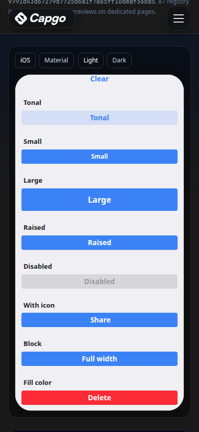

#### mobile material-light (frame)

#### mobile material-light (page)

#### mobile material-dark (frame)

#### mobile material-dark (page)

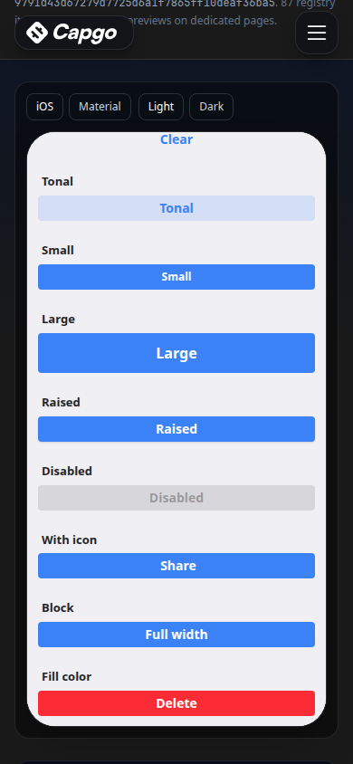

### disabled (Disabled)

#### desktop ios-light (frame)

#### desktop ios-dark (frame)

#### desktop material-light (frame)

#### desktop material-dark (frame)

#### mobile ios-light (frame)

#### mobile ios-light (page)

#### mobile ios-dark (frame)

#### mobile ios-dark (page)

#### mobile material-light (frame)

#### mobile material-light (page)

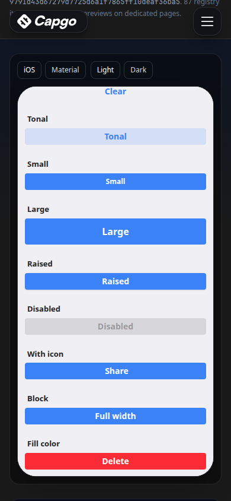

#### mobile material-dark (frame)

#### mobile material-dark (page)

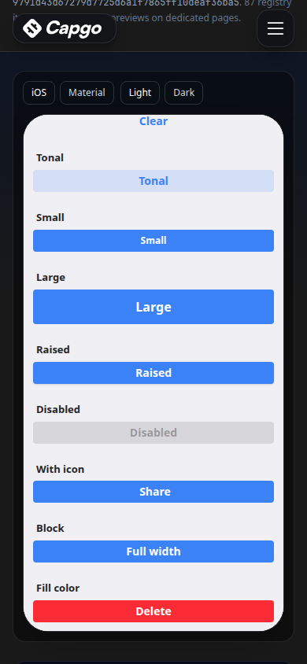

### with-icon (With icon)

#### desktop ios-light (frame)

#### desktop ios-dark (frame)

#### desktop material-light (frame)

#### desktop material-dark (frame)

#### mobile ios-light (frame)

#### mobile ios-light (page)

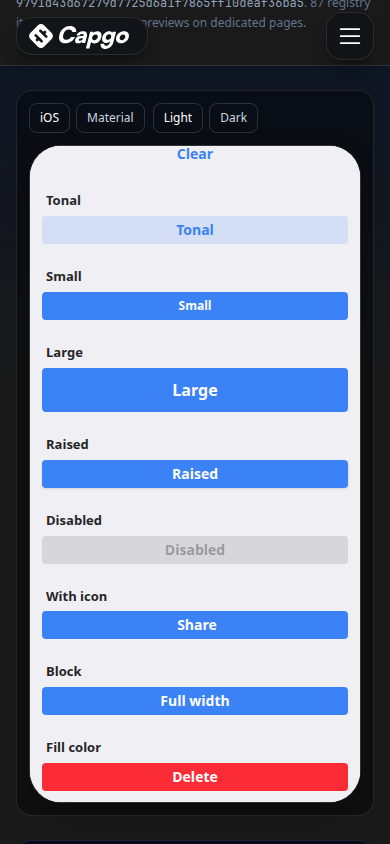

#### mobile ios-dark (frame)

#### mobile ios-dark (page)

#### mobile material-light (frame)

#### mobile material-light (page)

#### mobile material-dark (frame)

#### mobile material-dark (page)

### block (Block)

#### desktop ios-light (frame)

#### desktop ios-dark (frame)

#### desktop material-light (frame)

#### desktop material-dark (frame)

#### mobile ios-light (frame)

#### mobile ios-light (page)

#### mobile ios-dark (frame)

#### mobile ios-dark (page)

#### mobile material-light (frame)

#### mobile material-light (page)

#### mobile material-dark (frame)

#### mobile material-dark (page)

### fill-color (Fill color)

#### desktop ios-light (frame)

#### desktop ios-dark (frame)

#### desktop material-light (frame)

#### desktop material-dark (frame)

#### mobile ios-light (frame)

#### mobile ios-light (page)

#### mobile ios-dark (frame)

#### mobile ios-dark (page)

#### mobile material-light (frame)

#### mobile material-light (page)

#### mobile material-dark (frame)

#### mobile material-dark (page)

### outline-color (Outline color)

#### desktop ios-light (frame)

#### desktop ios-dark (frame)

#### desktop material-light (frame)

#### desktop material-dark (frame)

#### mobile ios-light (frame)

#### mobile ios-light (page)

#### mobile ios-dark (frame)

#### mobile ios-dark (page)

#### mobile material-light (frame)

#### mobile material-light (page)

#### mobile material-dark (frame)

#### mobile material-dark (page)

## capacitor-card

### feed (Feed card)

#### desktop ios-light (frame)

#### desktop ios-dark (frame)

#### desktop material-light (frame)

#### desktop material-dark (frame)

#### mobile ios-light (frame)

#### mobile ios-light (page)

#### mobile ios-dark (frame)

#### mobile ios-dark (page)

#### mobile material-light (frame)

#### mobile material-light (page)

#### mobile material-dark (frame)

#### mobile material-dark (page)

### media (Media card)

#### desktop ios-light (frame)

#### desktop ios-dark (frame)

#### desktop material-light (frame)

#### desktop material-dark (frame)

#### mobile ios-light (frame)

#### mobile ios-light (page)

#### mobile ios-dark (frame)

#### mobile ios-dark (page)

#### mobile material-light (frame)

#### mobile material-light (page)

#### mobile material-dark (frame)

#### mobile material-dark (page)

### outline (Outline card)

#### desktop ios-light (frame)

#### desktop ios-dark (frame)

#### desktop material-light (frame)

#### desktop material-dark (frame)

#### mobile ios-light (frame)

#### mobile ios-light (page)

#### mobile ios-dark (frame)

#### mobile ios-dark (page)

#### mobile material-light (frame)

#### mobile material-light (page)

#### mobile material-dark (frame)

#### mobile material-dark (page)

## capacitor-checkbox

### off (Off)

#### desktop ios-light (frame)

#### desktop ios-dark (frame)

#### desktop material-light (frame)

#### desktop material-dark (frame)

#### mobile ios-light (frame)

#### mobile ios-light (page)

#### mobile ios-dark (frame)

#### mobile ios-dark (page)

#### mobile material-light (frame)

#### mobile material-light (page)

#### mobile material-dark (frame)

#### mobile material-dark (page)

### on (On)

#### desktop ios-light (frame)

#### desktop ios-dark (frame)

#### desktop material-light (frame)

#### desktop material-dark (frame)

#### mobile ios-light (frame)

#### mobile ios-light (page)

#### mobile ios-dark (frame)

#### mobile ios-dark (page)

#### mobile material-light (frame)

#### mobile material-light (page)

#### mobile material-dark (frame)

#### mobile material-dark (page)

### disabled (Disabled)

#### desktop ios-light (frame)

#### desktop ios-dark (frame)

#### desktop material-light (frame)

#### desktop material-dark (frame)

#### mobile ios-light (frame)

#### mobile ios-light (page)

#### mobile ios-dark (frame)

#### mobile ios-dark (page)

#### mobile material-light (frame)

#### mobile material-light (page)

#### mobile material-dark (frame)

#### mobile material-dark (page)

## capacitor-chip

### filled (Filled)

#### desktop ios-light (frame)

#### desktop ios-dark (frame)

#### desktop material-light (frame)

#### desktop material-dark (frame)

#### mobile ios-light (frame)

#### mobile ios-light (page)

#### mobile ios-dark (frame)

#### mobile ios-dark (page)

#### mobile material-light (frame)

#### mobile material-light (page)

#### mobile material-dark (frame)

#### mobile material-dark (page)

### removable (Removable)

#### desktop ios-light (frame)

#### desktop ios-dark (frame)

#### desktop material-light (frame)

#### desktop material-dark (frame)

#### mobile ios-light (frame)

#### mobile ios-light (page)

#### mobile ios-dark (frame)

#### mobile ios-dark (page)

#### mobile material-light (frame)

#### mobile material-light (page)

#### mobile material-dark (frame)

#### mobile material-dark (page)

### outline (Outline)

#### desktop ios-light (frame)

#### desktop ios-dark (frame)

#### desktop material-light (frame)

#### desktop material-dark (frame)

#### mobile ios-light (frame)

#### mobile ios-light (page)

#### mobile ios-dark (frame)

#### mobile ios-dark (page)

#### mobile material-light (frame)

#### mobile material-light (page)

#### mobile material-dark (frame)

#### mobile material-dark (page)

## capacitor-datetime

### default (Default)

#### desktop ios-light (frame)

#### desktop ios-dark (frame)

#### desktop material-light (frame)

#### desktop material-dark (frame)

#### mobile ios-light (frame)

#### mobile ios-light (page)

#### mobile ios-dark (frame)

#### mobile ios-dark (page)

#### mobile material-light (frame)

#### mobile material-light (page)

#### mobile material-dark (frame)

#### mobile material-dark (page)

### alternate (Alternate)

#### desktop ios-light (frame)

#### desktop ios-dark (frame)

#### desktop material-light (frame)

#### desktop material-dark (frame)

#### mobile ios-light (frame)

#### mobile ios-light (page)

#### mobile ios-dark (frame)

#### mobile ios-dark (page)

#### mobile material-light (frame)

#### mobile material-light (page)

#### mobile material-dark (frame)

#### mobile material-dark (page)

## capacitor-dialog

### screen (Screen)

#### desktop ios-light (frame)

#### desktop ios-dark (frame)

#### desktop material-light (frame)

#### desktop material-dark (frame)

#### mobile ios-light (frame)

#### mobile ios-light (page)

#### mobile ios-dark (frame)

#### mobile ios-dark (page)

#### mobile material-light (frame)

#### mobile material-light (page)

#### mobile material-dark (frame)

#### mobile material-dark (page)

### open (Open)

#### desktop ios-light (frame)

#### desktop ios-dark (frame)

#### desktop material-light (frame)

#### desktop material-dark (frame)

#### mobile ios-light (frame)

#### mobile ios-light (page)

#### mobile ios-dark (frame)

#### mobile ios-dark (page)

#### mobile material-light (frame)

#### mobile material-light (page)

#### mobile material-dark (frame)

#### mobile material-dark (page)

## capacitor-dialog-button

### default (Default)

#### desktop ios-light (frame)

#### desktop ios-dark (frame)

#### desktop material-light (frame)

#### desktop material-dark (frame)

#### mobile ios-light (frame)

#### mobile ios-light (page)

#### mobile ios-dark (frame)

#### mobile ios-dark (page)

#### mobile material-light (frame)

#### mobile material-light (page)

#### mobile material-dark (frame)

#### mobile material-dark (page)

### alternate (Alternate)

#### desktop ios-light (frame)

#### desktop ios-dark (frame)

#### desktop material-light (frame)

#### desktop material-dark (frame)

#### mobile ios-light (frame)

#### mobile ios-light (page)

#### mobile ios-dark (frame)

#### mobile ios-dark (page)

#### mobile material-light (frame)

#### mobile material-light (page)

#### mobile material-dark (frame)

#### mobile material-dark (page)

## capacitor-fab

### default (Default)

#### desktop ios-light (frame)

#### desktop ios-dark (frame)

#### desktop material-light (frame)

#### desktop material-dark (frame)

#### mobile ios-light (frame)

#### mobile ios-light (page)

#### mobile ios-dark (frame)

#### mobile ios-dark (page)

#### mobile material-light (frame)

#### mobile material-light (page)

#### mobile material-dark (frame)

#### mobile material-dark (page)

### alternate (Alternate)

#### desktop ios-light (frame)

#### desktop ios-dark (frame)

#### desktop material-light (frame)

#### desktop material-dark (frame)

#### mobile ios-light (frame)

#### mobile ios-light (page)

#### mobile ios-dark (frame)

#### mobile ios-dark (page)

#### mobile material-light (frame)

#### mobile material-light (page)

#### mobile material-dark (frame)

#### mobile material-dark (page)

## capacitor-footer

### default (Default)

#### desktop ios-light (frame)

#### desktop ios-dark (frame)

#### desktop material-light (frame)

#### desktop material-dark (frame)

#### mobile ios-light (frame)

#### mobile ios-light (page)

#### mobile ios-dark (frame)

#### mobile ios-dark (page)

#### mobile material-light (frame)

#### mobile material-light (page)

#### mobile material-dark (frame)

#### mobile material-dark (page)

### alternate (Alternate)

#### desktop ios-light (frame)

#### desktop ios-dark (frame)

#### desktop material-light (frame)

#### desktop material-dark (frame)

#### mobile ios-light (frame)

#### mobile ios-light (page)

#### mobile ios-dark (frame)

#### mobile ios-dark (page)

#### mobile material-light (frame)

#### mobile material-light (page)

#### mobile material-dark (frame)

#### mobile material-dark (page)

## capacitor-header

### default (Default)

#### desktop ios-light (frame)

#### desktop ios-dark (frame)

#### desktop material-light (frame)

#### desktop material-dark (frame)

#### mobile ios-light (frame)

#### mobile ios-light (page)

#### mobile ios-dark (frame)

#### mobile ios-dark (page)

#### mobile material-light (frame)

#### mobile material-light (page)

#### mobile material-dark (frame)

#### mobile material-dark (page)

### alternate (Alternate)

#### desktop ios-light (frame)

#### desktop ios-dark (frame)

#### desktop material-light (frame)

#### desktop material-dark (frame)

#### mobile ios-light (frame)

#### mobile ios-light (page)

#### mobile ios-dark (frame)

#### mobile ios-dark (page)

#### mobile material-light (frame)

#### mobile material-light (page)

#### mobile material-dark (frame)

#### mobile material-dark (page)

## capacitor-icon

### default (Default)

#### desktop ios-light (frame)

#### desktop ios-dark (frame)

#### desktop material-light (frame)

#### desktop material-dark (frame)

#### mobile ios-light (frame)

#### mobile ios-light (page)

#### mobile ios-dark (frame)

#### mobile ios-dark (page)

#### mobile material-light (frame)

#### mobile material-light (page)

#### mobile material-dark (frame)

#### mobile material-dark (page)

### alternate (Alternate)

#### desktop ios-light (frame)

#### desktop ios-dark (frame)

#### desktop material-light (frame)

#### desktop material-dark (frame)

#### mobile ios-light (frame)

#### mobile ios-light (page)

#### mobile ios-dark (frame)

#### mobile ios-dark (page)

#### mobile material-light (frame)

#### mobile material-light (page)

#### mobile material-dark (frame)

#### mobile material-dark (page)

## capacitor-infinite-scroll

### default (Default)

#### desktop ios-light (frame)

#### desktop ios-dark (frame)

#### desktop material-light (frame)

#### desktop material-dark (frame)

#### mobile ios-light (frame)

#### mobile ios-light (page)

#### mobile ios-dark (frame)

#### mobile ios-dark (page)

#### mobile material-light (frame)

#### mobile material-light (page)

#### mobile material-dark (frame)

#### mobile material-dark (page)

### alternate (Alternate)

#### desktop ios-light (frame)

#### desktop ios-dark (frame)

#### desktop material-light (frame)

#### desktop material-dark (frame)

#### mobile ios-light (frame)

#### mobile ios-light (page)

#### mobile ios-dark (frame)

#### mobile ios-dark (page)

#### mobile material-light (frame)

#### mobile material-light (page)

#### mobile material-dark (frame)

#### mobile material-dark (page)

## capacitor-input-otp

### empty (Empty)

#### desktop ios-light (frame)

#### desktop ios-dark (frame)

#### desktop material-light (frame)

#### desktop material-dark (frame)

#### mobile ios-light (frame)

#### mobile ios-light (page)

#### mobile ios-dark (frame)

#### mobile ios-dark (page)

#### mobile material-light (frame)

#### mobile material-light (page)

#### mobile material-dark (frame)

#### mobile material-dark (page)

### filled (Filled)

#### desktop ios-light (frame)

#### desktop ios-dark (frame)

#### desktop material-light (frame)

#### desktop material-dark (frame)

#### mobile ios-light (frame)

#### mobile ios-light (page)

#### mobile ios-dark (frame)

#### mobile ios-dark (page)

#### mobile material-light (frame)

#### mobile material-light (page)

#### mobile material-dark (frame)

#### mobile material-dark (page)

## capacitor-item-sliding

### default (Default)

#### desktop ios-light (frame)

#### desktop ios-dark (frame)

#### desktop material-light (frame)

#### desktop material-dark (frame)

#### mobile ios-light (frame)

#### mobile ios-light (page)

#### mobile ios-dark (frame)

#### mobile ios-dark (page)

#### mobile material-light (frame)

#### mobile material-light (page)

#### mobile material-dark (frame)

#### mobile material-dark (page)

### alternate (Alternate)

#### desktop ios-light (frame)

#### desktop ios-dark (frame)

#### desktop material-light (frame)

#### desktop material-dark (frame)

#### mobile ios-light (frame)

#### mobile ios-light (page)

#### mobile ios-dark (frame)

#### mobile ios-dark (page)

#### mobile material-light (frame)

#### mobile material-light (page)

#### mobile material-dark (frame)

#### mobile material-dark (page)

## capacitor-link

### default (Default)

#### desktop ios-light (frame)

#### desktop ios-dark (frame)

#### desktop material-light (frame)

#### desktop material-dark (frame)

#### mobile ios-light (frame)

#### mobile ios-light (page)

#### mobile ios-dark (frame)

#### mobile ios-dark (page)

#### mobile material-light (frame)

#### mobile material-light (page)

#### mobile material-dark (frame)

#### mobile material-dark (page)

### alternate (Alternate)

#### desktop ios-light (frame)

#### desktop ios-dark (frame)

#### desktop material-light (frame)

#### desktop material-dark (frame)

#### mobile ios-light (frame)

#### mobile ios-light (page)

#### mobile ios-dark (frame)

#### mobile ios-dark (page)

#### mobile material-light (frame)

#### mobile material-light (page)

#### mobile material-dark (frame)

#### mobile material-dark (page)

## capacitor-list

### inset (Inset list)

#### desktop ios-light (frame)

#### desktop ios-dark (frame)

#### desktop material-light (frame)

#### desktop material-dark (frame)

#### mobile ios-light (frame)

#### mobile ios-light (page)

#### mobile ios-dark (frame)

#### mobile ios-dark (page)

#### mobile material-light (frame)

#### mobile material-light (page)

#### mobile material-dark (frame)

#### mobile material-dark (page)

### buttons (List buttons)

#### desktop ios-light (frame)

#### desktop ios-dark (frame)

#### desktop material-light (frame)

#### desktop material-dark (frame)

#### mobile ios-light (frame)

#### mobile ios-light (page)

#### mobile ios-dark (frame)

#### mobile ios-dark (page)

#### mobile material-light (frame)

#### mobile material-light (page)

#### mobile material-dark (frame)

#### mobile material-dark (page)

### media (Media rows)

#### desktop ios-light (frame)

#### desktop ios-dark (frame)

#### desktop material-light (frame)

#### desktop material-dark (frame)

#### mobile ios-light (frame)

#### mobile ios-light (page)

#### mobile ios-dark (frame)

#### mobile ios-dark (page)

#### mobile material-light (frame)

#### mobile material-light (page)

#### mobile material-dark (frame)

#### mobile material-dark (page)

## capacitor-list-button

### default (Default)

#### desktop ios-light (frame)

#### desktop ios-dark (frame)

#### desktop material-light (frame)

#### desktop material-dark (frame)

#### mobile ios-light (frame)

#### mobile ios-light (page)

#### mobile ios-dark (frame)

#### mobile ios-dark (page)

#### mobile material-light (frame)

#### mobile material-light (page)

#### mobile material-dark (frame)

#### mobile material-dark (page)

### alternate (Alternate)

#### desktop ios-light (frame)

#### desktop ios-dark (frame)

#### desktop material-light (frame)

#### desktop material-dark (frame)

#### mobile ios-light (frame)

#### mobile ios-light (page)

#### mobile ios-dark (frame)

#### mobile ios-dark (page)

#### mobile material-light (frame)

#### mobile material-light (page)

#### mobile material-dark (frame)

#### mobile material-dark (page)

## capacitor-list-group

### default (Default)

#### desktop ios-light (frame)

#### desktop ios-dark (frame)

#### desktop material-light (frame)

#### desktop material-dark (frame)

#### mobile ios-light (frame)

#### mobile ios-light (page)

#### mobile ios-dark (frame)

#### mobile ios-dark (page)

#### mobile material-light (frame)

#### mobile material-light (page)

#### mobile material-dark (frame)

#### mobile material-dark (page)

### alternate (Alternate)

#### desktop ios-light (frame)

#### desktop ios-dark (frame)

#### desktop material-light (frame)

#### desktop material-dark (frame)

#### mobile ios-light (frame)

#### mobile ios-light (page)

#### mobile ios-dark (frame)

#### mobile ios-dark (page)

#### mobile material-light (frame)

#### mobile material-light (page)

#### mobile material-dark (frame)

#### mobile material-dark (page)

## capacitor-list-input

### empty (Empty)

#### desktop ios-light (frame)

#### desktop ios-dark (frame)

#### desktop material-light (frame)

#### desktop material-dark (frame)

#### mobile ios-light (frame)

#### mobile ios-light (page)

#### mobile ios-dark (frame)

#### mobile ios-dark (page)

#### mobile material-light (frame)

#### mobile material-light (page)

#### mobile material-dark (frame)

#### mobile material-dark (page)

### filled (Filled)

#### desktop ios-light (frame)

#### desktop ios-dark (frame)

#### desktop material-light (frame)

#### desktop material-dark (frame)

#### mobile ios-light (frame)

#### mobile ios-light (page)

#### mobile ios-dark (frame)

#### mobile ios-dark (page)

#### mobile material-light (frame)

#### mobile material-light (page)

#### mobile material-dark (frame)

#### mobile material-dark (page)

### focused (Focused)

#### desktop ios-light (frame)

#### desktop ios-dark (frame)

#### desktop material-light (frame)

#### desktop material-dark (frame)

#### mobile ios-light (frame)

#### mobile ios-light (page)

#### mobile ios-dark (frame)

#### mobile ios-dark (page)

#### mobile material-light (frame)

#### mobile material-light (page)

#### mobile material-dark (frame)

#### mobile material-dark (page)

## capacitor-list-item

### standard (Standard)

#### desktop ios-light (frame)

#### desktop ios-dark (frame)

#### desktop material-light (frame)

#### desktop material-dark (frame)

#### mobile ios-light (frame)

#### mobile ios-light (page)

#### mobile ios-dark (frame)

#### mobile ios-dark (page)

#### mobile material-light (frame)

#### mobile material-light (page)

#### mobile material-dark (frame)

#### mobile material-dark (page)

### chevron (Chevron link)

#### desktop ios-light (frame)

#### desktop ios-dark (frame)

#### desktop material-light (frame)

#### desktop material-dark (frame)

#### mobile ios-light (frame)

#### mobile ios-light (page)

#### mobile ios-dark (frame)

#### mobile ios-dark (page)

#### mobile material-light (frame)

#### mobile material-light (page)

#### mobile material-dark (frame)

#### mobile material-dark (page)

### toggle-after (Toggle after)

#### desktop ios-light (frame)

#### desktop ios-dark (frame)

#### desktop material-light (frame)

#### desktop material-dark (frame)

#### mobile ios-light (frame)

#### mobile ios-light (page)

#### mobile ios-dark (frame)

#### mobile ios-dark (page)

#### mobile material-light (frame)

#### mobile material-light (page)

#### mobile material-dark (frame)

#### mobile material-dark (page)

### badge (Badge)

#### desktop ios-light (frame)

#### desktop ios-dark (frame)

#### desktop material-light (frame)

#### desktop material-dark (frame)

#### mobile ios-light (frame)

#### mobile ios-light (page)

#### mobile ios-dark (frame)

#### mobile ios-dark (page)

#### mobile material-light (frame)

#### mobile material-light (page)

#### mobile material-dark (frame)

#### mobile material-dark (page)

## capacitor-menu-list

### default (Default)

#### desktop ios-light (frame)

#### desktop ios-dark (frame)

#### desktop material-light (frame)

#### desktop material-dark (frame)

#### mobile ios-light (frame)

#### mobile ios-light (page)

#### mobile ios-dark (frame)

#### mobile ios-dark (page)

#### mobile material-light (frame)

#### mobile material-light (page)

#### mobile material-dark (frame)

#### mobile material-dark (page)

### alternate (Alternate)

#### desktop ios-light (frame)

#### desktop ios-dark (frame)

#### desktop material-light (frame)

#### desktop material-dark (frame)

#### mobile ios-light (frame)

#### mobile ios-light (page)

#### mobile ios-dark (frame)

#### mobile ios-dark (page)

#### mobile material-light (frame)

#### mobile material-light (page)

#### mobile material-dark (frame)

#### mobile material-dark (page)

## capacitor-menu-list-item

### default (Default)

#### desktop ios-light (frame)

#### desktop ios-dark (frame)

#### desktop material-light (frame)

#### desktop material-dark (frame)

#### mobile ios-light (frame)

#### mobile ios-light (page)

#### mobile ios-dark (frame)

#### mobile ios-dark (page)

#### mobile material-light (frame)

#### mobile material-light (page)

#### mobile material-dark (frame)

#### mobile material-dark (page)

### alternate (Alternate)

#### desktop ios-light (frame)

#### desktop ios-dark (frame)

#### desktop material-light (frame)

#### desktop material-dark (frame)

#### mobile ios-light (frame)

#### mobile ios-light (page)

#### mobile ios-dark (frame)

#### mobile ios-dark (page)

#### mobile material-light (frame)

#### mobile material-light (page)

#### mobile material-dark (frame)

#### mobile material-dark (page)

## capacitor-message

### default (Default)

#### desktop ios-light (frame)

#### desktop ios-dark (frame)

#### desktop material-light (frame)

#### desktop material-dark (frame)

#### mobile ios-light (frame)

#### mobile ios-light (page)

#### mobile ios-dark (frame)

#### mobile ios-dark (page)

#### mobile material-light (frame)

#### mobile material-light (page)

#### mobile material-dark (frame)

#### mobile material-dark (page)

### alternate (Alternate)

#### desktop ios-light (frame)

#### desktop ios-dark (frame)

#### desktop material-light (frame)

#### desktop material-dark (frame)

#### mobile ios-light (frame)

#### mobile ios-light (page)

#### mobile ios-dark (frame)

#### mobile ios-dark (page)

#### mobile material-light (frame)

#### mobile material-light (page)

#### mobile material-dark (frame)

#### mobile material-dark (page)

## capacitor-messagebar

### default (Default)

#### desktop ios-light (frame)

#### desktop ios-dark (frame)

#### desktop material-light (frame)

#### desktop material-dark (frame)

#### mobile ios-light (frame)

#### mobile ios-light (page)

#### mobile ios-dark (frame)

#### mobile ios-dark (page)

#### mobile material-light (frame)

#### mobile material-light (page)

#### mobile material-dark (frame)

#### mobile material-dark (page)

### alternate (Alternate)

#### desktop ios-light (frame)

#### desktop ios-dark (frame)

#### desktop material-light (frame)

#### desktop material-dark (frame)

#### mobile ios-light (frame)

#### mobile ios-light (page)

#### mobile ios-dark (frame)

#### mobile ios-dark (page)

#### mobile material-light (frame)

#### mobile material-light (page)

#### mobile material-dark (frame)

#### mobile material-dark (page)

## capacitor-messages

### default (Default)

#### desktop ios-light (frame)

#### desktop ios-dark (frame)

#### desktop material-light (frame)

#### desktop material-dark (frame)

#### mobile ios-light (frame)

#### mobile ios-light (page)

#### mobile ios-dark (frame)

#### mobile ios-dark (page)

#### mobile material-light (frame)

#### mobile material-light (page)

#### mobile material-dark (frame)

#### mobile material-dark (page)

### alternate (Alternate)

#### desktop ios-light (frame)

#### desktop ios-dark (frame)

#### desktop material-light (frame)

#### desktop material-dark (frame)

#### mobile ios-light (frame)

#### mobile ios-light (page)

#### mobile ios-dark (frame)

#### mobile ios-dark (page)

#### mobile material-light (frame)

#### mobile material-light (page)

#### mobile material-dark (frame)

#### mobile material-dark (page)

## capacitor-messages-title

### default (Default)

#### desktop ios-light (frame)

#### desktop ios-dark (frame)

#### desktop material-light (frame)

#### desktop material-dark (frame)

#### mobile ios-light (frame)

#### mobile ios-light (page)

#### mobile ios-dark (frame)

#### mobile ios-dark (page)

#### mobile material-light (frame)

#### mobile material-light (page)

#### mobile material-dark (frame)

#### mobile material-dark (page)

### alternate (Alternate)

#### desktop ios-light (frame)

#### desktop ios-dark (frame)

#### desktop material-light (frame)

#### desktop material-dark (frame)

#### mobile ios-light (frame)

#### mobile ios-light (page)

#### mobile ios-dark (frame)

#### mobile ios-dark (page)

#### mobile material-light (frame)

#### mobile material-light (page)

#### mobile material-dark (frame)

#### mobile material-dark (page)

## capacitor-modal

### default (Default)

#### desktop ios-light (frame)

#### desktop ios-dark (frame)

#### desktop material-light (frame)

#### desktop material-dark (frame)

#### mobile ios-light (frame)

#### mobile ios-light (page)

#### mobile ios-dark (frame)

#### mobile ios-dark (page)

#### mobile material-light (frame)

#### mobile material-light (page)

#### mobile material-dark (frame)

#### mobile material-dark (page)

### alternate (Alternate)

#### desktop ios-light (frame)

#### desktop ios-dark (frame)

#### desktop material-light (frame)

#### desktop material-dark (frame)

#### mobile ios-light (frame)

#### mobile ios-light (page)

#### mobile ios-dark (frame)

#### mobile ios-dark (page)

#### mobile material-light (frame)

#### mobile material-light (page)

#### mobile material-dark (frame)

#### mobile material-dark (page)

## capacitor-navbar

### default (Default)

#### desktop ios-light (frame)

#### desktop ios-dark (frame)

#### desktop material-light (frame)

#### desktop material-dark (frame)

#### mobile ios-light (frame)

#### mobile ios-light (page)

#### mobile ios-dark (frame)

#### mobile ios-dark (page)

#### mobile material-light (frame)

#### mobile material-light (page)

#### mobile material-dark (frame)

#### mobile material-dark (page)

### alternate (Alternate)

#### desktop ios-light (frame)

#### desktop ios-dark (frame)

#### desktop material-light (frame)

#### desktop material-dark (frame)

#### mobile ios-light (frame)

#### mobile ios-light (page)

#### mobile ios-dark (frame)

#### mobile ios-dark (page)

#### mobile material-light (frame)

#### mobile material-light (page)

#### mobile material-dark (frame)

#### mobile material-dark (page)

## capacitor-navbar-back-link

### default (Default)

#### desktop ios-light (frame)

#### desktop ios-dark (frame)

#### desktop material-light (frame)

#### desktop material-dark (frame)

#### mobile ios-light (frame)

#### mobile ios-light (page)

#### mobile ios-dark (frame)

#### mobile ios-dark (page)

#### mobile material-light (frame)

#### mobile material-light (page)

#### mobile material-dark (frame)

#### mobile material-dark (page)

### alternate (Alternate)

#### desktop ios-light (frame)

#### desktop ios-dark (frame)

#### desktop material-light (frame)

#### desktop material-dark (frame)

#### mobile ios-light (frame)

#### mobile ios-light (page)

#### mobile ios-dark (frame)

#### mobile ios-dark (page)

#### mobile material-light (frame)

#### mobile material-light (page)

#### mobile material-dark (frame)

#### mobile material-dark (page)

## capacitor-note

### default (Default)

#### desktop ios-light (frame)

#### desktop ios-dark (frame)

#### desktop material-light (frame)

#### desktop material-dark (frame)

#### mobile ios-light (frame)

#### mobile ios-light (page)

#### mobile ios-dark (frame)

#### mobile ios-dark (page)

#### mobile material-light (frame)

#### mobile material-light (page)

#### mobile material-dark (frame)

#### mobile material-dark (page)

### alternate (Alternate)

#### desktop ios-light (frame)

#### desktop ios-dark (frame)

#### desktop material-light (frame)

#### desktop material-dark (frame)

#### mobile ios-light (frame)

#### mobile ios-light (page)

#### mobile ios-dark (frame)

#### mobile ios-dark (page)

#### mobile material-light (frame)

#### mobile material-light (page)

#### mobile material-dark (frame)

#### mobile material-dark (page)

## capacitor-notification

### default (Default)

#### desktop ios-light (frame)

#### desktop ios-dark (frame)

#### desktop material-light (frame)

#### desktop material-dark (frame)

#### mobile ios-light (frame)

#### mobile ios-light (page)

#### mobile ios-dark (frame)

#### mobile ios-dark (page)

#### mobile material-light (frame)

#### mobile material-light (page)

#### mobile material-dark (frame)

#### mobile material-dark (page)

### alternate (Alternate)

#### desktop ios-light (frame)

#### desktop ios-dark (frame)

#### desktop material-light (frame)

#### desktop material-dark (frame)

#### mobile ios-light (frame)

#### mobile ios-light (page)

#### mobile ios-dark (frame)

#### mobile ios-dark (page)

#### mobile material-light (frame)

#### mobile material-light (page)

#### mobile material-dark (frame)

#### mobile material-dark (page)

## capacitor-page

### default (Default)

#### desktop ios-light (frame)

#### desktop ios-dark (frame)

#### desktop material-light (frame)

#### desktop material-dark (frame)

#### mobile ios-light (frame)

#### mobile ios-light (page)

#### mobile ios-dark (frame)

#### mobile ios-dark (page)

#### mobile material-light (frame)

#### mobile material-light (page)

#### mobile material-dark (frame)

#### mobile material-dark (page)

### alternate (Alternate)

#### desktop ios-light (frame)

#### desktop ios-dark (frame)

#### desktop material-light (frame)

#### desktop material-dark (frame)

#### mobile ios-light (frame)

#### mobile ios-light (page)

#### mobile ios-dark (frame)

#### mobile ios-dark (page)

#### mobile material-light (frame)

#### mobile material-light (page)

#### mobile material-dark (frame)

#### mobile material-dark (page)

## capacitor-panel

### screen (Screen)

#### desktop ios-light (frame)

#### desktop ios-dark (frame)

#### desktop material-light (frame)

#### desktop material-dark (frame)

#### mobile ios-light (frame)

#### mobile ios-light (page)

#### mobile ios-dark (frame)

#### mobile ios-dark (page)

#### mobile material-light (frame)

#### mobile material-light (page)

#### mobile material-dark (frame)

#### mobile material-dark (page)

### open (Open)

#### desktop ios-light (frame)

#### desktop ios-dark (frame)

#### desktop material-light (frame)

#### desktop material-dark (frame)

#### mobile ios-light (frame)

#### mobile ios-light (page)

#### mobile ios-dark (frame)

#### mobile ios-dark (page)

#### mobile material-light (frame)

#### mobile material-light (page)

#### mobile material-dark (frame)

#### mobile material-dark (page)

## capacitor-picker

### default (Default)

#### desktop ios-light (frame)

#### desktop ios-dark (frame)

#### desktop material-light (frame)

#### desktop material-dark (frame)

#### mobile ios-light (frame)

#### mobile ios-light (page)

#### mobile ios-dark (frame)

#### mobile ios-dark (page)

#### mobile material-light (frame)

#### mobile material-light (page)

#### mobile material-dark (frame)

#### mobile material-dark (page)

### alternate (Alternate)

#### desktop ios-light (frame)

#### desktop ios-dark (frame)

#### desktop material-light (frame)

#### desktop material-dark (frame)

#### mobile ios-light (frame)

#### mobile ios-light (page)

#### mobile ios-dark (frame)

#### mobile ios-dark (page)

#### mobile material-light (frame)

#### mobile material-light (page)

#### mobile material-dark (frame)

#### mobile material-dark (page)

## capacitor-popover

### screen (Screen)

#### desktop ios-light (frame)

#### desktop ios-dark (frame)

#### desktop material-light (frame)

#### desktop material-dark (frame)

#### mobile ios-light (frame)

#### mobile ios-light (page)

#### mobile ios-dark (frame)

#### mobile ios-dark (page)

#### mobile material-light (frame)

#### mobile material-light (page)

#### mobile material-dark (frame)

#### mobile material-dark (page)

### open (Open)

#### desktop ios-light (frame)

#### desktop ios-dark (frame)

#### desktop material-light (frame)

#### desktop material-dark (frame)

#### mobile ios-light (frame)

#### mobile ios-light (page)

#### mobile ios-dark (frame)

#### mobile ios-dark (page)

#### mobile material-light (frame)

#### mobile material-light (page)

#### mobile material-dark (frame)

#### mobile material-dark (page)

## capacitor-popup

### screen (Screen)

#### desktop ios-light (frame)

#### desktop ios-dark (frame)

#### desktop material-light (frame)

#### desktop material-dark (frame)

#### mobile ios-light (frame)

#### mobile ios-light (page)

#### mobile ios-dark (frame)

#### mobile ios-dark (page)

#### mobile material-light (frame)

#### mobile material-light (page)

#### mobile material-dark (frame)

#### mobile material-dark (page)

### open (Open)

#### desktop ios-light (frame)

#### desktop ios-dark (frame)

#### desktop material-light (frame)

#### desktop material-dark (frame)

#### mobile ios-light (frame)

#### mobile ios-light (page)

#### mobile ios-dark (frame)

#### mobile ios-dark (page)

#### mobile material-light (frame)

#### mobile material-light (page)

#### mobile material-dark (frame)

#### mobile material-dark (page)

## capacitor-preloader

### default (Default)

#### desktop ios-light (frame)

#### desktop ios-dark (frame)

#### desktop material-light (frame)

#### desktop material-dark (frame)

#### mobile ios-light (frame)

#### mobile ios-light (page)

#### mobile ios-dark (frame)

#### mobile ios-dark (page)

#### mobile material-light (frame)

#### mobile material-light (page)

#### mobile material-dark (frame)

#### mobile material-dark (page)

### alternate (Alternate)

#### desktop ios-light (frame)

#### desktop ios-dark (frame)

#### desktop material-light (frame)

#### desktop material-dark (frame)

#### mobile ios-light (frame)

#### mobile ios-light (page)

#### mobile ios-dark (frame)

#### mobile ios-dark (page)

#### mobile material-light (frame)

#### mobile material-light (page)

#### mobile material-dark (frame)

#### mobile material-dark (page)

## capacitor-progressbar

### default (Default)

#### desktop ios-light (frame)

#### desktop ios-dark (frame)

#### desktop material-light (frame)

#### desktop material-dark (frame)

#### mobile ios-light (frame)

#### mobile ios-light (page)

#### mobile ios-dark (frame)

#### mobile ios-dark (page)

#### mobile material-light (frame)

#### mobile material-light (page)

#### mobile material-dark (frame)

#### mobile material-dark (page)

### alternate (Alternate)

#### desktop ios-light (frame)

#### desktop ios-dark (frame)

#### desktop material-light (frame)

#### desktop material-dark (frame)

#### mobile ios-light (frame)

#### mobile ios-light (page)

#### mobile ios-dark (frame)

#### mobile ios-dark (page)

#### mobile material-light (frame)

#### mobile material-light (page)

#### mobile material-dark (frame)

#### mobile material-dark (page)

## capacitor-radio

### option-a (Option A)

#### desktop ios-light (frame)

#### desktop ios-dark (frame)

#### desktop material-light (frame)

#### desktop material-dark (frame)

#### mobile ios-light (frame)

#### mobile ios-light (page)

#### mobile ios-dark (frame)

#### mobile ios-dark (page)

#### mobile material-light (frame)

#### mobile material-light (page)

#### mobile material-dark (frame)

#### mobile material-dark (page)

### option-b (Option B)

#### desktop ios-light (frame)

#### desktop ios-dark (frame)

#### desktop material-light (frame)

#### desktop material-dark (frame)

#### mobile ios-light (frame)

#### mobile ios-light (page)

#### mobile ios-dark (frame)

#### mobile ios-dark (page)

#### mobile material-light (frame)

#### mobile material-light (page)

#### mobile material-dark (frame)

#### mobile material-dark (page)

## capacitor-range

### default (Default)

#### desktop ios-light (frame)

#### desktop ios-dark (frame)

#### desktop material-light (frame)

#### desktop material-dark (frame)

#### mobile ios-light (frame)

#### mobile ios-light (page)

#### mobile ios-dark (frame)

#### mobile ios-dark (page)

#### mobile material-light (frame)

#### mobile material-light (page)

#### mobile material-dark (frame)

#### mobile material-dark (page)

### alternate (Alternate)

#### desktop ios-light (frame)

#### desktop ios-dark (frame)

#### desktop material-light (frame)

#### desktop material-dark (frame)

#### mobile ios-light (frame)

#### mobile ios-light (page)

#### mobile ios-dark (frame)

#### mobile ios-dark (page)

#### mobile material-light (frame)

#### mobile material-light (page)

#### mobile material-dark (frame)

#### mobile material-dark (page)

## capacitor-refresher

### default (Default)

#### desktop ios-light (frame)

#### desktop ios-dark (frame)

#### desktop material-light (frame)

#### desktop material-dark (frame)

#### mobile ios-light (frame)

#### mobile ios-light (page)

#### mobile ios-dark (frame)

#### mobile ios-dark (page)

#### mobile material-light (frame)

#### mobile material-light (page)

#### mobile material-dark (frame)

#### mobile material-dark (page)

### alternate (Alternate)

#### desktop ios-light (frame)

#### desktop ios-dark (frame)

#### desktop material-light (frame)

#### desktop material-dark (frame)

#### mobile ios-light (frame)

#### mobile ios-light (page)

#### mobile ios-dark (frame)

#### mobile ios-dark (page)

#### mobile material-light (frame)

#### mobile material-light (page)

#### mobile material-dark (frame)

#### mobile material-dark (page)

## capacitor-reorder

### default (Default)

#### desktop ios-light (frame)

#### desktop ios-dark (frame)

#### desktop material-light (frame)

#### desktop material-dark (frame)

#### mobile ios-light (frame)

#### mobile ios-light (page)

#### mobile ios-dark (frame)

#### mobile ios-dark (page)

#### mobile material-light (frame)

#### mobile material-light (page)

#### mobile material-dark (frame)

#### mobile material-dark (page)

### alternate (Alternate)

#### desktop ios-light (frame)

#### desktop ios-dark (frame)

#### desktop material-light (frame)

#### desktop material-dark (frame)

#### mobile ios-light (frame)

#### mobile ios-light (page)

#### mobile ios-dark (frame)

#### mobile ios-dark (page)

#### mobile material-light (frame)

#### mobile material-light (page)

#### mobile material-dark (frame)

#### mobile material-dark (page)

## capacitor-searchbar

### empty (Empty)

#### desktop ios-light (frame)

#### desktop ios-dark (frame)

#### desktop material-light (frame)

#### desktop material-dark (frame)

#### mobile ios-light (frame)

#### mobile ios-light (page)

#### mobile ios-dark (frame)

#### mobile ios-dark (page)

#### mobile material-light (frame)

#### mobile material-light (page)

#### mobile material-dark (frame)

#### mobile material-dark (page)

### filled (Filled)

#### desktop ios-light (frame)

#### desktop ios-dark (frame)

#### desktop material-light (frame)

#### desktop material-dark (frame)

#### mobile ios-light (frame)

#### mobile ios-light (page)

#### mobile ios-dark (frame)

#### mobile ios-dark (page)

#### mobile material-light (frame)

#### mobile material-light (page)

#### mobile material-dark (frame)

#### mobile material-dark (page)

## capacitor-segmented

### one-selected (One selected)

#### desktop ios-light (frame)

#### desktop ios-dark (frame)

#### desktop material-light (frame)

#### desktop material-dark (frame)

#### mobile ios-light (frame)

#### mobile ios-light (page)

#### mobile ios-dark (frame)

#### mobile ios-dark (page)

#### mobile material-light (frame)

#### mobile material-light (page)

#### mobile material-dark (frame)

#### mobile material-dark (page)

### two-selected (Two selected)

#### desktop ios-light (frame)

#### desktop ios-dark (frame)

#### desktop material-light (frame)

#### desktop material-dark (frame)

#### mobile ios-light (frame)

#### mobile ios-light (page)

#### mobile ios-dark (frame)

#### mobile ios-dark (page)

#### mobile material-light (frame)

#### mobile material-light (page)

#### mobile material-dark (frame)

#### mobile material-dark (page)

## capacitor-segmented-button

### a-selected (A selected)

#### desktop ios-light (frame)

#### desktop ios-dark (frame)

#### desktop material-light (frame)

#### desktop material-dark (frame)

#### mobile ios-light (frame)

#### mobile ios-light (page)

#### mobile ios-dark (frame)

#### mobile ios-dark (page)

#### mobile material-light (frame)

#### mobile material-light (page)

#### mobile material-dark (frame)

#### mobile material-dark (page)

### b-selected (B selected)

#### desktop ios-light (frame)

#### desktop ios-dark (frame)

#### desktop material-light (frame)

#### desktop material-dark (frame)

#### mobile ios-light (frame)

#### mobile ios-light (page)

#### mobile ios-dark (frame)

#### mobile ios-dark (page)

#### mobile material-light (frame)

#### mobile material-light (page)

#### mobile material-dark (frame)

#### mobile material-dark (page)

## capacitor-select

### default (Default)

#### desktop ios-light (frame)

#### desktop ios-dark (frame)

#### desktop material-light (frame)

#### desktop material-dark (frame)

#### mobile ios-light (frame)

#### mobile ios-light (page)

#### mobile ios-dark (frame)

#### mobile ios-dark (page)

#### mobile material-light (frame)

#### mobile material-light (page)

#### mobile material-dark (frame)

#### mobile material-dark (page)

### alternate (Alternate)

#### desktop ios-light (frame)

#### desktop ios-dark (frame)

#### desktop material-light (frame)

#### desktop material-dark (frame)

#### mobile ios-light (frame)

#### mobile ios-light (page)

#### mobile ios-dark (frame)

#### mobile ios-dark (page)

#### mobile material-light (frame)

#### mobile material-light (page)

#### mobile material-dark (frame)

#### mobile material-dark (page)

## capacitor-sheet

### screen (Screen)

#### desktop ios-light (frame)

#### desktop ios-dark (frame)

#### desktop material-light (frame)

#### desktop material-dark (frame)

#### mobile ios-light (frame)

#### mobile ios-light (page)

#### mobile ios-dark (frame)

#### mobile ios-dark (page)

#### mobile material-light (frame)

#### mobile material-light (page)

#### mobile material-dark (frame)

#### mobile material-dark (page)

### open (Open)

#### desktop ios-light (frame)

#### desktop ios-dark (frame)

#### desktop material-light (frame)

#### desktop material-dark (frame)

#### mobile ios-light (frame)

#### mobile ios-light (page)

#### mobile ios-dark (frame)

#### mobile ios-dark (page)

#### mobile material-light (frame)

#### mobile material-light (page)

#### mobile material-dark (frame)

#### mobile material-dark (page)

## capacitor-skeleton

### default (Default)

#### desktop ios-light (frame)

#### desktop ios-dark (frame)

#### desktop material-light (frame)

#### desktop material-dark (frame)

#### mobile ios-light (frame)

#### mobile ios-light (page)

#### mobile ios-dark (frame)

#### mobile ios-dark (page)

#### mobile material-light (frame)

#### mobile material-light (page)

#### mobile material-dark (frame)

#### mobile material-dark (page)

### alternate (Alternate)

#### desktop ios-light (frame)

#### desktop ios-dark (frame)

#### desktop material-light (frame)

#### desktop material-dark (frame)

#### mobile ios-light (frame)

#### mobile ios-light (page)

#### mobile ios-dark (frame)

#### mobile ios-dark (page)

#### mobile material-light (frame)

#### mobile material-light (page)

#### mobile material-dark (frame)

#### mobile material-dark (page)

## capacitor-split-pane

### default (Default)

#### desktop ios-light (frame)

#### desktop ios-dark (frame)

#### desktop material-light (frame)

#### desktop material-dark (frame)

#### mobile ios-light (frame)

#### mobile ios-light (page)

#### mobile ios-dark (frame)

#### mobile ios-dark (page)

#### mobile material-light (frame)

#### mobile material-light (page)

#### mobile material-dark (frame)

#### mobile material-dark (page)

### alternate (Alternate)

#### desktop ios-light (frame)

#### desktop ios-dark (frame)

#### desktop material-light (frame)

#### desktop material-dark (frame)

#### mobile ios-light (frame)

#### mobile ios-light (page)

#### mobile ios-dark (frame)

#### mobile ios-dark (page)

#### mobile material-light (frame)

#### mobile material-light (page)

#### mobile material-dark (frame)

#### mobile material-dark (page)

## capacitor-stepper

### default (Default)

#### desktop ios-light (frame)

#### desktop ios-dark (frame)

#### desktop material-light (frame)

#### desktop material-dark (frame)

#### mobile ios-light (frame)

#### mobile ios-light (page)

#### mobile ios-dark (frame)

#### mobile ios-dark (page)

#### mobile material-light (frame)

#### mobile material-light (page)

#### mobile material-dark (frame)

#### mobile material-dark (page)

### alternate (Alternate)

#### desktop ios-light (frame)

#### desktop ios-dark (frame)

#### desktop material-light (frame)

#### desktop material-dark (frame)

#### mobile ios-light (frame)

#### mobile ios-light (page)

#### mobile ios-dark (frame)

#### mobile ios-dark (page)

#### mobile material-light (frame)

#### mobile material-light (page)

#### mobile material-dark (frame)

#### mobile material-dark (page)

## capacitor-tab

### tab-a (Tab A selected)

#### desktop ios-light (frame)

#### desktop ios-dark (frame)

#### desktop material-light (frame)

#### desktop material-dark (frame)

#### mobile ios-light (frame)

#### mobile ios-light (page)

#### mobile ios-dark (frame)

#### mobile ios-dark (page)

#### mobile material-light (frame)

#### mobile material-light (page)

#### mobile material-dark (frame)

#### mobile material-dark (page)

### tab-b (Tab B selected)

#### desktop ios-light (frame)

#### desktop ios-dark (frame)

#### desktop material-light (frame)

#### desktop material-dark (frame)

#### mobile ios-light (frame)

#### mobile ios-light (page)

#### mobile ios-dark (frame)

#### mobile ios-dark (page)

#### mobile material-light (frame)

#### mobile material-light (page)

#### mobile material-dark (frame)

#### mobile material-dark (page)

## capacitor-tabbar

### default (Default)

#### desktop ios-light (frame)

#### desktop ios-dark (frame)

#### desktop material-light (frame)

#### desktop material-dark (frame)

#### mobile ios-light (frame)

#### mobile ios-light (page)

#### mobile ios-dark (frame)

#### mobile ios-dark (page)

#### mobile material-light (frame)

#### mobile material-light (page)

#### mobile material-dark (frame)

#### mobile material-dark (page)

### alternate (Alternate)

#### desktop ios-light (frame)

#### desktop ios-dark (frame)

#### desktop material-light (frame)

#### desktop material-dark (frame)

#### mobile ios-light (frame)

#### mobile ios-light (page)

#### mobile ios-dark (frame)

#### mobile ios-dark (page)

#### mobile material-light (frame)

#### mobile material-light (page)

#### mobile material-dark (frame)

#### mobile material-dark (page)

## capacitor-tabbar-link

### default (Default)

#### desktop ios-light (frame)

#### desktop ios-dark (frame)

#### desktop material-light (frame)

#### desktop material-dark (frame)

#### mobile ios-light (frame)

#### mobile ios-light (page)

#### mobile ios-dark (frame)

#### mobile ios-dark (page)

#### mobile material-light (frame)

#### mobile material-light (page)

#### mobile material-dark (frame)

#### mobile material-dark (page)

### alternate (Alternate)

#### desktop ios-light (frame)

#### desktop ios-dark (frame)

#### desktop material-light (frame)

#### desktop material-dark (frame)

#### mobile ios-light (frame)

#### mobile ios-light (page)

#### mobile ios-dark (frame)

#### mobile ios-dark (page)

#### mobile material-light (frame)

#### mobile material-light (page)

#### mobile material-dark (frame)

#### mobile material-dark (page)

## capacitor-table

### default (Default)

#### desktop ios-light (frame)

#### desktop ios-dark (frame)

#### desktop material-light (frame)

#### desktop material-dark (frame)

#### mobile ios-light (frame)

#### mobile ios-light (page)

#### mobile ios-dark (frame)

#### mobile ios-dark (page)

#### mobile material-light (frame)

#### mobile material-light (page)

#### mobile material-dark (frame)

#### mobile material-dark (page)

### alternate (Alternate)

#### desktop ios-light (frame)

#### desktop ios-dark (frame)

#### desktop material-light (frame)

#### desktop material-dark (frame)

#### mobile ios-light (frame)

#### mobile ios-light (page)

#### mobile ios-dark (frame)

#### mobile ios-dark (page)

#### mobile material-light (frame)

#### mobile material-light (page)

#### mobile material-dark (frame)

#### mobile material-dark (page)

## capacitor-table-body

### default (Default)

#### desktop ios-light (frame)

#### desktop ios-dark (frame)

#### desktop material-light (frame)

#### desktop material-dark (frame)

#### mobile ios-light (frame)

#### mobile ios-light (page)

#### mobile ios-dark (frame)

#### mobile ios-dark (page)

#### mobile material-light (frame)

#### mobile material-light (page)

#### mobile material-dark (frame)

#### mobile material-dark (page)

### alternate (Alternate)

#### desktop ios-light (frame)

#### desktop ios-dark (frame)

#### desktop material-light (frame)

#### desktop material-dark (frame)

#### mobile ios-light (frame)

#### mobile ios-light (page)

#### mobile ios-dark (frame)

#### mobile ios-dark (page)

#### mobile material-light (frame)

#### mobile material-light (page)

#### mobile material-dark (frame)

#### mobile material-dark (page)

## capacitor-table-cell

### default (Default)

#### desktop ios-light (frame)

#### desktop ios-dark (frame)

#### desktop material-light (frame)

#### desktop material-dark (frame)

#### mobile ios-light (frame)

#### mobile ios-light (page)

#### mobile ios-dark (frame)

#### mobile ios-dark (page)

#### mobile material-light (frame)

#### mobile material-light (page)

#### mobile material-dark (frame)

#### mobile material-dark (page)

### alternate (Alternate)

#### desktop ios-light (frame)

#### desktop ios-dark (frame)

#### desktop material-light (frame)

#### desktop material-dark (frame)

#### mobile ios-light (frame)

#### mobile ios-light (page)

#### mobile ios-dark (frame)

#### mobile ios-dark (page)

#### mobile material-light (frame)

#### mobile material-light (page)

#### mobile material-dark (frame)

#### mobile material-dark (page)

## capacitor-table-head

### default (Default)

#### desktop ios-light (frame)

#### desktop ios-dark (frame)

#### desktop material-light (frame)

#### desktop material-dark (frame)

#### mobile ios-light (frame)

#### mobile ios-light (page)

#### mobile ios-dark (frame)

#### mobile ios-dark (page)

#### mobile material-light (frame)

#### mobile material-light (page)

#### mobile material-dark (frame)

#### mobile material-dark (page)

### alternate (Alternate)

#### desktop ios-light (frame)

#### desktop ios-dark (frame)

#### desktop material-light (frame)

#### desktop material-dark (frame)

#### mobile ios-light (frame)

#### mobile ios-light (page)

#### mobile ios-dark (frame)

#### mobile ios-dark (page)

#### mobile material-light (frame)

#### mobile material-light (page)

#### mobile material-dark (frame)

#### mobile material-dark (page)

## capacitor-table-row

### default (Default)

#### desktop ios-light (frame)

#### desktop ios-dark (frame)

#### desktop material-light (frame)

#### desktop material-dark (frame)

#### mobile ios-light (frame)

#### mobile ios-light (page)

#### mobile ios-dark (frame)

#### mobile ios-dark (page)

#### mobile material-light (frame)

#### mobile material-light (page)

#### mobile material-dark (frame)

#### mobile material-dark (page)

### alternate (Alternate)

#### desktop ios-light (frame)

#### desktop ios-dark (frame)

#### desktop material-light (frame)

#### desktop material-dark (frame)

#### mobile ios-light (frame)

#### mobile ios-light (page)

#### mobile ios-dark (frame)

#### mobile ios-dark (page)

#### mobile material-light (frame)

#### mobile material-light (page)

#### mobile material-dark (frame)

#### mobile material-dark (page)

## capacitor-tabs

### tab-one (One selected)

#### desktop ios-light (frame)

#### desktop ios-dark (frame)

#### desktop material-light (frame)

#### desktop material-dark (frame)

#### mobile ios-light (frame)

#### mobile ios-light (page)

#### mobile ios-dark (frame)

#### mobile ios-dark (page)

#### mobile material-light (frame)

#### mobile material-light (page)

#### mobile material-dark (frame)

#### mobile material-dark (page)

### tab-two (Two selected)

#### desktop ios-light (frame)

#### desktop ios-dark (frame)

#### desktop material-light (frame)

#### desktop material-dark (frame)

#### mobile ios-light (frame)

#### mobile ios-light (page)

#### mobile ios-dark (frame)

#### mobile ios-dark (page)

#### mobile material-light (frame)

#### mobile material-light (page)

#### mobile material-dark (frame)

#### mobile material-dark (page)

## capacitor-textarea

### empty (Empty)

#### desktop ios-light (frame)

#### desktop ios-dark (frame)

#### desktop material-light (frame)

#### desktop material-dark (frame)

#### mobile ios-light (frame)

#### mobile ios-light (page)

#### mobile ios-dark (frame)

#### mobile ios-dark (page)

#### mobile material-light (frame)

#### mobile material-light (page)

#### mobile material-dark (frame)

#### mobile material-dark (page)

### filled (Filled)

#### desktop ios-light (frame)

#### desktop ios-dark (frame)

#### desktop material-light (frame)

#### desktop material-dark (frame)

#### mobile ios-light (frame)

#### mobile ios-light (page)

#### mobile ios-dark (frame)

#### mobile ios-dark (page)

#### mobile material-light (frame)

#### mobile material-light (page)

#### mobile material-dark (frame)

#### mobile material-dark (page)

## capacitor-thumbnail

### default (Default)

#### desktop ios-light (frame)

#### desktop ios-dark (frame)

#### desktop material-light (frame)

#### desktop material-dark (frame)

#### mobile ios-light (frame)

#### mobile ios-light (page)

#### mobile ios-dark (frame)

#### mobile ios-dark (page)

#### mobile material-light (frame)

#### mobile material-light (page)

#### mobile material-dark (frame)

#### mobile material-dark (page)

### alternate (Alternate)

#### desktop ios-light (frame)

#### desktop ios-dark (frame)

#### desktop material-light (frame)

#### desktop material-dark (frame)

#### mobile ios-light (frame)

#### mobile ios-light (page)

#### mobile ios-dark (frame)

#### mobile ios-dark (page)

#### mobile material-light (frame)

#### mobile material-light (page)

#### mobile material-dark (frame)

#### mobile material-dark (page)

## capacitor-toast

### screen (Screen)

#### desktop ios-light (frame)

#### desktop ios-dark (frame)

#### desktop material-light (frame)

#### desktop material-dark (frame)

#### mobile ios-light (frame)

#### mobile ios-light (page)

#### mobile ios-dark (frame)

#### mobile ios-dark (page)

#### mobile material-light (frame)

#### mobile material-light (page)

#### mobile material-dark (frame)

#### mobile material-dark (page)

### open (Open)

#### desktop ios-light (frame)

#### desktop ios-dark (frame)

#### desktop material-light (frame)

#### desktop material-dark (frame)

#### mobile ios-light (frame)

#### mobile ios-light (page)

#### mobile ios-dark (frame)

#### mobile ios-dark (page)

#### mobile material-light (frame)

#### mobile material-light (page)

#### mobile material-dark (frame)

#### mobile material-dark (page)

## capacitor-toggle

### off (Off)

#### desktop ios-light (frame)

#### desktop ios-dark (frame)

#### desktop material-light (frame)

#### desktop material-dark (frame)

#### mobile ios-light (frame)

#### mobile ios-light (page)

#### mobile ios-dark (frame)

#### mobile ios-dark (page)

#### mobile material-light (frame)

#### mobile material-light (page)

#### mobile material-dark (frame)

#### mobile material-dark (page)

### on (On)

#### desktop ios-light (frame)

#### desktop ios-dark (frame)

#### desktop material-light (frame)

#### desktop material-dark (frame)

#### mobile ios-light (frame)

#### mobile ios-light (page)

#### mobile ios-dark (frame)

#### mobile ios-dark (page)

#### mobile material-light (frame)

#### mobile material-light (page)

#### mobile material-dark (frame)

#### mobile material-dark (page)

### disabled (Disabled)

#### desktop ios-light (frame)

#### desktop ios-dark (frame)

#### desktop material-light (frame)

#### desktop material-dark (frame)

#### mobile ios-light (frame)

#### mobile ios-light (page)

#### mobile ios-dark (frame)

#### mobile ios-dark (page)

#### mobile material-light (frame)

#### mobile material-light (page)

#### mobile material-dark (frame)

#### mobile material-dark (page)

## capacitor-toolbar

### default (Default)

#### desktop ios-light (frame)

#### desktop ios-dark (frame)

#### desktop material-light (frame)

#### desktop material-dark (frame)

#### mobile ios-light (frame)

#### mobile ios-light (page)

#### mobile ios-dark (frame)

#### mobile ios-dark (page)

#### mobile material-light (frame)

#### mobile material-light (page)

#### mobile material-dark (frame)

#### mobile material-dark (page)

### alternate (Alternate)

#### desktop ios-light (frame)

#### desktop ios-dark (frame)

#### desktop material-light (frame)

#### desktop material-dark (frame)

#### mobile ios-light (frame)

#### mobile ios-light (page)

#### mobile ios-dark (frame)

#### mobile ios-dark (page)

#### mobile material-light (frame)

#### mobile material-light (page)

#### mobile material-dark (frame)

#### mobile material-dark (page)

## capacitor-touch-ripple

### default (Default)

#### desktop ios-light (frame)

#### desktop ios-dark (frame)

#### desktop material-light (frame)

#### desktop material-dark (frame)

#### mobile ios-light (frame)

#### mobile ios-light (page)

#### mobile ios-dark (frame)

#### mobile ios-dark (page)

#### mobile material-light (frame)

#### mobile material-light (page)

#### mobile material-dark (frame)

#### mobile material-dark (page)

### alternate (Alternate)

#### desktop ios-light (frame)

#### desktop ios-dark (frame)

#### desktop material-light (frame)

#### desktop material-dark (frame)

#### mobile ios-light (frame)

#### mobile ios-light (page)

#### mobile ios-dark (frame)

#### mobile ios-dark (page)

#### mobile material-light (frame)

#### mobile material-light (page)

#### mobile material-dark (frame)

#### mobile material-dark (page)

