# Tailwind Capacitor demo QA shots

Base URL: http://127.0.0.1:4321

Pass: 2016, Fail: 0

## foundation

### desktop ios-light

### desktop ios-dark

### desktop material-light

### desktop material-dark

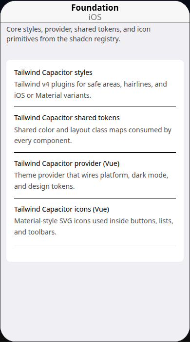

### mobile ios-light

### mobile ios-dark

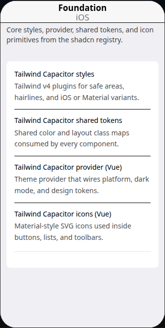

### mobile material-light

### mobile material-dark

## capacitor-accordion

### desktop ios-light

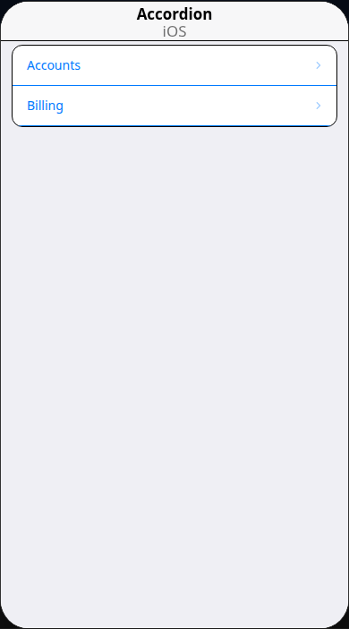

### desktop ios-dark

### desktop material-light

### desktop material-dark

### mobile ios-light

### mobile ios-dark

### mobile material-light

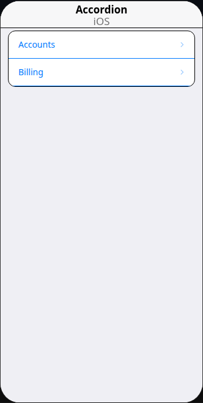

### mobile material-dark

## capacitor-accordion-item

### desktop ios-light

### desktop ios-dark

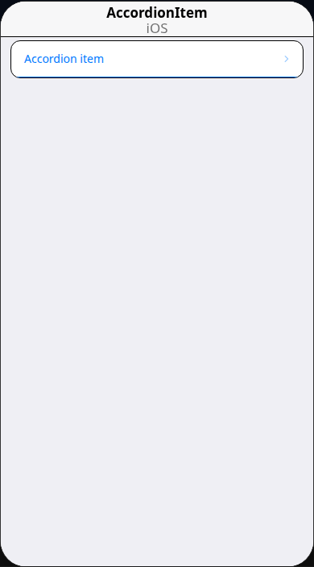

### desktop material-light

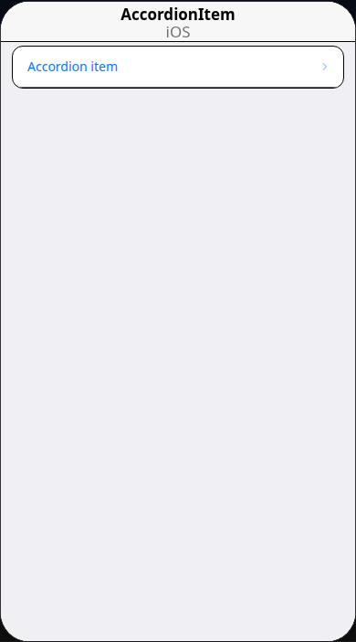

### desktop material-dark

### mobile ios-light

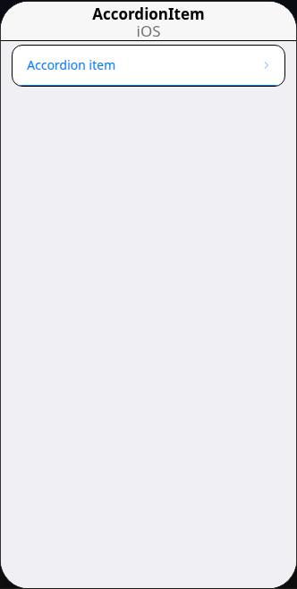

### mobile ios-dark

### mobile material-light

### mobile material-dark

## capacitor-actions

### desktop ios-light

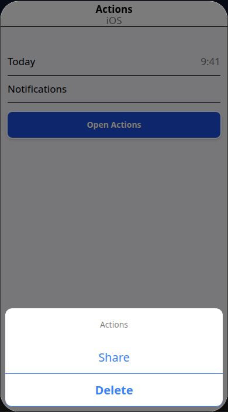

### desktop ios-dark

### desktop material-light

### desktop material-dark

### mobile ios-light

### mobile ios-dark

### mobile material-light

### mobile material-dark

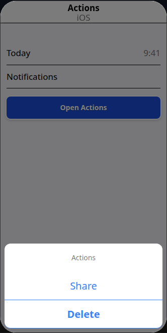

## capacitor-actions-button

### desktop ios-light

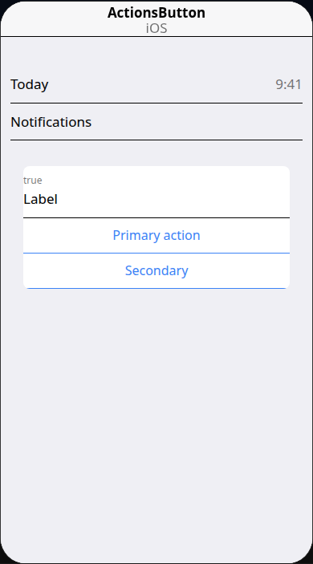

### desktop ios-dark

### desktop material-light

### desktop material-dark

### mobile ios-light

### mobile ios-dark

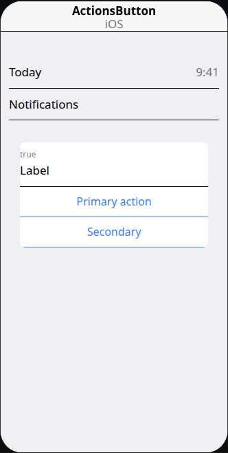

### mobile material-light

### mobile material-dark

## capacitor-actions-group

### desktop ios-light

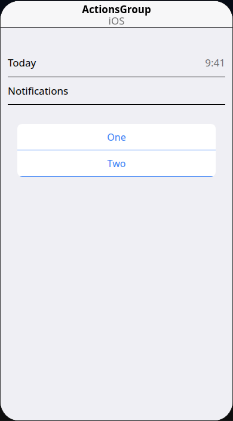

### desktop ios-dark

### desktop material-light

### desktop material-dark

### mobile ios-light

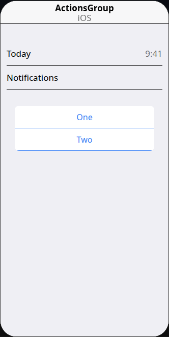

### mobile ios-dark

### mobile material-light

### mobile material-dark

## capacitor-actions-label

### desktop ios-light

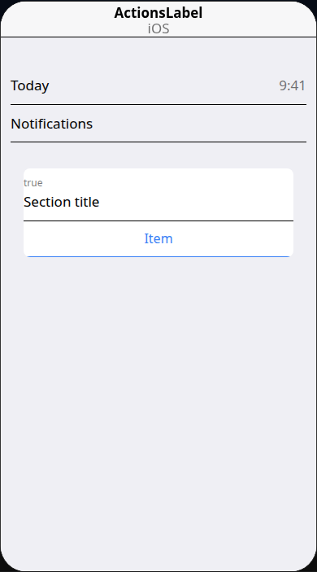

### desktop ios-dark

### desktop material-light

### desktop material-dark

### mobile ios-light

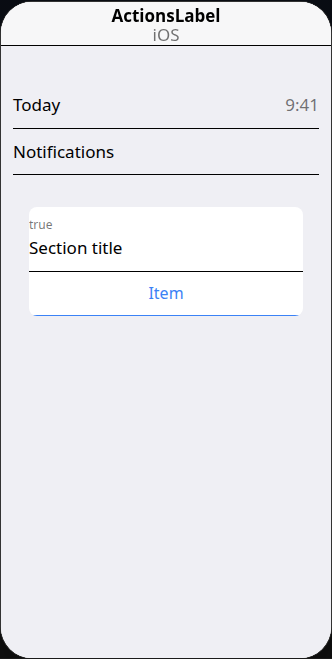

### mobile ios-dark

### mobile material-light

### mobile material-dark

## capacitor-alert

### desktop ios-light

### desktop ios-dark

### desktop material-light

### desktop material-dark

### mobile ios-light

### mobile ios-dark

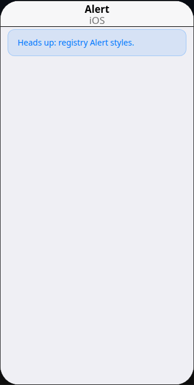

### mobile material-light

### mobile material-dark

## capacitor-app

### desktop ios-light

### desktop ios-dark

### desktop material-light

### desktop material-dark

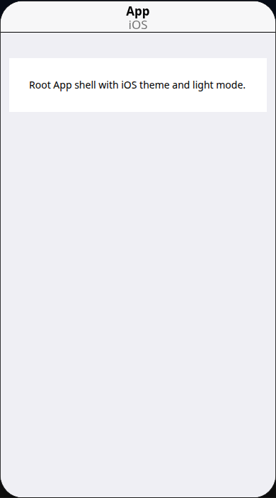

### mobile ios-light

### mobile ios-dark

### mobile material-light

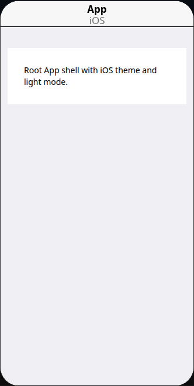

### mobile material-dark

## capacitor-avatar

### desktop ios-light

### desktop ios-dark

### desktop material-light

### desktop material-dark

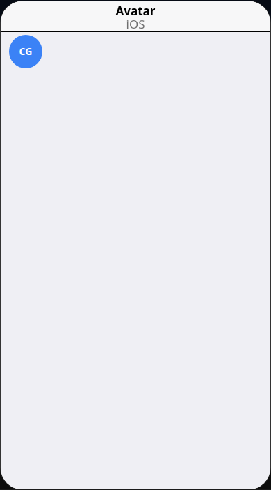

### mobile ios-light

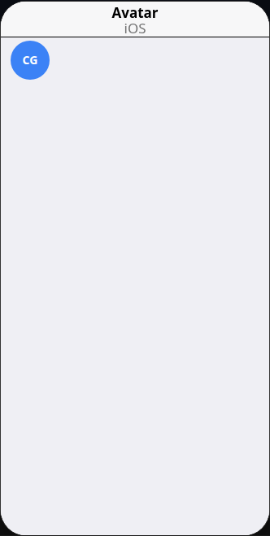

### mobile ios-dark

### mobile material-light

### mobile material-dark

## capacitor-badge

### desktop ios-light

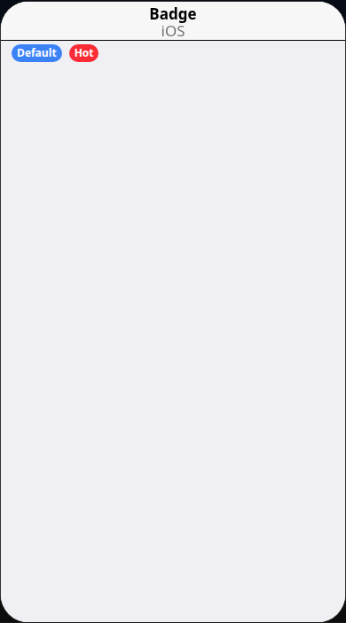

### desktop ios-dark

### desktop material-light

### desktop material-dark

### mobile ios-light

### mobile ios-dark

### mobile material-light

### mobile material-dark

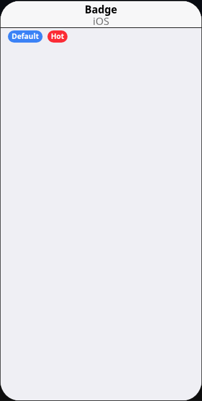

## capacitor-block

### desktop ios-light

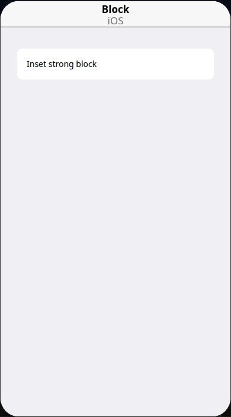

### desktop ios-dark

### desktop material-light

### desktop material-dark

### mobile ios-light

### mobile ios-dark

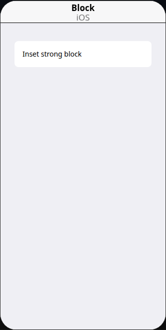

### mobile material-light

### mobile material-dark

## capacitor-block-footer

### desktop ios-light

### desktop ios-dark

### desktop material-light

### desktop material-dark

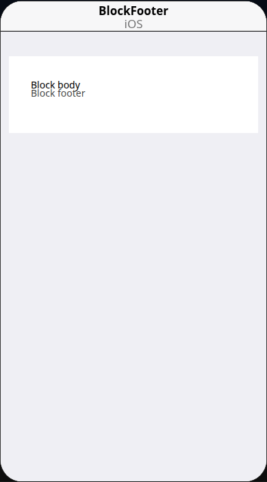

### mobile ios-light

### mobile ios-dark

### mobile material-light

### mobile material-dark

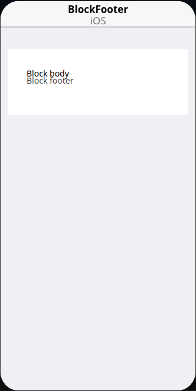

## capacitor-block-header

### desktop ios-light

### desktop ios-dark

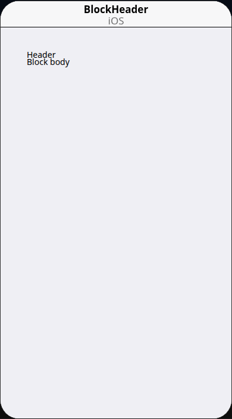

### desktop material-light

### desktop material-dark

### mobile ios-light

### mobile ios-dark

### mobile material-light

### mobile material-dark

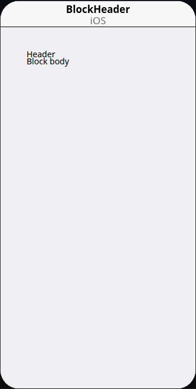

## capacitor-block-title

### desktop ios-light

### desktop ios-dark

### desktop material-light

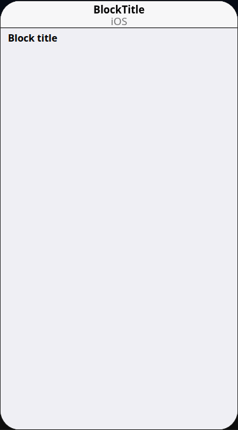

### desktop material-dark

### mobile ios-light

### mobile ios-dark

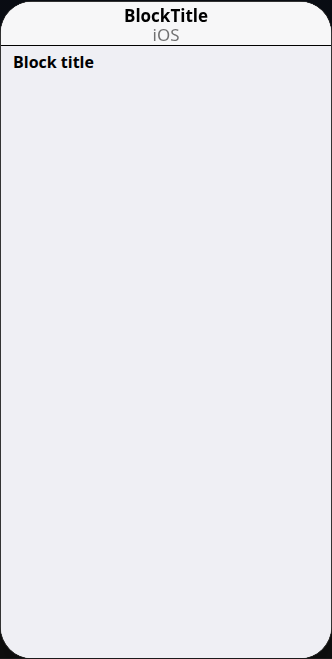

### mobile material-light

### mobile material-dark

## capacitor-breadcrumbs

### desktop ios-light

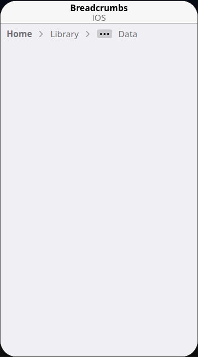

### desktop ios-dark

### desktop material-light

### desktop material-dark

### mobile ios-light

### mobile ios-dark

### mobile material-light

### mobile material-dark

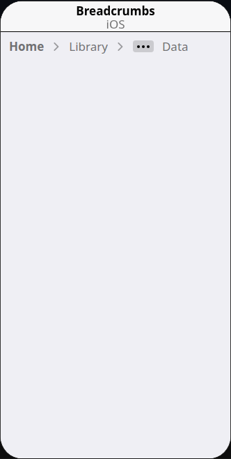

## capacitor-breadcrumbs-collapsed

### desktop ios-light

### desktop ios-dark

### desktop material-light

### desktop material-dark

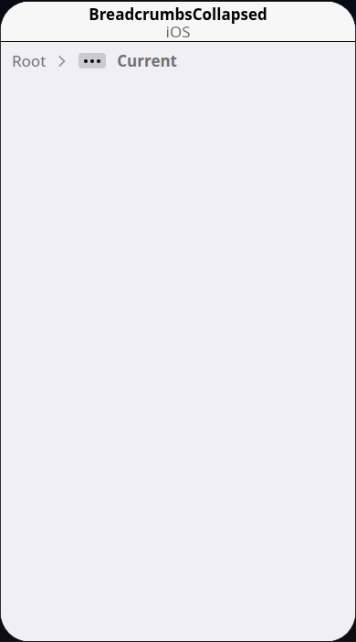

### mobile ios-light

### mobile ios-dark

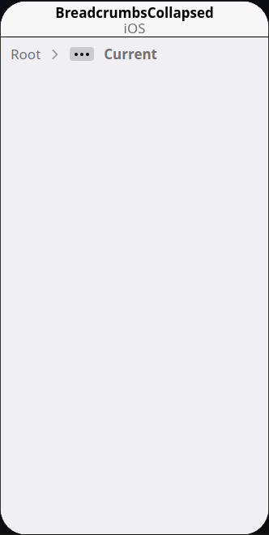

### mobile material-light

### mobile material-dark

## capacitor-breadcrumbs-item

### desktop ios-light

### desktop ios-dark

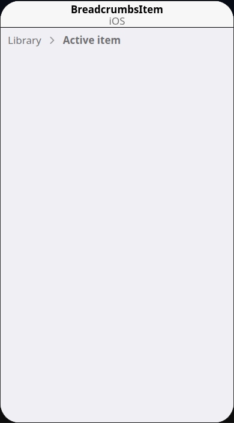

### desktop material-light

### desktop material-dark

### mobile ios-light

### mobile ios-dark

### mobile material-light

### mobile material-dark

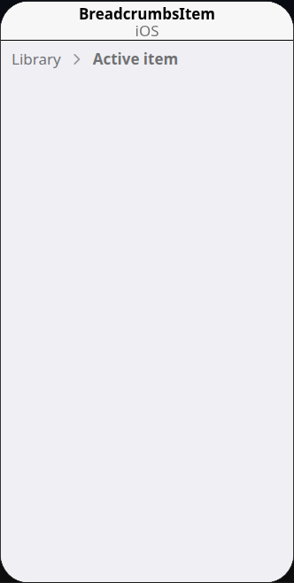

## capacitor-breadcrumbs-separator

### desktop ios-light

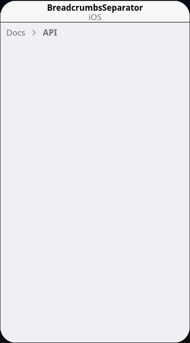

### desktop ios-dark

### desktop material-light

### desktop material-dark

### mobile ios-light

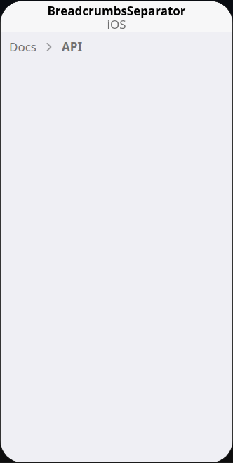

### mobile ios-dark

### mobile material-light

### mobile material-dark

## capacitor-button

### desktop ios-light

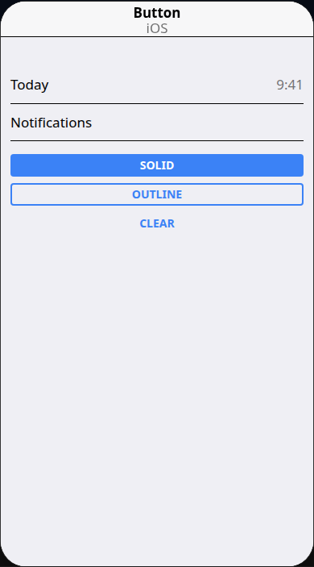

### desktop ios-dark

### desktop material-light

### desktop material-dark

### mobile ios-light

### mobile ios-dark

### mobile material-light

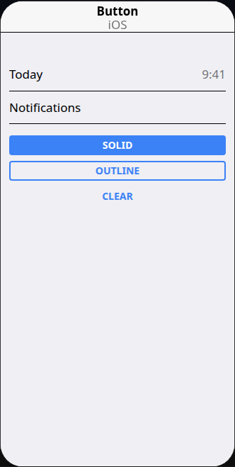

### mobile material-dark

## capacitor-card

### desktop ios-light

### desktop ios-dark

### desktop material-light

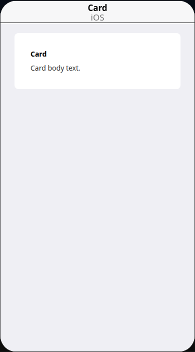

### desktop material-dark

### mobile ios-light

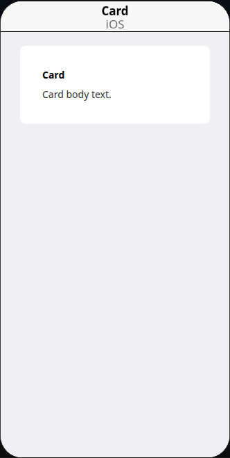

### mobile ios-dark

### mobile material-light

### mobile material-dark

## capacitor-checkbox

### desktop ios-light

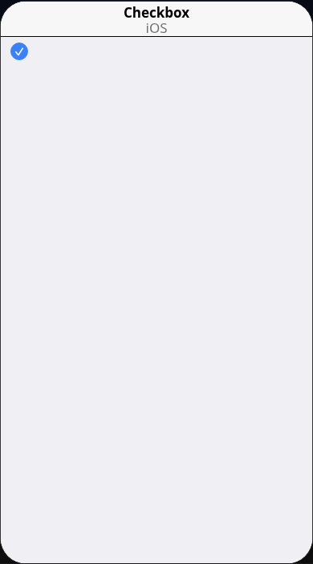

### desktop ios-dark

### desktop material-light

### desktop material-dark

### mobile ios-light

### mobile ios-dark

### mobile material-light

### mobile material-dark

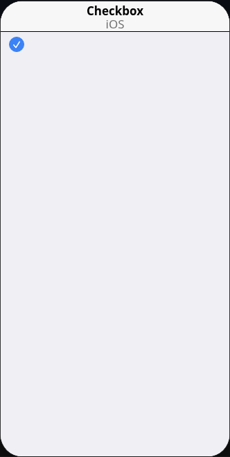

## capacitor-chip

### desktop ios-light

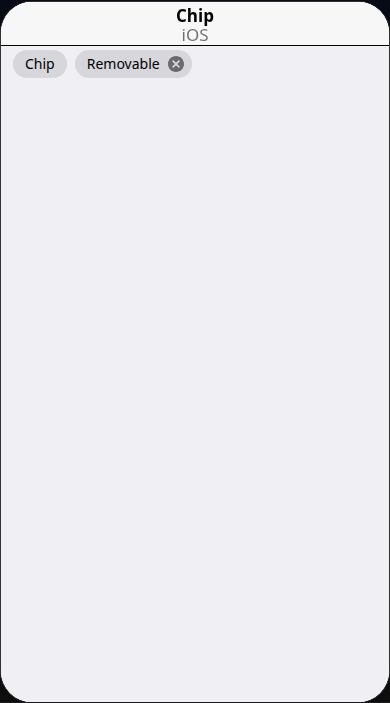

### desktop ios-dark

### desktop material-light

### desktop material-dark

### mobile ios-light

### mobile ios-dark

### mobile material-light

### mobile material-dark

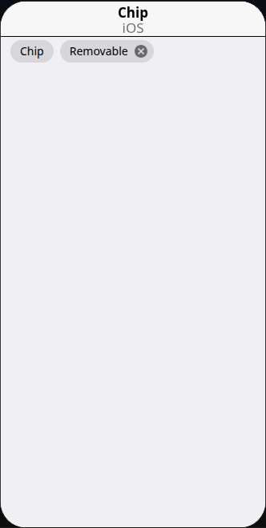

## capacitor-datetime

### desktop ios-light

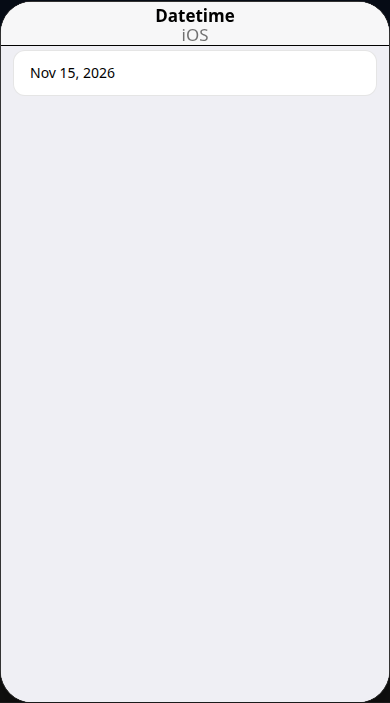

### desktop ios-dark

### desktop material-light

### desktop material-dark

### mobile ios-light

### mobile ios-dark

### mobile material-light

### mobile material-dark

## capacitor-dialog

### desktop ios-light

### desktop ios-dark

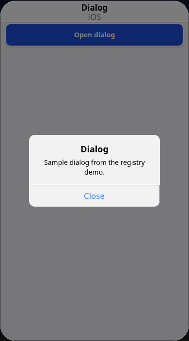

### desktop material-light

### desktop material-dark

### mobile ios-light

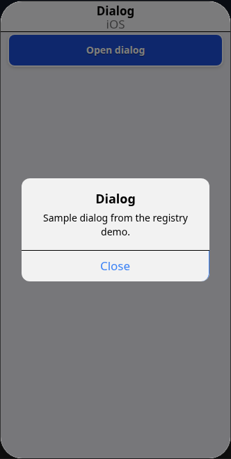

### mobile ios-dark

### mobile material-light

### mobile material-dark

## capacitor-dialog-button

### desktop ios-light

### desktop ios-dark

### desktop material-light

### desktop material-dark

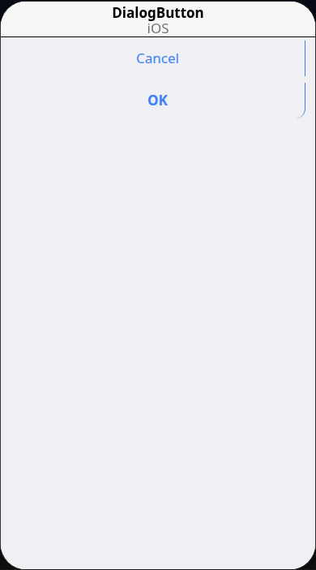

### mobile ios-light

### mobile ios-dark

### mobile material-light

### mobile material-dark

## capacitor-fab

### desktop ios-light

### desktop ios-dark

### desktop material-light

### desktop material-dark

### mobile ios-light

### mobile ios-dark

### mobile material-light

### mobile material-dark

## capacitor-footer

### desktop ios-light

### desktop ios-dark

### desktop material-light

### desktop material-dark

### mobile ios-light

### mobile ios-dark

### mobile material-light

### mobile material-dark

## capacitor-header

### desktop ios-light

### desktop ios-dark

### desktop material-light

### desktop material-dark

### mobile ios-light

### mobile ios-dark

### mobile material-light

### mobile material-dark

## capacitor-icon

### desktop ios-light

### desktop ios-dark

### desktop material-light

### desktop material-dark

### mobile ios-light

### mobile ios-dark

### mobile material-light

### mobile material-dark

## capacitor-infinite-scroll

### desktop ios-light

### desktop ios-dark

### desktop material-light

### desktop material-dark

### mobile ios-light

### mobile ios-dark

### mobile material-light

### mobile material-dark

## capacitor-input-otp

### desktop ios-light

### desktop ios-dark

### desktop material-light

### desktop material-dark

### mobile ios-light

### mobile ios-dark

### mobile material-light

### mobile material-dark

## capacitor-item-sliding

### desktop ios-light

### desktop ios-dark

### desktop material-light

### desktop material-dark

### mobile ios-light

### mobile ios-dark

### mobile material-light

### mobile material-dark

## capacitor-link

### desktop ios-light

### desktop ios-dark

### desktop material-light

### desktop material-dark

### mobile ios-light

### mobile ios-dark

### mobile material-light

### mobile material-dark

## capacitor-list

### desktop ios-light

### desktop ios-dark

### desktop material-light

### desktop material-dark

### mobile ios-light

### mobile ios-dark

### mobile material-light

### mobile material-dark

## capacitor-list-button

### desktop ios-light

### desktop ios-dark

### desktop material-light

### desktop material-dark

### mobile ios-light

### mobile ios-dark

### mobile material-light

### mobile material-dark

## capacitor-list-group

### desktop ios-light

### desktop ios-dark

### desktop material-light

### desktop material-dark

### mobile ios-light

### mobile ios-dark

### mobile material-light

### mobile material-dark

## capacitor-list-input

### desktop ios-light

### desktop ios-dark

### desktop material-light

### desktop material-dark

### mobile ios-light

### mobile ios-dark

### mobile material-light

### mobile material-dark

## capacitor-list-item

### desktop ios-light

### desktop ios-dark

### desktop material-light

### desktop material-dark

### mobile ios-light

### mobile ios-dark

### mobile material-light

### mobile material-dark

## capacitor-menu-list

### desktop ios-light

### desktop ios-dark

### desktop material-light

### desktop material-dark

### mobile ios-light

### mobile ios-dark

### mobile material-light

### mobile material-dark

## capacitor-menu-list-item

### desktop ios-light

### desktop ios-dark

### desktop material-light

### desktop material-dark

### mobile ios-light

### mobile ios-dark

### mobile material-light

### mobile material-dark

## capacitor-message

### desktop ios-light

### desktop ios-dark

### desktop material-light

### desktop material-dark

### mobile ios-light

### mobile ios-dark

### mobile material-light

### mobile material-dark

## capacitor-messagebar

### desktop ios-light

### desktop ios-dark

### desktop material-light

### desktop material-dark

### mobile ios-light

### mobile ios-dark

### mobile material-light

### mobile material-dark

## capacitor-messages

### desktop ios-light

### desktop ios-dark

### desktop material-light

### desktop material-dark

### mobile ios-light

### mobile ios-dark

### mobile material-light

### mobile material-dark

## capacitor-messages-title

### desktop ios-light

### desktop ios-dark

### desktop material-light

### desktop material-dark

### mobile ios-light

### mobile ios-dark

### mobile material-light

### mobile material-dark

## capacitor-modal

### desktop ios-light

### desktop ios-dark

### desktop material-light

### desktop material-dark

### mobile ios-light

### mobile ios-dark

### mobile material-light

### mobile material-dark

## capacitor-navbar

### desktop ios-light

### desktop ios-dark

### desktop material-light

### desktop material-dark

### mobile ios-light

### mobile ios-dark

### mobile material-light

### mobile material-dark

## capacitor-navbar-back-link

### desktop ios-light

### desktop ios-dark

### desktop material-light

### desktop material-dark

### mobile ios-light

### mobile ios-dark

### mobile material-light

### mobile material-dark

## capacitor-note

### desktop ios-light

### desktop ios-dark

### desktop material-light

### desktop material-dark

### mobile ios-light

### mobile ios-dark

### mobile material-light

### mobile material-dark

## capacitor-notification

### desktop ios-light

### desktop ios-dark

### desktop material-light

### desktop material-dark

### mobile ios-light

### mobile ios-dark

### mobile material-light

### mobile material-dark

## capacitor-page

### desktop ios-light

### desktop ios-dark

### desktop material-light

### desktop material-dark

### mobile ios-light

### mobile ios-dark

### mobile material-light

### mobile material-dark

## capacitor-panel

### desktop ios-light

### desktop ios-dark

### desktop material-light

### desktop material-dark

### mobile ios-light

### mobile ios-dark

### mobile material-light

### mobile material-dark

## capacitor-picker

### desktop ios-light

### desktop ios-dark

### desktop material-light

### desktop material-dark

### mobile ios-light

### mobile ios-dark

### mobile material-light

### mobile material-dark

## capacitor-popover

### desktop ios-light

### desktop ios-dark

### desktop material-light

### desktop material-dark

### mobile ios-light

### mobile ios-dark

### mobile material-light

### mobile material-dark

## capacitor-popup

### desktop ios-light

### desktop ios-dark

### desktop material-light

### desktop material-dark

### mobile ios-light

### mobile ios-dark

### mobile material-light

### mobile material-dark

## capacitor-preloader

### desktop ios-light

### desktop ios-dark

### desktop material-light

### desktop material-dark

### mobile ios-light

### mobile ios-dark

### mobile material-light

### mobile material-dark

## capacitor-progressbar

### desktop ios-light

### desktop ios-dark

### desktop material-light

### desktop material-dark

### mobile ios-light

### mobile ios-dark

### mobile material-light

### mobile material-dark

## capacitor-radio

### desktop ios-light

### desktop ios-dark

### desktop material-light

### desktop material-dark

### mobile ios-light

### mobile ios-dark

### mobile material-light

### mobile material-dark

## capacitor-range

### desktop ios-light

### desktop ios-dark

### desktop material-light

### desktop material-dark

### mobile ios-light

### mobile ios-dark

### mobile material-light

### mobile material-dark

## capacitor-refresher

### desktop ios-light

### desktop ios-dark

### desktop material-light

### desktop material-dark

### mobile ios-light

### mobile ios-dark

### mobile material-light

### mobile material-dark

## capacitor-reorder

### desktop ios-light

### desktop ios-dark

### desktop material-light

### desktop material-dark

### mobile ios-light

### mobile ios-dark

### mobile material-light

### mobile material-dark

## capacitor-searchbar

### desktop ios-light

### desktop ios-dark

### desktop material-light

### desktop material-dark

### mobile ios-light

### mobile ios-dark

### mobile material-light

### mobile material-dark

## capacitor-segmented

### desktop ios-light

### desktop ios-dark

### desktop material-light

### desktop material-dark

### mobile ios-light

### mobile ios-dark

### mobile material-light

### mobile material-dark

## capacitor-segmented-button

### desktop ios-light

### desktop ios-dark

### desktop material-light

### desktop material-dark

### mobile ios-light

### mobile ios-dark

### mobile material-light

### mobile material-dark

## capacitor-select

### desktop ios-light

### desktop ios-dark

### desktop material-light

### desktop material-dark

### mobile ios-light

### mobile ios-dark

### mobile material-light

### mobile material-dark

## capacitor-sheet

### desktop ios-light

### desktop ios-dark

### desktop material-light

### desktop material-dark

### mobile ios-light

### mobile ios-dark

### mobile material-light

### mobile material-dark

## capacitor-skeleton

### desktop ios-light

### desktop ios-dark

### desktop material-light

### desktop material-dark

### mobile ios-light

### mobile ios-dark

### mobile material-light

### mobile material-dark

## capacitor-split-pane

### desktop ios-light

### desktop ios-dark

### desktop material-light

### desktop material-dark

### mobile ios-light

### mobile ios-dark

### mobile material-light

### mobile material-dark

## capacitor-stepper

### desktop ios-light

### desktop ios-dark

### desktop material-light

### desktop material-dark

### mobile ios-light

### mobile ios-dark

### mobile material-light

### mobile material-dark

## capacitor-tab

### desktop ios-light

### desktop ios-dark

### desktop material-light

### desktop material-dark

### mobile ios-light

### mobile ios-dark

### mobile material-light

### mobile material-dark

## capacitor-tabbar

### desktop ios-light

### desktop ios-dark

### desktop material-light

### desktop material-dark

### mobile ios-light

### mobile ios-dark

### mobile material-light

### mobile material-dark

## capacitor-tabbar-link

### desktop ios-light

### desktop ios-dark

### desktop material-light

### desktop material-dark

### mobile ios-light

### mobile ios-dark

### mobile material-light

### mobile material-dark

## capacitor-table

### desktop ios-light

### desktop ios-dark

### desktop material-light

### desktop material-dark

### mobile ios-light

### mobile ios-dark

### mobile material-light

### mobile material-dark

## capacitor-table-body

### desktop ios-light

### desktop ios-dark

### desktop material-light

### desktop material-dark

### mobile ios-light

### mobile ios-dark

### mobile material-light

### mobile material-dark

## capacitor-table-cell

### desktop ios-light

### desktop ios-dark

### desktop material-light

### desktop material-dark

### mobile ios-light

### mobile ios-dark

### mobile material-light

### mobile material-dark

## capacitor-table-head

### desktop ios-light

### desktop ios-dark

### desktop material-light

### desktop material-dark

### mobile ios-light

### mobile ios-dark

### mobile material-light

### mobile material-dark

## capacitor-table-row

### desktop ios-light

### desktop ios-dark

### desktop material-light

### desktop material-dark

### mobile ios-light

### mobile ios-dark

### mobile material-light

### mobile material-dark

## capacitor-tabs

### desktop ios-light

### desktop ios-dark

### desktop material-light

### desktop material-dark

### mobile ios-light

### mobile ios-dark

### mobile material-light

### mobile material-dark

## capacitor-textarea

### desktop ios-light

### desktop ios-dark

### desktop material-light

### desktop material-dark

### mobile ios-light

### mobile ios-dark

### mobile material-light

### mobile material-dark

## capacitor-thumbnail

### desktop ios-light

### desktop ios-dark

### desktop material-light

### desktop material-dark

### mobile ios-light

### mobile ios-dark

### mobile material-light

### mobile material-dark

## capacitor-toast

### desktop ios-light

### desktop ios-dark

### desktop material-light

### desktop material-dark

### mobile ios-light

### mobile ios-dark

### mobile material-light

### mobile material-dark

## capacitor-toggle

### desktop ios-light

### desktop ios-dark

### desktop material-light

### desktop material-dark

### mobile ios-light

### mobile ios-dark

### mobile material-light

### mobile material-dark

## capacitor-toolbar

### desktop ios-light

### desktop ios-dark

### desktop material-light

### desktop material-dark

### mobile ios-light

### mobile ios-dark

### mobile material-light

### mobile material-dark

## capacitor-touch-ripple

### desktop ios-light

### desktop ios-dark

### desktop material-light

### desktop material-dark

### mobile ios-light

### mobile ios-dark

### mobile material-light

### mobile material-dark

